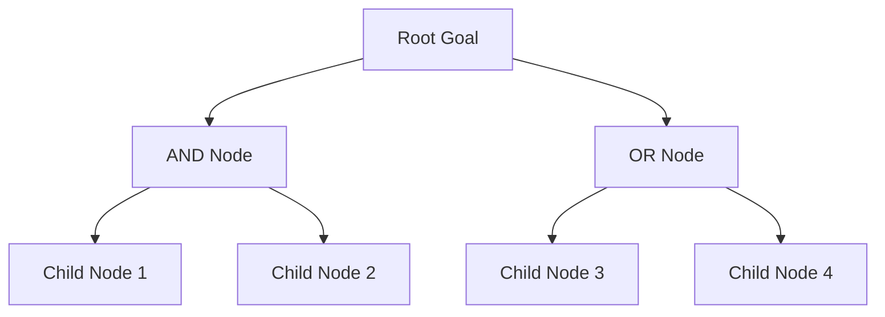
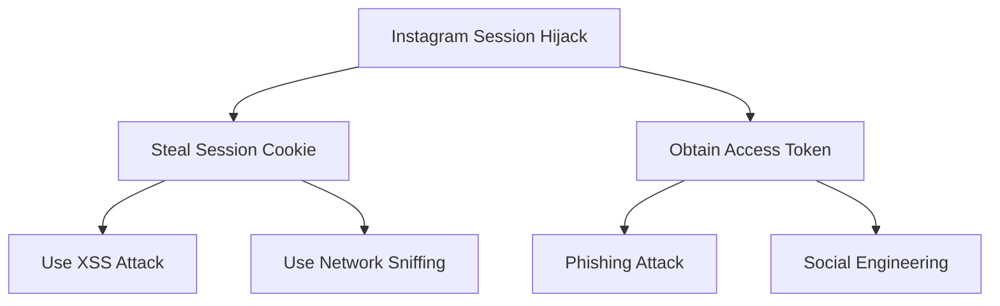
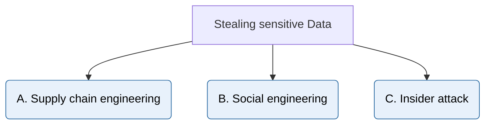
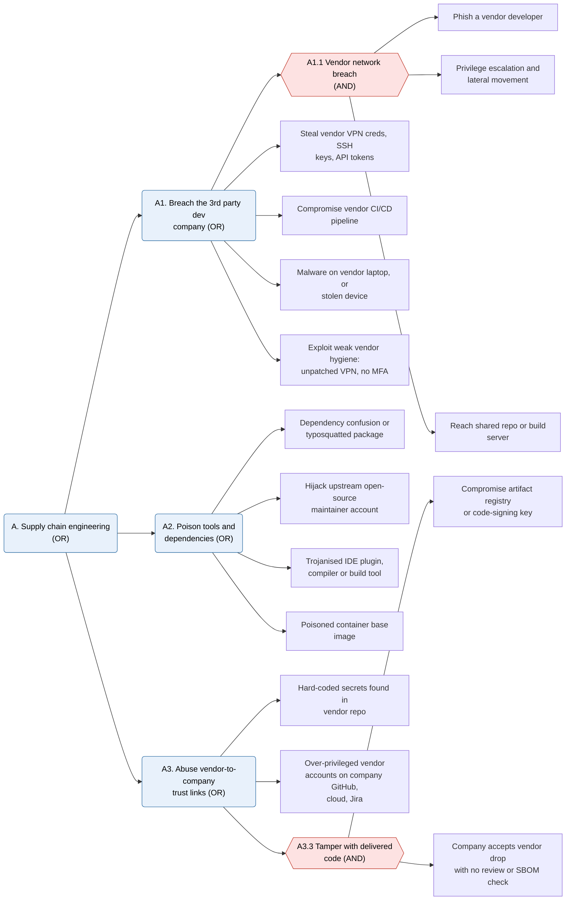
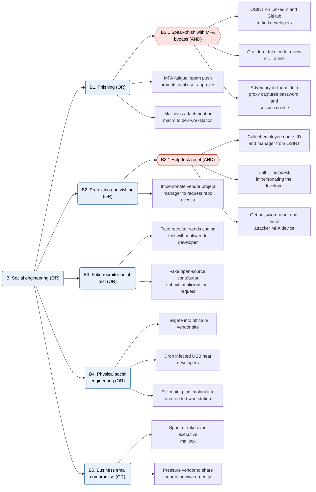
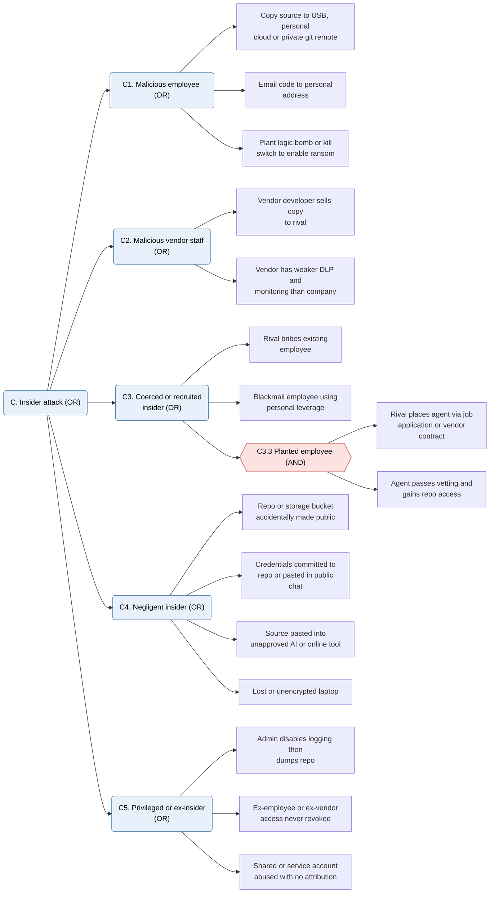
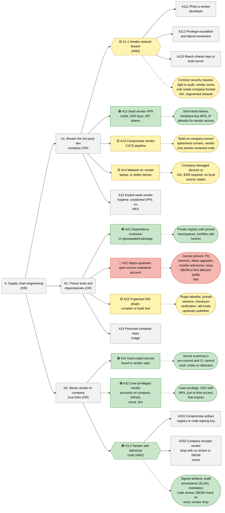
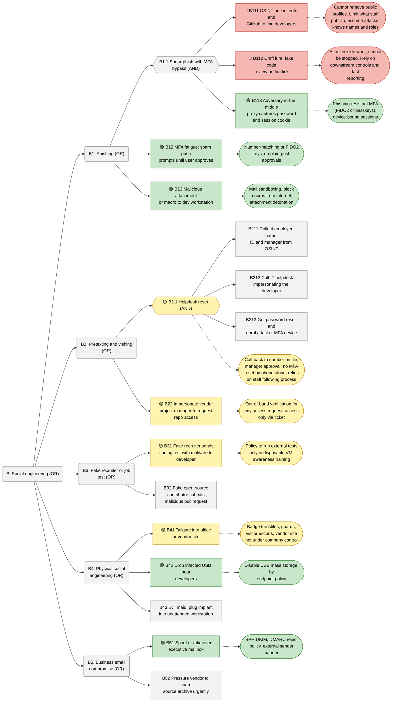
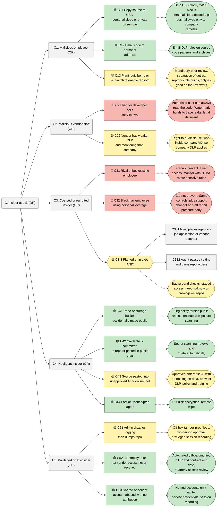

# Threat Modeling

- [Threat Modeling](#threat-modeling)
  - [Introduction to Threat Modeling](#introduction-to-threat-modeling)
  - [Threat Modeling vs Risk Assessment](#threat-modeling-vs-risk-assessment)
  - [Types of Threat Models](#types-of-threat-models)
    - [Application Threat Model](#application-threat-model)
    - [Operational Threat Model](#operational-threat-model)
    - [Data Flow Threat Model](#data-flow-threat-model)
  - [STRIDE Threat Model](#stride-threat-model)
  - [DREAD Threat Model](#dread-threat-model)
  - [PASTA Threat Model](#pasta-threat-model)
  - [OCTAVE Threat Model](#octave-threat-model)
  - [TRIKE Threat Model](#trike-threat-model)
  - [Attack Trees](#attack-trees)
    - [Attack Tree: Steal or Ransom the Product Software](#attack-tree-steal-or-ransom-the-product-software)
      - [Level 0: Overview](#level-0-overview)
      - [Branch A: Supply Chain Engineering](#branch-a-supply-chain-engineering)
      - [Branch B: Social Engineering](#branch-b-social-engineering)
      - [Branch C: Insider Attack](#branch-c-insider-attack)
      - [Reading the tree](#reading-the-tree)

## Introduction to Threat Modeling

>[!IMPORTANT]
>
>- Threat Modeling is a structured approach to identifying and addressing potential security threats to a system. It helps organizations understand the security risks associated with their applications, infrastructure, and processes, and allows them to design appropriate mitigations to protect against these threats.
> 
>- Using a model as an approach for analyzing the security of an application and allows the identification and quantification of the security risks associated with the application.

- There are several methodologies for threat modeling:

  - STRIDE (Spoofing, Tampering, Repudiation, Information Disclosure, Denial of Service, Elevation of Privilege)
  - DREAD (Damage, Reproducibility, Exploitability, Affected Users, Discoverability)
  - PASTA (Process for Attack Simulation and Threat Analysis)
  - TRIKE (Threat Modeling Framework)
  - VAST (Visual, Agile, and Simple Threat)
  - OCTAVE (Operationally Critical Threat, Asset, and Vulnerability Evaluation)
  - PnG (Process and Governance)

- And, there are perspectives to these methodologies as well:

  - Functional
  - Process
  - Deployment
  - Data Flows
  - Social
  - Environmental

- For, example let's understand this with a simple case of Social Perspective, where sensitive company data must not be copied to personal USB drives(threat).

  A proper mitigation to this would sound something on the lines of "Use of Security Policy banning the use of USB Drives".
  
   

  

- But, what if there's an insider, and if someone really decides to use one anyways. To mitigate this we will do data audits. Now, if the insider knows audits are performed regularly, logs are taken regularly, which increases the likelihood of detection and acts as a deterrent. But what if auditing or logging fails.

  

- Another mitigation could be blocking the outgoing USB ports to prevent data from being copied to personal USB drives, and only allow incoming/outgoingUSB devices that are approved and monitored by the IT department. This would be the perfect final resolution to the threat.

  

- FMEA (Failure Modes and Effects Analysis) helps a lot with identifying potential failure points in a system and assessing their impact, which in turn aids in designing effective mitigations for security threats. Feel free to take a tour through the FMEA process to understand how it can be applied in threat modeling in <a href="../FMEA Fundamentals/chapter-01.md">this link</a>.

## Threat Modeling vs Risk Assessment

>[!NOTE]
> Threats can exist without a risk, but a risk needs a associated threat to exist. Risks are event focused while threats are intent focused.

- Risks are measured based on <b>probability</b> that an event might occur and have certain impact on the functioning of the system.

- Threat assesment is combination of a threat actor's intention to harm combined with capability of the actor to carry out these intentions.

## Types of Threat Models

- There are mainly 3 types of threat models:

  - Application Threat Model
  - Operational Threat Model
  - Data Flow Threat Model

### Application Threat Model

- Focuses exclusively on the application the model has been designed for and is used to identify potential threats and vulnerabilities specific to that application.

- The general idea here is:

  - We first create an Architecture Design Diagram
  - Identify the assets in use
  - Identify the threats to those assets
  - Team participation
  - Idetify Threat Actors
  - Controls to mitigate identified threats

### Operational Threat Model

- Provides organizations with general overview of it's infrastructure risk profile in order to better understand the attack surface and develop effective mitigation policies and strategies.

- Operational Threat Model is more about entire business as a whole.

- The general idea here is:

  - We first identify the operational environment. This can include shared resources like database or encryption servers.

  - Every resource attributes are identified, for example a server with unrestricted admin access can have more threats

  - Potential threats are identified.

  - Effective security controls are developed.

### Data Flow Threat Model

- Used to accurately model the application through visual representation.

- Diagram should identify the affected components through critical points and also highlight the flow of control through these components.

## STRIDE Threat Model

  

- STRIDE stands for Spoofing, Tampering, Repudiation, Information Disclosure, Denial of Service, and Elevation of Privilege. It is a widely used threat modeling framework that helps identify and categorize potential security threats to a system.
- STRIDE was developed by Microsoft
- Developers can use this model during design phase to spot potential threats in the system.
- So, when using STRIDE, developers ask themselves 2 questions:

  1. What can go wrong in the system?
  2. Are mitigation controls put in place effective?

- To counter this the Threat Model aims for:

  - Authentication
  - Integrity
  - Identification
  - Confidentiality
  - Availability
  - Authorization

- These threats are addressed by:

  - Mitigation
  - Elimination (component is removed)
  - Transfered
  - Accepted

## DREAD Threat Model

- DREAD stands for Damage, Reproducibility, Exploitability, Affected Users, and Discoverability. It is a risk assessment model used to quantify and prioritize potential security threats.
- DREAD is used to assess and prioritize threats based on their potential impact and probability, helping organizations make informed decisions about risk management.
- Each factor is awarded a score but this process can be very subjective and unreliable.

## PASTA Threat Model

- PASTA stands for Process for Attack Simulation and Threat Analysis. It is a risk-centric threat modeling methodology that aims to identify and mitigate potential security threats throughout the software development lifecycle.

- It's a 7 step methodology to create a process for simulating attacks to application, analyzing the threats, their origin, the risk they post to an organization, and how to mitigate them.

- The 7 steps of PASTA are:
  1. Definition of the Objectives
  2. Definition of the Technical Scope
  3. Application Decomposition and Analysis
  4. Threat Analysis
  5. Vulnerability and Weakness Analysis
  6. Attack Simulation
  7. Risk and Impact Analysis

## OCTAVE Threat Model

- OCTAVE stands for Operationally Critical Threat, Asset, and Vulnerability Evaluation. It is a risk-based strategic assessment and planning technique for security.
- Due to its flexibility, it can be made to fit the needs of practically any organization while only requiring a small team of cyber security professionals to collaborate on the endeavor.
- There are 3 variants of the OCTAVE methodology: 
  - OCTAVE Allegro: best for small teams
  - OCTAVE-S: suitable for larger organizations
  - OCTAVE FORTE: Most Adaptable Variation
- It is fast at discovering, prioritizing, and mitigating risks.

## TRIKE Threat Model

- TRIKE stands for Threat modeling, Risk assessment, and Information security Knowledge Engineering. It is a risk management and threat modeling framework that focuses on defining and enforcing security requirements for a system.
- It is a Open Source Developed Framework released in 2006 and, is used by Security Professionals who run security audits.
- It is a risk driven approach to threat modeling, where the focus is on identifying and mitigating risks based on their potential impact on the system.
- It focuses on defence rather than offense, aiming to strengthen the system's security posture by proactively addressing potential threats.
- TRIKE involves 4 stages:

  - Determine risk level for each asset
  - Document what's been done
  - Communicate what was done and the impact to stake holders
  - Work with stake holders to reduce risk
  
- <strong>TRIKE Process</strong>

  - TRIKE uses something called a `requirement model`.
    - Actors interacting with the system
    - Assets or data elements to be used
    - Intended actions performed by the system (CRUD)
    - Rules that define when the actions can be performed.

  - The next thing that comes in the TRIKE process is the `implementation model`.
    - Identify the set of supporting operations
    - Develop Data flow diagrams
    - Identify Use flows

  - The next step is to build the `threat model`.
    - Identify all possible threats
    - Identify weaknesses and vulnerabilities
    - Identify mitigations that can reduce the risks

  - The last step is building the `Risk Model`.
    - Experimental and still under development
    - Recommended to use other methodologies like NIST

## Attack Trees

>[!IMPORTANT]
> Attack trees are graphical representation of attack against a system or a network using a hierarichal tree structure.
> The Root node represents the main goal of the attacker, and the branches represent different ways to achieve that goal. 
> This graphical representation have 2 types of nodes: AND nodes and OR nodes.
> `AND` nodes indicate that all child nodes must be achieved to reach the parent node, while `OR` nodes indicate that achieving any one of the child nodes is sufficient to reach the parent node.

Example of an attack tree:

Here's an example for instagram.

- The attack tree process has following steps:

  - Identify the main goal of the attacker (root node)
  - Identify the ways to achieve the main goal (branches)
  - Determine the logical relationship between the child nodes (AND/OR)
  - Delete unrealistic leaf nodes
  - Check for completeness

- Let's take a real life scenario for analysis wherein your company is on the verge of releasing a revolutionary product and are concerned that the software used to create it will either be stolen and sold to rival companies or could be used to hold the company to ransom.

  A 3rd party Software Development company is also involved in the project.

### Attack Tree: Steal or Ransom the Product Software

> Legend: hexagon = `AND` node (all children needed), rounded box = `OR` node (any child enough), plain box = leaf attack step.

#### Level 0: Overview

The attacker needs to *gain access* **AND** *monetise* it, so the root is an `AND` node. Access can come via any of 3 vectors (`OR`), and monetisation via any of 3 routes (`OR`).

#### Branch A: Supply Chain Engineering

Attacker goes after the weakest link: the 3rd party development company, its tools, or the trust the company places in them.

#### Branch B: Social Engineering

Attacker targets people at the company or the vendor, not the technology.

#### Branch C: Insider Attack

Attacker is already inside, or turns someone who is. Includes the vendor's staff, who are insiders to the project too.

#### Reading the tree

- Weak points are leaves with no `AND` partner. One step, attacker wins. Examples: stolen vendor creds (`A12`), unrevoked access (`C52`), MFA fatigue (`B12`).
- `AND` nodes are where defenders get leverage. Break any one child and whole path fails. Example: `A3.3` fails if company reviews vendor code or verifies signatures.
- Vendor appears in all 3 branches (`A1`, `B22`, `C2`). Third party is the common thread, so contract security requirements, least-privilege access and monitoring for vendor accounts matter as much as internal controls.

### Mitigations for the Attack Tree

The same attack trees are redrawn below with a rating on each attack node and the mitigation attached as a child. Solid line = attack step, dotted line = countermeasure (rounded pill). Hexagon = `AND` node. Rating:

| Colour | Status | Meaning |
| --- | --- | --- |
| 🟢 Green | Resolved | A control exists that closes the path or reduces it to negligible risk. |
| 🟡 Yellow | Possible | A mitigation exists but is partial: it needs vendor cooperation, process discipline or extra budget, or leaves residual risk. |
| 🔴 Red | Unavoidable | Cannot be prevented (attacker-side activity, or a trusted person acting maliciously). Only limit the blast radius, detect and respond. |

Grey nodes are not rated. An `AND` node such as `A1.1` is rated as a whole, so its mitigation hangs off the hexagon. An `OR` node stays open until every child under it is closed, so one unrated or red sibling keeps the whole branch exposed.

#### Mitigations: Branch A (Supply Chain)

#### Mitigations: Branch B (Social Engineering)

#### Mitigations: Branch C (Insider)

#### Summary

| Branch | 🟢 Resolved | 🟡 Possible | 🔴 Unavoidable |
| --- | --- | --- | --- |
| A. Supply chain | 5 | 4 | 1 |
| B. Social engineering | 5 | 4 | 2 |
| C. Insider | 7 | 5 | 3 |

- Green items are mostly technical controls the company owns outright, so fix them first. They are cheap relative to the risk removed.
- Yellow items nearly all depend on the vendor or on people following process. Contracts, audits and moving vendor work into company-hosted VDI convert many of them to green.
- Red items cannot be engineered away. Plan for them with least privilege, detection (logging, UEBA), leak tracing (build watermarking) and an incident response plan that includes legal action and ransom-handling decisions.
- Even a fully green branch leaves the red ones, so the residual risk of the project is set by the red leaves.

