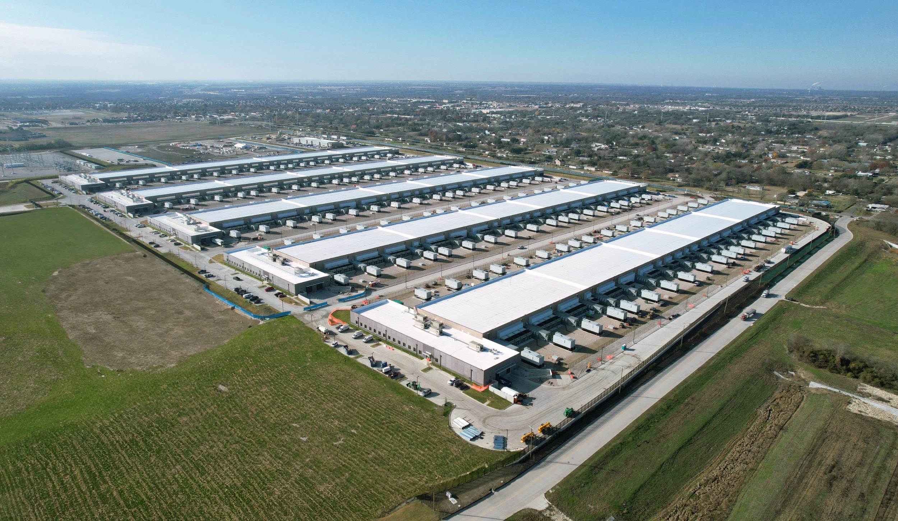
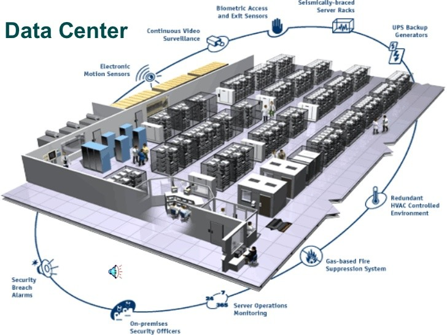

# Secure Architecture and Application & Data Security

---

- [Secure Architecture and Application \& Data Security](#secure-architecture-and-application--data-security)
  - [Security Perimeters](#security-perimeters)
    - [Physical Security Perimeter](#physical-security-perimeter)
    - [Network Security Perimeter](#network-security-perimeter)
      - [Access Control](#access-control)
      - [Reliabiltiy](#reliabiltiy)
    - [Platform Security](#platform-security)
  - [Application \& Data Security](#application--data-security)

---

## Security Perimeters

- Software security is done using the Security Paramaeters Paradigm. In, this paradigm we look at our software as a collection of parameters that need protection, each one confined in the perimeter of the outer one.

- The idea behind the paradigm is that if a hacker will break through the 5th perimeter. He will find a new one which will pose new different challanges for him.

- There are total 5 perimeters:
  1. Physical Perimeter
  2. Network Perimeter
  3. Platform Perimeter
  4. Application Perimeter
  5. Data Perimeter

### Physical Security Perimeter

- The first and the outermost perimeter is the Physical Perimeter.
- It controls the physical access to the physical hardware.
- This is mainly done at the enterances of Data Centers and other facilities housing critical hardware.

  

  

- The Architect is not involved in Physical Security, as it is mainly the responsibility of facility management and security personnel.

### Network Security Perimeter

- The second perimeter is the Network Perimeter.
- It controls access to the network infrastructure and protects against unauthorized access and attacks.
- This includes firewalls, intrusion detection/prevention systems, and network segmentation.
- Make sure network is up and reliable.

#### Access Control

- To avoid access control issues, for that people mainly use a authentication engine such as Active Directory.
- Active Directory and similar authentication engines provides robust secure and advanced authentication solution. They can be used at the organization-wdie user store and are extremly flexible with the authentication requirements. These engines allow for various types of authentication such as User Password, Biometric, Text, MFA.

#### Reliabiltiy

- There are couple of solutions that organizations use in combination to ensure network reliability. These include redundant network paths, failover mechanisms, load balancing, and regular network monitoring to quickly detect and address any issues.

  - Firewall

    - This protects the network against unauthorized requests and is used as the first line of defense against DDoS attacks and, other malicious activities.
    - Firewals can come as a physical device that is installed in the network or as a software installed on the server.
    - In general this is considered most effective in large organisations, which usually go for them.
    - Some popular firewall solutions include Cisco ASA, Palo Alto Networks, Fortinet, and Check Point.

  - Segmentation

    - Company network doesnot have to be a single monolith network, allowing every device to access every other device.
    - Network segmentation divides the network into smaller, isolated segments, improving security and limiting the impact of potential breaches.
    - With segmentation, we can control the devices b/w which data exchange happens.
    - For example: Let's say have a very sensitive information database, we can ut it in a segment called VNet or subnet, isolating it from the rest of the network and controlling access to it more effectively, And set a specific guarded tunnel between it and the other network, so that only authorized devices can only access it.

  - IPS (Intrusion Prevention System)

    - An IPS monitors network traffic for suspicious activity and takes action to prevent potential threats.
    - It can block malicious traffic, alert administrators, and help mitigate attacks in real-time.
    - IPS solutions are often integrated with firewalls or deployed as standalone devices.

### Platform Security

- The Platform Security is similar to the network security. But, most of it is not our concern.
- Platform security focuses on securing the underlying hardware and software components of the organization's IT infrastructure. This includes operating systems, servers, and other critical platforms.
- It is also called `Operations Security` or `OpSec`, which involves protecting the organization's critical infrastructure and ensuring the secure operation of its IT systems.
- Platform security can be ensured by following methods:

  - Using Modern Operating Systems
  
    - Never use an outdated and unsecure underlying operating system. Always keep the OS updated with the latest security patches and updates to protect against vulnerabilities.

  - Patch Management

    - Regularly apply security patches and updates to all software and systems to protect against known vulnerabilities. This helps prevent attackers from exploiting outdated software to gain unauthorized access or cause damage.

  - DLP (Data Loss Prevention)

    - Implement DLP solutions to monitor and protect sensitive data from unauthorized access, sharing, or leakage. DLP helps ensure that critical information remains secure and compliant with organizational policies.

## Application & Data Security

- Well, we will consider it in next section as that deserves a topic of its own. Application security focuses on protecting software applications from vulnerabilities and attacks, while data security ensures the confidentiality, integrity, and availability of sensitive information.