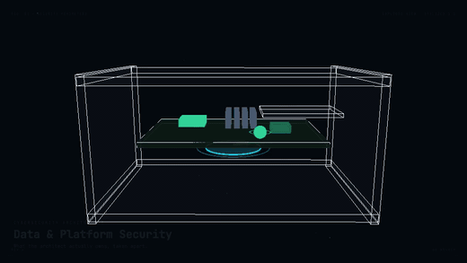
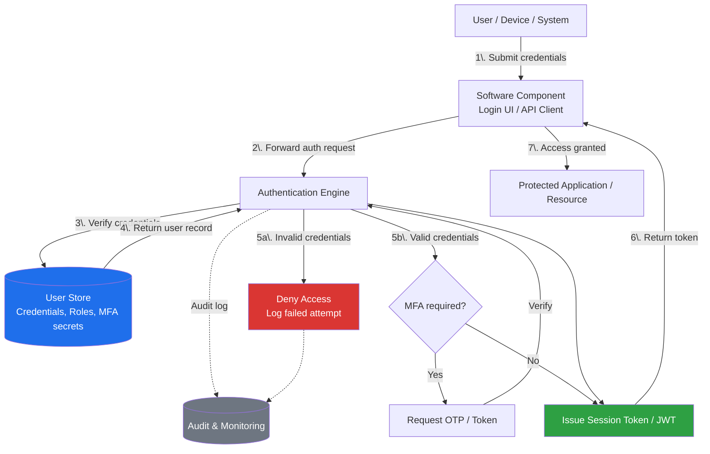

# Application & Data Security


---

- [Application \& Data Security](#application--data-security)
  - [Authentication](#authentication)
    - [Why is authentication important?](#why-is-authentication-important)
    - [Authentication System Design](#authentication-system-design)
    - [Authentication System Design Considerations](#authentication-system-design-considerations)

---

- It's the duty of the Architect to ensure that applications and data are secured against potential threats and vulnerabilities. If security problems are found in the network or within the applications, they must be addressed promptly to prevent unauthorized access, data breaches, and other security incidents.



## Authentication


- Authentication is defined as the process of verifying the identity of a user, device, or system before granting access to resources. It ensures that only authorized individuals or entities can access sensitive data and applications.

>[!NOTE]
>Authentication and Authorization are two distinct but closely related concepts in security. Authentication verifies the identity of a user, device, or system, while Authorization determines what resources and actions the authenticated entity is allowed to access.

### Why is authentication important?

- Identifies who the user, device, or system is, ensuring that only legitimate entities can access the application or data.
- What the user, device, or system is allowed to do, ensuring that access is granted only to authorized actions and resources i.e. allow/deny based on permissions.
- Log all actions performed by the user, device, or system to maintain an audit trail for security monitoring and incident response.
- Prevent data breaches and unauthorized access by ensuring that only authenticated and authorized entities can interact with sensitive resources.

### Authentication System Design

- Authentication system design include mainly 3 components:

  - User Store
  - Authentication Engine
  - Software Component

- A general design for authentication systems:




- There are 2 main types of authentication flow:

  - In the first kind

    - When user wants to access the system, it goes to the authentication engine, and enters it's authentication data(username, password, etc.).
    - The authntication engine than goes to the user store, that a user with the credentials provided really exists on the database.
    - If the credentials are valid, the authentication engine approves the authentication request and proceeds with any additional verification steps if required, and sends the details to the software component.

    ```mermaid
    flowchart TD
        U[User / Device / System] -->|1\. Enter auth data<br/>username, password, etc.| AE[Authentication Engine]
        AE -->|2\. Check credentials| US[(User Store)]
        US -->|3\. User record exists?| AE
        AE -->|4\. Valid - approve + additional<br/>verification if required| SC[Software Component]

        style US fill:#1f6feb,color:#fff
        style AE fill:#2ea043,color:#fff
    ```

- In the second kind of authentication flow:

  - The user first goes to the application itself, and enters its authentication details.

  - The Software Component then forwards the authentication request to the Authentication Engine for verification.

  - Than Authentication Engine sends this to the User store and, verifies the user actually exists in the database.

  - If, it doesn't the Authentication Engine sends the details to the software component indicating the authentication failure.

    ```mermaid
    flowchart TD
        U[User / Device / System] -->|1\. Enter auth details| SC[Software Component]
        SC -->|2\. Forward auth request| AE[Authentication Engine]
        AE -->|3\. Verify user exists| US[(User Store)]
        US -->|4\. User record found?| AE
        AE -->|5\. Not found - auth failure| SC

        style US fill:#1f6feb,color:#fff
        style AE fill:#2ea043,color:#fff
        style SC fill:#da3633,color:#fff
    ```

- The difference b/w both the flows is there starting point, where for one Authentication initiates at the Authentication Engine directly, and for the other it starts at the Software Component.

- Most of the Software in real-world scenarios follows the second kind of authentication flow, where the authentication process is initiated at the Software Component rather than directly at the Authentication Engine.

>[!NOTE]
> There are more flows and variations in authentication mechanisms like:
>
> - <strong>Self-authenticating component:</strong> A component that can authenticate itself without relying on an external authentication engine, often using cryptographic keys or certificates. It is not a recommended approach for all scenarios due to potential security risks.
> - <strong>Authentication engine using another authentication engine or Authentication-as-a-Service (AaaS) or Hybrid Identity Mechanism:</strong> This happens if the user store and the authentication enginer working with it, are located in another environment, and we donot want to expose the user store to the new more public environment.

### Authentication System Design Considerations


- When trying to design the authentication system, it is important to consider the following factors:

  - User Store:
    - Where??
    - Is it part of authentication engine or a separate component?
    - Who is responsible??
      - Who adds new users
      - Removes unused users
        - Is it dev team, or team responsible for the application, or is it a separate team?

  - Authentication Engine:
    - Which Engine to use??
      - Open-source or commercial?
      - Is it a part of the application or a separate component?
    - Authentication Type

  - Software Component:
    - How user's details recieved??
    - Is it a part of the application or a separate component?
    - How does it interact with the authentication engine ?

- Let's start with each of the components in detail:

  - User Store:

    - Where is the User Store located?

      - For this we have 3 potential answers:

        - **Option 1 — Auth-Owned User Store:** It is part of the Authentication Engine, and is located in the same environment as the Authentication Engine. And, the software itself has no access to it. With this approach authentication engine has all it needs to perform authentication, since it has the user data.

          ```mermaid
          flowchart LR
              U([User]) -->|credentials| AE

              subgraph AE_ENV ["Authentication Engine Environment"]
                  AE["Authentication Engine"]
                  US[("User Store\n(auth data only)")]
                  AE <-->|read/verify| US
              end

              AE -->|auth result| SC["Software Component"]
              SC -.->|no access| US
          ```

        - **Option 2 — Software-Owned User Store:** It is part of the software component, this means when the authentication engine needs to check the user authentication data, it goes to the software component, and asks it for the data.

          ```mermaid
          flowchart LR
              U([User]) -->|credentials| AE["Authentication Engine"]

              subgraph SC_ENV ["Software Component Environment"]
                  SC["Software Component"]
                  US[("User Store\n(auth + profile data)")]
                  SC <-->|read/write| US
              end

              AE -->|"query: does user exist?"| SC
              SC -->|"response: auth data"| AE
              AE -->|auth result| SC
          ```

        - **Option 3 — Hybrid User Store:** Here there are 2 user stores, one is part of the authentication engine, and the other is part of the software component. The authentication engine first checks its own user store, and if it doesn't find the user there, it goes to the software component to check its user store.

          The difference with hybrid is that the Authentication Data store only has authentication related data, while the Software Component User Store has more data about the user, like profile data, preferences, etc. So, if the authentication engine doesn't find the user in its own store, it goes to the software component to check if the user exists there. The Software Component User Store is usually used for Components needs.

          ```mermaid
          flowchart LR
              U([User]) -->|credentials| AE

              subgraph AE_ENV ["Authentication Engine Environment"]
                  AE["Authentication Engine"]
                  AUS[("Auth User Store\n(auth data only)")]
                  AE <-->|"1. check here first"| AUS
              end

              subgraph SC_ENV ["Software Component Environment"]
                  SC["Software Component"]
                  SUS[("Software User Store\n(profile, preferences,\napp-specific data)")]
                  SC <-->|read/write| SUS
              end

              AE -->|"2. not found? query SC"| SC
              SC -->|"3. fallback auth data"| AE
              AE -->|auth result| SC
          ```

    - The Hybrid approach has the advantage of sepration of concern, well-defined boundaries, and better security, since the authentication engine only has access to the authentication data, while the software component has access to the user profile and other data. However, it also adds complexity to the system, since there are now 2 user stores to manage and maintain. This is the reason why it's a preffered one.

  - Authentication Engine:

    - Here, we have 2 main options:

      - **Option 1 — Self Developed Authentication Engine:** This is when the authentication engine is developed in-house, and is part of the software component. This approach gives more control over the authentication process, but also requires more effort to develop and maintain.

      - **Option 2 — Third-Party Authentication Engine:** This is when the authentication engine is a third-party service, and is not part of the software component. This approach reduces the effort required to develop and maintain the authentication process, but also reduces control over the authentication process.

    - Using 3rd party engine is the preferred approach. And, why we prefer them, they are robust, and designed to work with huge number of authentication methods, and have built in redundancy mechanism. Secondly, it's flexible, this flexibility is in terms of authentication methods they offer.

    These engines sometimes, come with a built in user store, so you don't have to worry about it. It's heavily monitored so if they have any problem, you will be alertd immediately. They can be easily managed using easy to use management console, or even a convinient API. Some provide great SSO capablity, with stands for `Single Sign-On`. and preserve identity for subsequent logins into other systems, thus eliminating the need to log into each and every sytem seprately. And, these engines are usually standard based, and are compatible with the latest technologies in use.

- Most of these 3rd party engines include:

  - `Azure Active Directory (AD)`: A cloud-based identity and access management service provided by Microsoft. It offers features like single sign-on, multi-factor authentication, and integration with various applications and services.

  - `okta`: A cloud-based identity and access management service that provides features like single sign-on, multi-factor authentication, and user lifecycle management. It supports integration with various applications and services.

  - `Auth0`: A cloud-based identity and access management service that provides features like single sign-on, multi-factor authentication, and user management. It supports integration with various applications and services.

  - `AWS IAM (Identity and Access Management)`: A service provided by Amazon Web Services that allows you to manage access to AWS resources. It provides features like user and group management, role-based access control, and integration with various applications and services.

  - `Centrify`: A cloud-based identity and access management service that provides features like single sign-on, multi-factor authentication, and privileged access management. It supports integration with various applications and services.

  - `RSA SecurID`: A hardware and software-based authentication solution that provides features like two-factor authentication, single sign-on, and integration with various applications and services.

- Authentication is divided into 3 factors:

  - **Something you know:** This is something that the user knows, like a password, PIN, or security question. This is the most common form of authentication.

  - **Something you have:** This is something that the user has, like a smart card, token, or mobile device. This form of authentication is often used in conjunction with something you know for two-factor authentication.

  - **Something you are:** This is something that the user is, like a fingerprint, facial recognition, voice recognition or biometric data. This form of authentication is often used in conjunction with something you know or something you have for multi-factor authentication.

- When designing an authentication system, it is important to consider the right authentication factors for the system. And, there are some considerations that need to be taken into account.