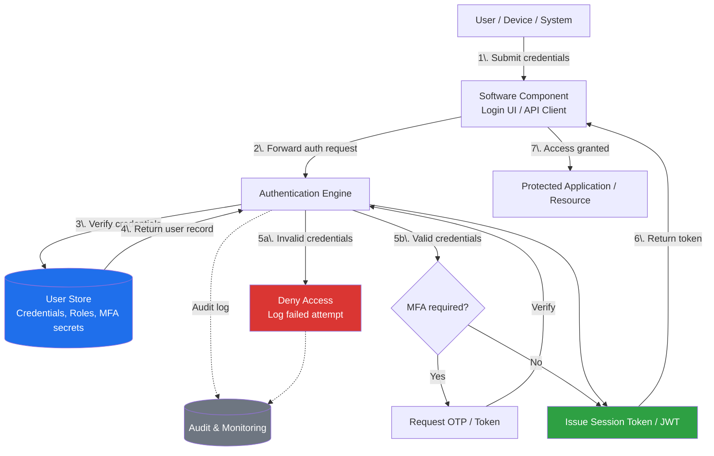

# Application & Data Security


---

- [Application \& Data Security](#application--data-security)
  - [Authentication](#authentication)
    - [Why is authentication important?](#why-is-authentication-important)
    - [Authentication System Design](#authentication-system-design)

---

- It's the duty of the Architect to ensure that applications and data are secured against potential threats and vulnerabilities. If security problems are found in the network or within the applications, they must be addressed promptly to prevent unauthorized access, data breaches, and other security incidents.


## Authentication


- Authentication is defined as the process of verifying the identity of a user, device, or system before granting access to resources. It ensures that only authorized individuals or entities can access sensitive data and applications.

>[!NOTE]
>Authentication and Authorization are two distinct but closely related concepts in security. Authentication verifies the identity of a user, device, or system, while Authorization determines what resources and actions the authenticated entity is allowed to access.

### Why is authentication important?

- Identifies who the user, device, or system is, ensuring that only legitimate entities can access the application or data.
- What the user, device, or system is allowed to do, ensuring that access is granted only to authorized actions and resources i.e. allow/deny based on permissions.
- Log all actions performed by the user, device, or system to maintain an audit trail for security monitoring and incident response.
- Prevent data breaches and unauthorized access by ensuring that only authenticated and authorized entities can interact with sensitive resources.

### Authentication System Design

- Authentication system design include mainly 3 components:

  - User Store
  - Authentication Engine
  - Software Component

- A general design for authentication systems:




- There are 2 main types of authentication flow:

  - In the first kind

    - When user wants to access the system, it goes to the authentication engine, and enters it's authentication data(username, password, etc.).
    - The authntication engine than goes to the user store, that a user with the credentials provided really exists on the database.
    - If the credentials are valid, the authentication engine approves the authentication request and proceeds with any additional verification steps if required, and sends the details to the software component.

    ```mermaid
    flowchart TD
        U[User / Device / System] -->|1\. Enter auth data<br/>username, password, etc.| AE[Authentication Engine]
        AE -->|2\. Check credentials| US[(User Store)]
        US -->|3\. User record exists?| AE
        AE -->|4\. Valid - approve + additional<br/>verification if required| SC[Software Component]

        style US fill:#1f6feb,color:#fff
        style AE fill:#2ea043,color:#fff
    ```

- In the second kind of authentication flow:

  - The user first goes to the application itself, and enters its authentication details.

  - The Software Component then forwards the authentication request to the Authentication Engine for verification.

  - Than Authentication Engine sends this to the User store and, verifies the user actually exists in the database.

  - If, it doesn't the Authentication Engine sends the details to the software component indicating the authentication failure.

    ```mermaid
    flowchart TD
        U[User / Device / System] -->|1\. Enter auth details| SC[Software Component]
        SC -->|2\. Forward auth request| AE[Authentication Engine]
        AE -->|3\. Verify user exists| US[(User Store)]
        US -->|4\. User record found?| AE
        AE -->|5\. Not found - auth failure| SC

        style US fill:#1f6feb,color:#fff
        style AE fill:#2ea043,color:#fff
        style SC fill:#da3633,color:#fff
    ```

- The difference b/w both the flows is there starting point, where for one Authentication initiates at the Authentication Engine directly, and for the other it starts at the Software Component.

- Most of the Software in real-world scenarios follows the second kind of authentication flow, where the authentication process is initiated at the Software Component rather than directly at the Authentication Engine.

>[!NOTE]
> There are more flows and variations in authentication mechanisms like:
> - <strong>Self-authenticating component:</strong> A component that can authenticate itself without relying on an external authentication engine, often using cryptographic keys or certificates. It is not a recommended approach for all scenarios due to potential security risks.
> - <strong>Authentication engine using another authentication engine or Authentication-as-a-Service (AaaS) or Hybrid Identity Mechanism:</strong> This happens if the user store and the authentication enginer working with it, are located in another environment, and we donot want to expose the user store to the new more public environment.
>  - 