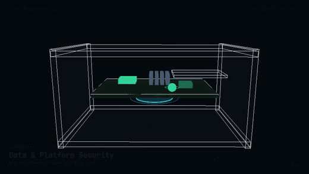

# Application & Data Security

- It's the duty of the Architect to ensure that applications and data are secured against potential threats and vulnerabilities. If security problems are found in the network or within the applications, they must be addressed promptly to prevent unauthorized access, data breaches, and other security incidents.

