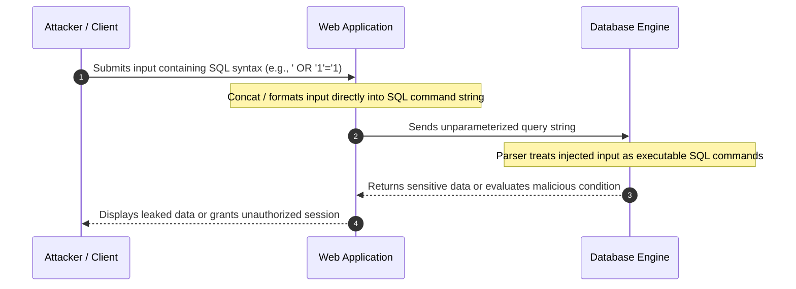
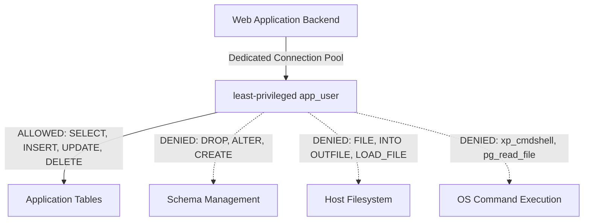
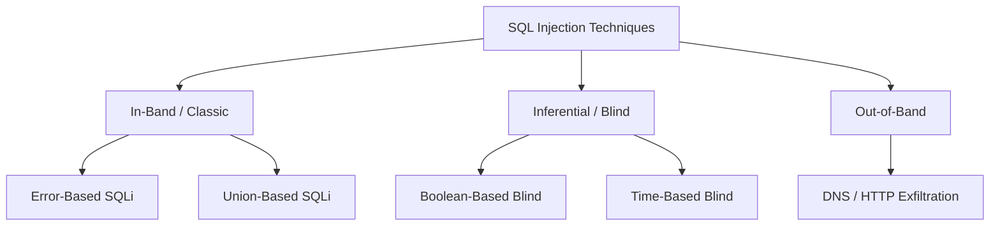
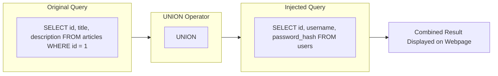
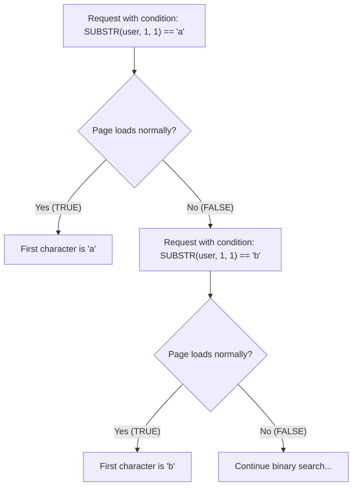
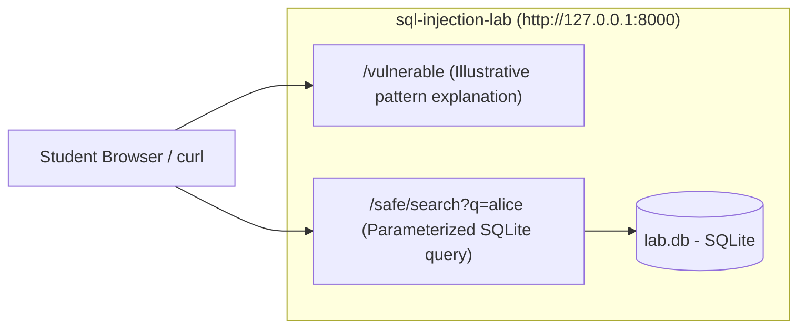
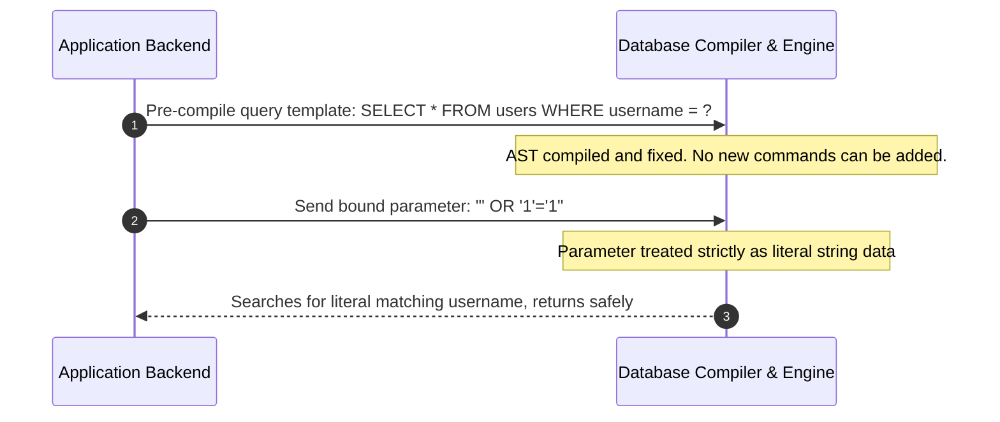

# SQL Injection (SQLi)

> [!IMPORTANT]
> **Ethical & Authorized Testing Boundaries:**
> All concepts, code demonstrations, and tool commands in this lesson are strictly for educational purposes and authorized defensive security research. Never attempt SQL injection against systems, servers, or web applications without explicit, written authorization from the owner. All practical exercises and commands demonstrated here are strictly confined to local, isolated environments (`127.0.0.1` / `localhost` or Docker containers such as the included `sql-injection-lab`).

---

- [SQL Injection (SQLi)](#sql-injection-sqli)
  - [1. SQL Injection Fundamentals](#1-sql-injection-fundamentals)
    - [What is SQL Injection?](#what-is-sql-injection)
    - [The Underlying Cause: Separation of Code and Data](#the-underlying-cause-separation-of-code-and-data)
    - [Impact of SQL Injection](#impact-of-sql-injection)
  - [2. Database Roles & Privilege Levels](#2-database-roles--privilege-levels)
    - [The Blast Radius of Excessive Privileges](#the-blast-radius-of-excessive-privileges)
    - [Enforcing the Principle of Least Privilege](#enforcing-the-principle-of-least-privilege)
  - [3. SQL Injection Classifications & Techniques](#3-sql-injection-classifications--techniques)
    - [In-Band SQLi (Classic)](#in-band-sqli-classic)
      - [Error-Based SQLi](#error-based-sqli)
      - [Union-Based SQLi](#union-based-sqli)
    - [Inferential SQLi (Blind)](#inferential-sqli-blind)
      - [Boolean-Based Blind SQLi](#boolean-based-blind-sqli)
      - [Time-Based Blind SQLi](#time-based-blind-sqli)
  - [4. Vulnerable Code Examples](#4-vulnerable-code-examples)
    - [Vulnerable PHP Implementation](#vulnerable-php-implementation)
    - [Vulnerable Python Implementation](#vulnerable-python-implementation)
  - [5. Step-by-Step Walkthrough: Authentication Bypass](#5-step-by-step-walkthrough-authentication-bypass)
    - [The Legitimate Query Logic](#the-legitimate-query-logic)
    - [Crafting the Payload: `' OR '1'='1`](#crafting-the-payload--or-11)
    - [Step-by-Step Query Evaluation](#step-by-step-query-evaluation)
    - [Why the First Account (Admin) is Returned](#why-the-first-account-admin-is-returned)
  - [6. Automated Testing with sqlmap (Local Lab Only)](#6-automated-testing-with-sqlmap-local-lab-only)
    - [Overview and Safety Flags](#overview-and-safety-flags)
    - [Testing Local GET Parameters](#testing-local-get-parameters)
    - [Testing Local POST Parameters](#testing-local-post-parameters)
    - [Non-Destructive Database Fingerprinting](#non-destructive-database-fingerprinting)
  - [7. Hands-On Practice: The Repository Lab (`sql-injection-lab`)](#7-hands-on-practice-the-repository-lab-sql-injection-lab)
    - [Lab Overview](#lab-overview)
    - [Running with Docker](#running-with-docker)
    - [Running with Python Virtual Environment](#running-with-python-virtual-environment)
    - [Comparing Endpoints](#comparing-endpoints)
    - [Running the Smoke Tests](#running-the-smoke-tests)
  - [8. Defenses & Remediation](#8-defenses--remediation)
    - [Primary Defense: Parameterized Queries (Prepared Statements)](#primary-defense-parameterized-queries-prepared-statements)
      - [Remediated PHP Implementation (PDO)](#remediated-php-implementation-pdo)
      - [Remediated Python Implementation](#remediated-python-implementation)
    - [Input Validation: Allowlisting vs. Blocklisting](#input-validation-allowlisting-vs-blocklisting)
    - [Limitations of String Escaping](#limitations-of-string-escaping)
    - [Database Account Hardening](#database-account-hardening)
    - [Safe Password Handling (Adaptive Hashing)](#safe-password-handling-adaptive-hashing)
  - [9. Summary & Quick Reference Table](#9-summary--quick-reference-table)
  - [10. References & Further Reading](#10-references--further-reading)

---

## 1. SQL Injection Fundamentals

### What is SQL Injection?

**SQL Injection (SQLi)** is a web application security vulnerability that allows an attacker to interfere with the queries that an application makes to its database. It occurs when untrusted user input is directly concatenated, interpolated, or formatted into a database command rather than treated as strictly isolated data.

Ranked consistently in the **OWASP Top 10** (currently categorized under **A03:2021 – Injection**), SQL injection represents one of the most devastating web vulnerabilities because databases typically store an application's most critical assets: user credentials, personally identifiable information (PII), proprietary business data, and financial records.



### The Underlying Cause: Separation of Code and Data

At its core, SQL injection is caused by a failure to maintain a strict boundary between **code (the SQL commands and execution structure)** and **data (the user-supplied values)**.

When developers use string concatenation:

```sql
"SELECT * FROM accounts WHERE owner = '" + userInput + "';"
```

The application delivers a single, raw text string to the database engine parser. The parser interprets the string sequentially:
1. Quotes denote literal values.
2. Unquoted keywords (`SELECT`, `UNION`, `OR`, `AND`, `WHERE`) denote commands.
3. Specific character sequences (`--`, `/*`, `#`) denote comments.

If `userInput` contains quotes and command keywords, the user's data prematurely terminates the literal data block and inserts new clauses directly into the query's **Abstract Syntax Tree (AST)**. The database engine cannot know whether those commands were authored by the application developer or supplied by an external user.

### Impact of SQL Injection

The blast radius of an SQL injection vulnerability can compromise the entire security triad:

- **Confidentiality:** Attackers can exfiltrate sensitive data, including password hashes, session tokens, customer PII, credit card numbers, and proprietary intellectual property.
- **Integrity:** Attackers can modify, insert, or tamper with database records—such as escalating user privileges, forging financial balances, or altering audit logs.
- **Availability:** Attackers can delete tables (`DROP TABLE`), truncate critical audit histories, or cause Denial of Service (DoS) by executing resource-intensive operations or locking database rows.
- **Operating System Takeover (RCE):** Under certain database configurations (such as Microsoft SQL Server's `xp_cmdshell`, PostgreSQL's `COPY ... FROM PROGRAM`, or MySQL's `INTO OUTFILE` writing web shells into the web server document root), attackers can break out of the database and execute commands on the underlying operating system.

---

## 2. Database Roles & Privilege Levels

### The Blast Radius of Excessive Privileges

A common architectural flaw in web applications is configuring the backend service to connect to the database using an all-powerful superuser account—such as `root`, `sa`, `postgres`, `SYSTEM`, or `DBA`.

When an application runs with administrative database privileges, any SQL injection flaw immediately grants the attacker full database administrator powers:
1. **Access to System Catalogs & Other Databases:** The attacker can read metadata, user tables, and passwords across all databases hosted on the same database server instance, not just the current application's schema.
2. **File System Manipulation:** In MySQL, superusers can read server files with `LOAD_FILE('/etc/passwd')` or write files using `SELECT ... INTO OUTFILE '/var/www/html/shell.php'`.
3. **Execution of Administrative Stored Procedures:** In Microsoft SQL Server, an administrative user can invoke `xp_cmdshell` to spawn a Windows command prompt directly.

### Enforcing the Principle of Least Privilege

To minimize the blast radius of any potential vulnerability, database accounts must adhere to the **Principle of Least Privilege (PoLP)**:



Key database hardening guidelines:
- **Dedicated Application User:** Create a specific user account (e.g., `app_user`) exclusively for the web application. Never use root or administrator accounts for daily application queries.
- **Restrict Data Manipulation Language (DML):** Grant only the specific operations required (`SELECT`, `INSERT`, `UPDATE`, `DELETE`) on relevant tables.
- **Revoke Data Definition Language (DDL):** The application runtime account should never have `DROP`, `ALTER`, `TRUNCATE`, or `GRANT` permissions. Database migrations should run under a separate deployment role during build/release cycles.
- **Revoke Host and OS Privileges:** Explicitly revoke administrative capabilities, file access privileges, and remote procedure execution from the application user.
- **Segment Roles by Workload:** Use separate read-only database connections for search, reporting, and public browsing endpoints, reserving read-write connections only for transaction processing.

---

## 3. SQL Injection Classifications & Techniques

SQL injection vulnerabilities are classified based on the channel used to retrieve data and the degree of visibility the attacker has over the database output.



### In-Band SQLi (Classic)

In-band SQL injection is the most direct form of SQLi: the attacker uses the same channel of communication (the HTTP request/response cycle) to both launch the attack and collect the results.

#### Error-Based SQLi

In Error-Based SQLi, the attacker intentionally injects malformed input or functions that trigger a database runtime error. When an application is misconfigured to display verbose database error messages directly in the HTTP response, the database engine inadvertently reveals internal table structures, syntax errors, or data values inside the error text.

- **Triggering the Error:** An attacker submits a syntax-breaking character (such as a single quote `'`, a double quote `"`, or an unmatched parenthesis `)`).
- **Leaked Information:**
  ```text
  Fatal error: Uncaught mysqli_sql_exception: You have an error in your SQL syntax; 
  check the manual that corresponds to your MySQL server version for the right syntax to use 
  near ''admin''' at line 1 in /var/www/html/search.php:12
  ```
- **Deliberate Extraction via Errors:** In some database engines (like MySQL or Microsoft SQL Server), specific functions (e.g., `EXTRACTVALUE`, `UPDATEXML`, or type conversion routines like `CAST('string' AS INT)`) can be forced to evaluate an inner subquery and display the result inside the error message:
  ```sql
  -- MySQL deliberate error disclosure pattern (conceptual):
  AND EXTRACTVALUE(1, CONCAT(0x7e, (SELECT @@version), 0x7e))
  -- Returns: "XPATH syntax error: '~8.0.35~'"
  ```

#### Union-Based SQLi

Union-Based SQLi utilizes the SQL `UNION` or `UNION ALL` operator to append the results of an attacker-crafted secondary `SELECT` query to the results of the original query issued by the application.



To successfully execute a UNION-based attack, two technical prerequisites must be met:
1. **Identical Column Count:** The injected query must return the exact same number of columns as the original query.
2. **Compatible Data Types:** The data types of each corresponding column in the injected query must be compatible with those of the original query.

##### Step 1: Determining the Number of Columns
Attackers incrementally increase the `ORDER BY` index until an error occurs:
```sql
' ORDER BY 1 -- 
' ORDER BY 2 -- 
' ORDER BY 3 -- 
' ORDER BY 4 -- (Error: column 4 does not exist)
```
If `ORDER BY 3` succeeds and `ORDER BY 4` throws an error, the original query selects exactly 3 columns. Alternatively, `UNION SELECT NULL, NULL, NULL` can be used because `NULL` is compatible with almost any column type.

##### Step 2: Determining Which Columns Display on Screen
Once the column count is established, characters or numbers are substituted into the columns to locate where data is reflected in the HTML response:
```sql
' UNION SELECT 'col1', 'col2', 'col3' -- 
```
If `'col2'` appears in the rendered web page, that position can be used to extract data from system catalogs (e.g., `sqlite_master` in SQLite or `information_schema.tables` in MySQL).

---

### Inferential SQLi (Blind)

In many hardened or modern applications, database errors are suppressed and database records are not directly reflected on the screen. The vulnerability still exists, but the attacker cannot read data in-band. Instead, the attacker reconstructs information **inferentially** by asking the database a series of TRUE/FALSE questions.

#### Boolean-Based Blind SQLi

In Boolean-Based Blind SQLi, the attacker injects an SQL condition that evaluates to either `TRUE` or `FALSE`. The application responds differently depending on the evaluation:
- **When TRUE:** The application displays normal content (e.g., "User profile found", HTTP 200, or a specific page length).
- **When FALSE:** The application displays alternate content (e.g., "User not found", empty search results, or different text).

By inspecting characters one by one using string manipulation functions (such as `SUBSTR()` or `SUBSTRING()`), an attacker can reconstruct strings:

```sql
-- Is the first character of the database user 'a'?
AND SUBSTR((SELECT current_user), 1, 1) = 'a'
-- If false, try 'b', 'c', or use binary search (> 'm')
```



#### Time-Based Blind SQLi

When an application returns identical visual content and identical HTTP status codes regardless of whether a condition is true or false, boolean inference is not possible.

In Time-Based Blind SQLi, the attacker injects database commands that cause the database server to sleep or pause for a predetermined amount of time (e.g., 5 seconds) if and only if a condition evaluates to TRUE:

- **MySQL / MariaDB:** `AND IF(1=1, SLEEP(5), 0)`
- **PostgreSQL:** `AND (SELECT CASE WHEN (1=1) THEN pg_sleep(5) ELSE pg_sleep(0) END)`
- **Microsoft SQL Server:** `WAITFOR DELAY '0:0:5'`
- **SQLite:** Computationally intensive mathematical functions or large blob generations (e.g., `LIKE(HEX(RANDOMBLOB(50000000)), ...)`)

##### Testing Procedure
1. Send a baseline request to establish average latency (e.g., response time ~ 45 ms).
2. Send a request with a time-delay payload conditioned on a TRUE statement:
   ```text
   GET /search?q=test'+AND+(SELECT+1+FROM+(SELECT+SLEEP(5))A)--+
   ```
3. If the server takes ~ 5045 ms to respond, the database parsed and executed the sleep instruction, confirming the vulnerability.

---

## 4. Vulnerable Code Examples

To recognize SQL injection during code reviews and security audits, examine how user input enters SQL statements.

### Vulnerable PHP Implementation

```php
<?php
// VULNERABLE: Direct string concatenation into SQL query
$mysqli = new mysqli("127.0.0.1", "db_user", "db_pass", "shop_db");

if ($mysqli->connect_errno) {
    die("Connection failed: " . $mysqli->connect_error);
}

// Untrusted user input retrieved directly from request
$username = $_POST['username'];
$password = $_POST['password'];

// Dangerous: String interpolation merges code and data into a single query string
$sql = "SELECT id, username, role FROM users WHERE username = '" . $username . "' AND password = '" . $password . "';";

$result = $mysqli->query($sql);

if ($result && $result->num_rows > 0) {
    $user = $result->fetch_assoc();
    echo "Welcome back, " . htmlspecialchars($user['username']);
} else {
    echo "Invalid username or password.";
}

$mysqli->close();
?>
```

> [!WARNING]
> **Why this is vulnerable:**
> The input variables `$username` and `$password` are concatenated directly into the `$sql` string before passing it to `$mysqli->query()`. If an attacker supplies quotes or SQL syntax, the database compiler executes the injected syntax rather than treating it as literal data.

### Vulnerable Python Implementation

```python
# VULNERABLE: Python string formatting (f-string) in database query
import sqlite3

def login_user(username_input: str, password_input: str) -> bool:
    conn = sqlite3.connect("local_app.db")
    cursor = conn.cursor()

    # Dangerous: Python f-string formats untrusted input directly into SQL syntax
    query = f"SELECT id, username, role FROM users WHERE username = '{username_input}' AND password = '{password_input}';"
    
    # The database receives the already-interpolated string
    cursor.execute(query)
    user = cursor.fetchone()
    conn.close()

    if user:
        return True
    return False
```

> [!WARNING]
> **Why this is vulnerable:**
> The Python runtime formats `username_input` into the SQL string before SQLite ever sees the command. The database parser receives the fully expanded string and compiles whatever instructions it contains.

---

## 5. Step-by-Step Walkthrough: Authentication Bypass

Authentication bypass is one of the classic demonstrations of SQL injection. It illustrates how changing a query's logical operators allows an attacker to authenticate without providing a valid password.

### The Legitimate Query Logic

Consider an authentication endpoint with the following backend query structure:

```sql
SELECT id, username, role FROM users WHERE username = '<USER_INPUT>' AND password = '<PASSWORD_INPUT>';
```

Under normal operation, a legitimate user enters:
- Username: `alice`
- Password: `secretpassword123`

The database executes:
```sql
SELECT id, username, role FROM users WHERE username = 'alice' AND password = 'secretpassword123';
```
The database checks both conditions. If both match, one record is returned, and login succeeds.

### Crafting the Payload: `' OR '1'='1`

To bypass this check, an attacker provides the following input in the username field:
```text
' OR '1'='1' -- 
```
(and any arbitrary text in the password field, such as `anything`).

### Step-by-Step Query Evaluation

Let us trace how the database parses the query after string concatenation:

1. **String Assembly:**
   ```sql
   SELECT id, username, role FROM users WHERE username = '' OR '1'='1' -- ' AND password = 'anything';
   ```

2. **Comment Truncation:**
   The `-- ` sequence in SQL denotes a single-line comment. Everything following the `-- ` is completely discarded by the database query parser. The query effectively becomes:
   ```sql
   SELECT id, username, role FROM users WHERE username = '' OR '1'='1';
   ```

3. **Logical Truth Evaluation:**
   The database evaluates the `WHERE` clause for each row in the `users` table:
   - Condition A: `username = ''` $\rightarrow$ Evaluates to `FALSE` (assuming no user has an empty username).
   - Condition B: `'1' = '1'` $\rightarrow$ Evaluates to `TRUE` (a constant identity).
   - Combined Expression: `FALSE OR TRUE` $\rightarrow$ Evaluates to `TRUE`.

4. **Row Matching:**
   Because `TRUE` is constant for every record in the table, the query matches **all** rows in the `users` table.

### Why the First Account (Admin) is Returned

In backend application code (such as `cursor.fetchone()` in Python or `$result->fetch_assoc()` in PHP), the application expects a single authenticated user record:

```python
user = cursor.fetchone()  # Grabs the first record from the returned set
if user:
    session["user_id"] = user[0]  # Grants access
```

In standard database designs:
- The first record inserted into a database table typically has `id = 1`.
- Account #1 is almost universally the system administrator (`admin`, `administrator`, `root`).

Consequently, the application reads the administrator record from the result set, initializes an administrative session for the client, and bypasses authentication entirely.

---

## 6. Automated Testing with sqlmap (Local Lab Only)

### Overview and Safety Flags

[sqlmap](https://sqlmap.org/) is an open-source penetration testing tool that automates the process of detecting and exploiting SQL injection flaws.

> [!CAUTION]
> **Strict Operational Constraints:**
> sqlmap is an active scanning tool that transmits hundreds of requests containing injection probes. Use sqlmap **only** against local testbeds (`127.0.0.1` / `localhost`) or systems for which you have explicit written authorization. Never run sqlmap against public domains or third-party targets.

Key safety flags when working in local labs:
- `--batch`: Runs in non-interactive mode using default safe choices.
- `--level=1`: Restricts testing to standard parameters (avoids aggressive cookie and header fuzzing).
- `--risk=1`: Executes only non-destructive tests (avoids heavy load or data corruption).
- `--banner`: Retrieves only the DBMS version banner without dumping tables.

### Testing Local GET Parameters

To scan a local test application passing query parameters via GET:

```bash
sqlmap -u "http://127.0.0.1:8000/vulnerable/search?q=test" --batch --level=1 --risk=1
```

### Testing Local POST Parameters

To test a local login endpoint receiving POST form data:

```bash
sqlmap -u "http://127.0.0.1:8000/login" \
  --data="username=test&password=test" \
  --method=POST \
  --batch \
  --level=1 --risk=1
```

### Non-Destructive Database Fingerprinting

To safely identify the underlying database engine and version without touching table contents:

```bash
sqlmap -u "http://127.0.0.1:8000/vulnerable/search?q=test" --banner --batch
```

Expected safe output:
```text
[INFO] the back-end DBMS is SQLite
web application technology: Flask, Python
back-end DBMS: SQLite 3.39.5
banner: '3.39.5'
```

---

## 7. Hands-On Practice: The Repository Lab (`sql-injection-lab`)

This repository includes a safe, self-contained educational lab in [`sql-injection-lab/`](../sql-injection-lab/README.md). It allows you to inspect vulnerable patterns and compare them directly against safe, parameterized implementations.



### Lab Overview

The lab consists of:
- `sql-injection-lab/app/vulnerable_app.py`: An educational endpoint illustrating unsafe string construction.
- `sql-injection-lab/app/safe_app.py`: A production-style endpoint demonstrating parameterized SQLite queries.
- `sql-injection-lab/exercises/`: Conceptual exercises on SQLi detection and mitigation.
- `sql-injection-lab/tests/`: Automated smoke tests verifying safe endpoints.

### Running with Docker

From the repository root:

```bash
cd sql-injection-lab/docker
docker-compose up --build
```

Access the lab in your browser at `http://127.0.0.1:8000`.

To stop the container:
```bash
docker-compose down
```

### Running with Python Virtual Environment

```bash
# Navigate to the lab folder
cd sql-injection-lab

# Initialize environment and install requirements
python3 -m venv .venv
source .venv/bin/activate
pip install -r requirements.txt

# Run the local server
python -m app.run
```

The application starts on `http://127.0.0.1:8000`.

### Comparing Endpoints

1. **Examine the Illustrative Vulnerable Pattern:**
   Navigate to `http://127.0.0.1:8000/vulnerable/`. The endpoint returns a JSON payload explaining how string formatting creates injection risks:
   ```json
   {
     "title": "Illustrative Vulnerable Pattern",
     "illustrative_pattern": "SELECT * FROM users WHERE username = '{user_input}';",
     "advice": "Use parameterized queries and input validation. See /safe for a safe example."
   }
   ```

2. **Examine the Safe Parameterized Endpoint:**
   Navigate to `http://127.0.0.1:8000/safe/search?q=alice`. Notice how parameterized queries process the query argument cleanly:
   ```json
   {
     "count": 1,
     "query": "alice",
     "results": [
       {
         "full_name": "Alice Example",
         "id": 1,
         "username": "alice"
       }
     ]
   }
   ```

3. **Verify Parameterized Immunity:**
   Try searching with an injection string on the safe endpoint:
   ```text
   http://127.0.0.1:8000/safe/search?q=alice'+OR+'1'='1
   ```
   The safe endpoint treats `'alice\' OR \'1\'=\'1'` as a literal username string. Because no user possesses that exact username literal, it safely returns 0 results instead of leaking data.

### Running the Smoke Tests

The lab includes automated smoke tests using `pytest`:

```bash
cd sql-injection-lab
pytest -v
```

---

## 8. Defenses & Remediation

Preventing SQL injection requires defense-in-depth, with **parameterized queries** serving as the non-negotiable primary line of defense.

### Primary Defense: Parameterized Queries (Prepared Statements)

Parameterized queries (also known as prepared statements) eliminate SQL injection at the architectural level.

#### How Prepared Statements Work
1. **Pre-compilation Phase:** The application sends the SQL query template with placeholders (`?` or `:name`) to the database engine first.
2. **Compilation:** The database engine parses, analyzes, and compiles the SQL execution plan based purely on the template.
3. **Data Binding Phase:** The application transmits the user parameter values separately.
4. **Execution:** The database engine inserts the values directly into the designated parameter slots in the compiled execution plan.



Even if the bound parameter contains quotes, semicolons, comments, or SQL keywords, the database parser never treats them as executable SQL commands; they remain harmless text literals.

#### Remediated PHP Implementation (PDO)

```php
<?php
// SECURE: Prepared statements with PDO parameter binding
try {
    $pdo = new PDO("mysql:host=127.0.0.1;dbname=shop_db;charset=utf8mb4", "app_user", "SecureAppPass123!", [
        PDO::ATTR_ERRMODE            => PDO::ERRMODE_EXCEPTION,
        PDO::ATTR_DEFAULT_FETCH_MODE => PDO::FETCH_ASSOC,
        PDO::ATTR_EMULATE_PREPARES   => false, // Enforce native database prepared statements
    ]);

    $username = $_POST['username'] ?? '';
    $password = $_POST['password'] ?? '';

    // 1. Prepare query template with named placeholder
    $stmt = $pdo->prepare("SELECT id, username, password_hash, role FROM users WHERE username = :username;");

    // 2. Execute with bound parameter array
    $stmt->execute([':username' => $username]);
    $user = $stmt->fetch();

    // 3. Verify password hash using secure adaptive hashing
    if ($user && password_verify($password, $user['password_hash'])) {
        echo "Authentication successful. Welcome, " . htmlspecialchars($user['username']);
    } else {
        echo "Invalid username or password.";
    }

} catch (PDOException $e) {
    // Log error internally, display generic message to client
    error_log("Database error: " . $e->getMessage());
    echo "An unexpected error occurred. Please try again later.";
}
?>
```

#### Remediated Python Implementation

```python
# SECURE: Parameterized query in Python sqlite3
import sqlite3
import hmac

def authenticate_user_secure(username_input: str, password_input: str) -> bool:
    conn = sqlite3.connect("local_app.db")
    cursor = conn.cursor()

    # Placeholders (?) ensure input is treated strictly as data literals
    query = "SELECT id, username, password_hash FROM users WHERE username = ?;"
    cursor.execute(query, (username_input,))

    user = cursor.fetchone()
    conn.close()

    if not user:
        return False

    user_id, db_username, db_hash = user

    # Secure verification with adaptive hashing library (e.g., bcrypt or argon2)
    return verify_password_hash(password_input, db_hash)

def verify_password_hash(plain_password: str, stored_hash: str) -> bool:
    # Example placeholder: in production use bcrypt.checkpw or argon2.PasswordHasher
    import hashlib
    # Simulating constant-time comparison
    computed_hash = hashlib.sha256(plain_password.encode()).hexdigest()
    return hmac.compare_digest(computed_hash, stored_hash)
```

---

### Input Validation: Allowlisting vs. Blocklisting

Input validation acts as a secondary defense layer to ensure data adheres to business constraints before processing.

- **Allowlisting (Accept Known Good):**
  Validate that data conforms to strict formatting rules (e.g., regex, type, length, range):
  - Usernames: Only alphanumeric characters and underscores, 3 to 20 characters (`^[a-zA-Z0-9_]{3,20}$`).
  - IDs and page numbers: Strictly cast to integers (`int(user_id)`).
  - Dynamic sort columns: Compare input against an explicit array of allowed column names:
    ```php
    $allowed_sort = ['id', 'username', 'created_at'];
    $sort_by = in_array($_GET['sort'], $allowed_sort, true) ? $_GET['sort'] : 'id';
    ```
- **Blocklisting (Reject Known Bad) — Why It Fails:**
  Attempting to filter out words like `SELECT`, `OR`, `UNION`, `--`, or `'` is unreliable and easily bypassed:
  - Mixed-case variations: `sElEcT`, `uNiOn`
  - URL encoding / double encoding: `%2527`
  - Comment insertion: `SEL/*comment*/ECT`
  - Alternate SQL syntax: using hex literals (`0x61646d696e` for `admin`) or character concatenation (`CHAR(97,100,109,105,110)`)

---

### Limitations of String Escaping

Functions such as PHP's `addslashes()` or legacy `mysql_real_escape_string()` attempt to neutralize quotes by prefixing them with a backslash (`\'`). **Escaping is not a reliable substitute for prepared statements.**

1. **Numeric Context Vulnerability:**
   Escaping only helps when the variable is wrapped in single quotes inside the SQL query. If the input is unquoted (common in numeric queries):
   ```sql
   SELECT * FROM items WHERE category_id = " . addslashes($_GET['cat']);
   ```
   An attacker injects `1 OR 1=1`. No quotes are required, rendering escaping completely ineffective.
2. **Multibyte Character Encoding Exploits:**
   In certain multibyte character sets (such as GBK or Big5), an attacker can supply a trailing high byte (e.g., `0xbf27`). When the escaping function inserts a backslash (`0x5c`), the byte sequence `0xbf5c` is parsed by the database as a single multibyte Chinese character, leaving the single quote (`0x27`) unescaped and free to break syntax.
3. **Second-Order SQL Injection:**
   When escaped input is written safely to a database, the escaping slashes are stripped during storage. If a separate part of the application subsequently reads that stored data and concatenates it into a second query, injection occurs.

---

### Database Account Hardening

Ensure database accounts follow strict containment rules:
1. Revoke `GRANT OPTION`, `SUPER`, `PROCESS`, and `SHUTDOWN` privileges from application accounts.
2. Disable or restrict dangerous stored procedures (`xp_cmdshell` in SQL Server).
3. Restrict file access: set MySQL's `secure_file_priv` to an empty or disabled directory to prevent reading or writing host files.
4. Separate environments: development, staging, and production databases must run on isolated server instances with distinct, non-shared credentials.

---

### Safe Password Handling (Adaptive Hashing)

When attackers exploit an SQL injection vulnerability to dump user tables, safe password storage ensures user credentials cannot be reversed or cracked:

- **Never Store Plaintext Passwords:** Plaintext storage exposes all user accounts immediately upon a database leak.
- **Avoid Deprecated Hash Functions:** MD5, SHA-1, and un-salted SHA-256 are extremely fast and vulnerable to GPU cracking and precomputed rainbow table attacks.
- **Use Modern Adaptive Hashing Functions:**
  - **Argon2id** (Recommended by OWASP and password security standards)
  - **bcrypt** (Robust, battle-tested standard)
  - **PBKDF2** (NIST-approved standard)
- **Automatic Salting:** Adaptive algorithms automatically generate a cryptographically random salt per user, preventing rainbow table attacks.
- **Constant-Time Verification:** Always use constant-time comparison routines (e.g., `password_verify()` in PHP or `hmac.compare_digest()` in Python) to prevent side-channel timing attacks during password checks.

---

## 9. Summary & Quick Reference Table

| SQLi Type | Channel | Data Extraction Method | Typical Indicator | Primary Defense |
| :--- | :--- | :--- | :--- | :--- |
| **Error-Based** | In-Band | Leaked in database error messages | Database syntax / runtime exception on screen | Parameterized queries, suppress verbose error output |
| **Union-Based** | In-Band | Appended to legitimate query results | Extra rows or column text rendered on page | Parameterized queries |
| **Boolean-Based** | Inferential (Blind) | Inferred via TRUE/FALSE response differences | Subtle content differences, HTTP 200 vs 404 | Parameterized queries |
| **Time-Based** | Inferential (Blind) | Inferred by measuring server delay | Deliberate latency delay (e.g. 5000 ms) | Parameterized queries |
| **Out-of-Band** | External Channel | Exfiltrated via DNS or HTTP requests | DNS/HTTP lookup to attacker-controlled listener | Parameterized queries, restrict egress database traffic |

---

## 10. References & Further Reading

- [OWASP SQL Injection Overview](https://owasp.org/www-community/attacks/SQL_Injection)
- [OWASP SQL Injection Prevention Cheat Sheet](https://cheatsheetseries.owasp.org/cheatsheets/SQL_Injection_Prevention_Cheat_Sheet.html)
- [PortSwigger Web Security Academy: SQL Injection](https://portswigger.net/web-security/sql-injection)
- [Repository Lab: `sql-injection-lab`](../sql-injection-lab/README.md)
