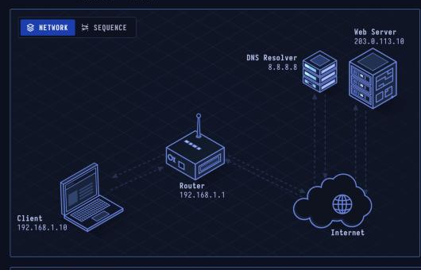
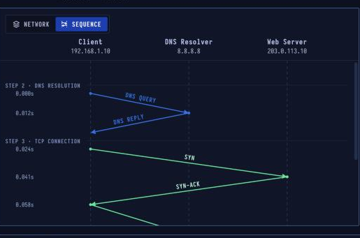

# HTTP — Web Communication

> **Layer 7 · Application** | Port `80` | Transport: TCP | RFC 9110, RFC 9112

## What Is HTTP?

HTTP is the protocol of the web: a client asks for a resource, such as an HTML page, and the server answers with a status code, headers and usually a body. Every exchange is one request and one response, written as readable text in HTTP/1.1.

| Property | Value |
|----------|-------|
| Layer | Application (Layer 7) |
| Default Port | 80 (HTTPS: 443) |
| Transport | TCP |
| Data Format | Text (headers + optional body) |
| Common Methods | `GET`, `POST`, `PUT`, `DELETE`, `HEAD` |
| Defined In | RFC 9110, RFC 9112 |

---

## Network Topology



The client, router, DNS resolver (8.8.8.8), and web server (203.0.113.10) are involved. Before HTTP data flows, the laptop must resolve the name to an IP and open a TCP connection.

---

## Sequence Diagram



Three round trips before the page arrives:
1. **DNS** — resolve name to IP
2. **TCP** — three-way handshake
3. **HTTP** — GET request + 200 OK response

---

## Step-by-Step Walkthrough

### Step 1 · Client Request
You open `http://www.example.com`. The browser will send a GET request, but packets travel to IP addresses, not names, so first it needs the server's address. (Browsers now try `https://` first; this is the plain version.)

| | |
|--|--|
| URL | `http://www.example.com/` |
| Method | GET |
| Next hop | Router 192.168.1.1 |

### Step 2 · DNS Resolution
The laptop asks the DNS resolver it was given by DHCP, `8.8.8.8`, for the address of `www.example.com`. The query goes over **UDP port 53** and the answer is an A record with the IPv4 address.

| | |
|--|--|
| Resolver | 8.8.8.8 (had it cached) |
| Transport | UDP, port 53 |
| Answer | A 203.0.113.10 |

### Step 3 · TCP Connection
HTTP runs on top of TCP. Before any page data moves, the laptop and the server open a connection to port 80 with a three-way handshake: **SYN → SYN-ACK → ACK**.

| | |
|--|--|
| Server port | 80 |
| Client port | 52344 (ephemeral) |
| Handshake | SYN → SYN-ACK → ACK |

### Step 4 · HTTP Exchange
The browser sends a GET request with a `Host` header. The server answers `200 OK` with the HTML in the body — too big for one packet, so TCP splits it into 9 segments.

```
GET / HTTP/1.1
Host: www.example.com
User-Agent: Mozilla/5.0 ...
Accept: text/html,...

HTTP/1.1 200 OK
Content-Type: text/html
Content-Length: 12345

<!DOCTYPE html>...
```

### Step 5 · Page Rendering
The browser parses the HTML and paints the page. Linked CSS, images and scripts would each start more requests just like this one, reusing the open connection where they can.

| | |
|--|--|
| Connection | Kept open for reuse |
| Total time | 0.094 s |
| Round trips | 3 (DNS, TCP, HTTP) |

---

## Packet Flow

| # | Time | Source | Dest | Protocol | Info |
|---|------|--------|------|----------|------|
| 1 | 0.000s | 192.168.1.10 | 8.8.8.8 | DNS | Standard query A www.example.com |
| 2 | 0.012s | 8.8.8.8 | 192.168.1.10 | DNS | Standard query response A 203.0.113.10 |
| 3 | 0.024s | 192.168.1.10 | 203.0.113.10 | TCP | 52344 → 80 [SYN] Seq=0 |
| 4 | 0.041s | 203.0.113.10 | 192.168.1.10 | TCP | 80 → 52344 [SYN, ACK] Seq=0 Ack=1 |
| 5 | 0.058s | 192.168.1.10 | 203.0.113.10 | TCP | 52344 → 80 [ACK] Seq=1 Ack=1 |
| 6 | 0.058s | 192.168.1.10 | 203.0.113.10 | HTTP | GET / HTTP/1.1 (484 B) |
| 7 | 0.076s | 203.0.113.10 | 192.168.1.10 | HTTP | HTTP/1.1 200 OK (12.8 KB, 9 segments) |

---

## Security Considerations

- **No encryption** — everything is plaintext, readable by anyone on the path (ISP, router, same Wi-Fi)
- **No authentication** — no proof the server is who it claims to be
- **Header injection** — untrusted input in response headers can split responses
- **HTTP verb tampering** — servers that don't validate methods may expose unintended functionality

**Upgrade path:** Use HTTPS. See [lesson-03-https.md](lesson-03-https.md).
