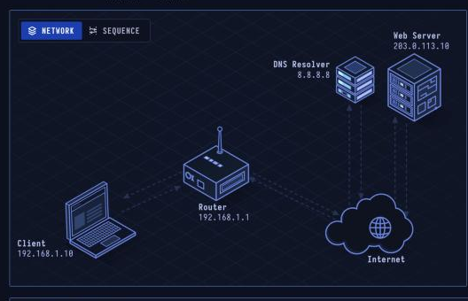
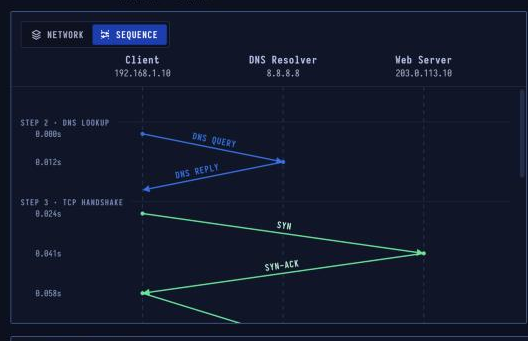

# HTTPS — Secure Web Communication

> **Layer 7 · Application** | Port `443` | Transport: TCP | RFC 9110, RFC 8446

## What Is HTTPS?

HTTPS is HTTP sent through an encrypted TLS connection. TLS proves the server is who it claims to be with a certificate, agrees on fresh encryption keys, and then protects every request and response from being read or changed on the way.

| Property | Value |
|----------|-------|
| Layer | Application (HTTP over TLS) |
| Default Port | 443 |
| Transport | TCP |
| Security | TLS 1.3 (1.2 still common) |
| Proves | Server identity (certificate) |
| Defined In | RFC 9110, RFC 8446 |

---

## Network Topology

Same topology as HTTP, but traffic goes to port **443** and is encrypted after the TLS handshake.

---

## Sequence Diagram

Four round trips before the page arrives:
1. **DNS** — resolve name (unencrypted, unless DoH is used)
2. **TCP** — three-way handshake to port 443
3. **TLS** — one-round-trip handshake (TLS 1.3)
4. **HTTP** — GET request + 200 OK, now inside TLS records

---

## Step-by-Step Walkthrough

### Step 1 · Secure Request
You type `https://www.example.com`. The "s" tells the browser to protect the connection with TLS on port 443. It still needs to resolve the name first.

| | |
|--|--|
| URL | `https://www.example.com/` |
| Port | 443 |
| Next hop | Router 192.168.1.1 |

### Step 2 · DNS Lookup
The lookup is exactly the same as plain HTTP: a query to `8.8.8.8` over UDP port 53. **This is not encrypted** — anyone on the path can see which name you asked for, unless the browser uses DNS over HTTPS (DoH).

| | |
|--|--|
| Resolver | 8.8.8.8 (had it cached) |
| Encrypted | No (plain DNS) |
| Answer | A 203.0.113.10 |

### Step 3 · TCP Handshake
TLS rides on TCP, so the same three-way handshake comes first, this time to port **443**. Nothing is encrypted yet.

| | |
|--|--|
| Server port | 443 |
| Client port | 52411 (ephemeral) |
| Handshake | SYN → SYN-ACK → ACK |

### Step 4 · TLS Handshake
The browser offers cipher suites and key shares, including a post-quantum hybrid. The server picks one and sends its own share plus its certificate, already encrypted. The browser checks the certificate against trusted Certificate Authorities.

| | |
|--|--|
| Cipher | TLS_AES_128_GCM_SHA256 |
| Still visible | IPs, server name (SNI), packet sizes |
| Round trip | 1 (TLS 1.3) |

### Step 5 · Encrypted Exchange
The GET and `200 OK` are the same HTTP messages as plain HTTP, but sealed in TLS records that look like random "application data" on the wire.

### Step 6 · Page Rendering
The browser decrypts the response, paints the page and shows a padlock. The `Strict-Transport-Security` header tells it to use HTTPS for this site from now on.

---

## What's Still Visible to an Observer?

Even with HTTPS, an observer on the network can see:
- **Destination IP address** — which server you're connecting to
- **Server Name Indication (SNI)** — the hostname, in the ClientHello
- **Packet sizes and timing** — may reveal which page you're loading
- **DNS queries** — which names you're resolving (unless using DoH/DoT)

---

## Security Considerations

| Attack | Description |
|--------|-------------|
| TLS downgrade | Forcing connection to TLS 1.0/1.1 to use broken ciphers |
| HSTS stripping | Intercepting initial HTTP redirect before HSTS kicks in |
| Certificate spoofing | Presenting a fraudulent cert (requires compromised CA) |
| SNI fingerprinting | Identifying destination from unencrypted ClientHello |
| Session ticket reuse | Resumption tickets can aid correlation attacks |

See [lesson-14-tls-ssl.md](lesson-14-tls-ssl.md) for TLS handshake deep-dive.
