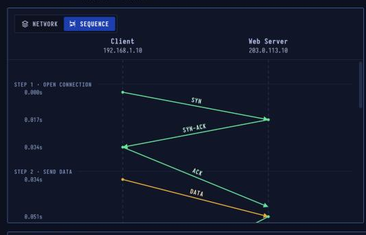

# TCP — Reliable Delivery

> **Layer 4 · Transport** | RFC 9293

## What Is TCP?

TCP turns the internet's best-effort packet delivery into a reliable, ordered stream of bytes. It numbers every byte, acknowledges what arrives, resends what goes missing, and paces the sender so neither the other side nor the network is overwhelmed.

| Property | Value |
|----------|-------|
| Layer | Transport (Layer 4) |
| Connection | Three-way handshake |
| Reliability | Sequence numbers + ACKs |
| Recovery | Retransmission |
| Header | 20–60 bytes |
| Defined In | RFC 9293 |

---

## Sequence Diagram



The diagram shows: open (SYN/SYN-ACK/ACK), data transfer with one lost segment detected via duplicate ACK + SACK, selective retransmit of only the missing segment, and four-way close (FIN/ACK × 2).

---

## Step-by-Step Walkthrough

### Step 1 · Open Connection — Three-Way Handshake

Before any data moves, both sides choose a starting sequence number and confirm it:

```
Client → Server: SYN  (Seq=0)
Server → Client: SYN-ACK  (Seq=0, Ack=1)
Client → Server: ACK  (Seq=1, Ack=1)
```

Real sequence numbers start at a **random value** (ISN — Initial Sequence Number). This prevents sequence prediction attacks.

| | |
|--|--|
| Server | 203.0.113.10, port 80 |
| Flags | SYN → SYN-ACK → ACK |

### Step 2 · Send Data — Every Byte Is Numbered

```
Client → Server: PSH, ACK  Seq=1  Len=1460  (segment 1)
Client → Server: PSH, ACK  Seq=1461  Len=1460  (segment 2)
Client → Server: PSH, ACK  Seq=2921  Len=1460  (segment 3)
...
```

The receiver sends cumulative ACKs. If the sender fills its congestion window before an ACK returns, it must wait.

### Step 3 · A Segment Is Lost

Segment 1 (Seq=1) is dropped somewhere on the network. Segments 2–9 arrive, but the receiver can't deliver them in order — it buffers them.

### Step 4 · Gap Is Noticed — Duplicate ACK + SACK

The receiver sends duplicate ACKs: "still waiting for byte 1". The SACK (Selective Acknowledgment) option tells the sender exactly which ranges it *has* received:

```
Server → Client: ACK  Ack=1  SACK 1461-13141
Server → Client: ACK  Ack=1  SACK 1461-13141
Server → Client: ACK  Ack=1  SACK 1461-13141  ← 3 dupack triggers fast retransmit
```

| | |
|--|--|
| Loss found by | Duplicate ACK + SACK |
| Total segments | 14 (1 lost, 1 resent) |

### Step 5 · Resend the Gap — Selective Retransmission

The SACK tells the server exactly what's missing, so it resends **just segment 1**, not all segments after it:

```
Client → Server: PSH, ACK  Seq=1  Len=1460  (retransmit)
Server → Client: ACK  Ack=13141  ← everything acknowledged
```

Had no ACK come back at all, timers would step in: a probe after ~2 RTTs, then a retransmission timeout (at least 200 ms on Linux).

### Step 6 · Close Connection — Four-Way Close

Each direction closes on its own (half-close):

```
Client → Server: FIN  (Seq=N)
Server → Client: ACK
Server → Client: FIN  (Seq=M)
Client → Server: ACK
```

The client then enters **TIME-WAIT** for 2× MSL (Maximum Segment Lifetime, typically 60 s) to handle late-arriving packets and ensure the final ACK was received.

| | |
|--|--|
| Closed by | A FIN from each side |
| Order | FIN → ACK → FIN → ACK |
| Then | Client waits (TIME-WAIT) |

---

## TCP Header Fields

```
 0                   1                   2                   3
 0 1 2 3 4 5 6 7 8 9 0 1 2 3 4 5 6 7 8 9 0 1 2 3 4 5 6 7 8 9 0 1
+-+-+-+-+-+-+-+-+-+-+-+-+-+-+-+-+-+-+-+-+-+-+-+-+-+-+-+-+-+-+-+-+
|          Source Port          |       Destination Port        |
+-+-+-+-+-+-+-+-+-+-+-+-+-+-+-+-+-+-+-+-+-+-+-+-+-+-+-+-+-+-+-+-+
|                        Sequence Number                        |
+-+-+-+-+-+-+-+-+-+-+-+-+-+-+-+-+-+-+-+-+-+-+-+-+-+-+-+-+-+-+-+-+
|                    Acknowledgment Number                      |
+-+-+-+-+-+-+-+-+-+-+-+-+-+-+-+-+-+-+-+-+-+-+-+-+-+-+-+-+-+-+-+-+
|  Data |           |U|A|P|R|S|F|                               |
| Offset| Reserved  |R|C|S|S|Y|I|            Window             |
|       |           |G|K|H|T|N|N|                               |
+-+-+-+-+-+-+-+-+-+-+-+-+-+-+-+-+-+-+-+-+-+-+-+-+-+-+-+-+-+-+-+-+
|           Checksum            |         Urgent Pointer        |
+-+-+-+-+-+-+-+-+-+-+-+-+-+-+-+-+-+-+-+-+-+-+-+-+-+-+-+-+-+-+-+-+
|                    Options                    |    Padding    |
+-+-+-+-+-+-+-+-+-+-+-+-+-+-+-+-+-+-+-+-+-+-+-+-+-+-+-+-+-+-+-+-+
```

Key flags: `SYN`, `ACK`, `FIN`, `RST`, `PSH`, `URG`

---

## Security Considerations

| Attack | Mechanism |
|--------|-----------|
| **SYN Flood** | Send many SYNs without completing handshakes, exhausting server's SYN backlog |
| **RST Injection** | Send forged RST with guessed sequence number to tear down a connection |
| **Sequence Prediction** | Guess ISN to inject data into an existing connection (mitigated by random ISN) |
| **Session Hijacking** | After guessing or sniffing sequence numbers, inject commands |
| **TIME-WAIT Assassination** | Force premature connection termination via forged RST |

**Mitigations:** `SYN cookies`, `TCP MD5 signature option` (RFC 2385), random ISN, OS-level rate limiting.
