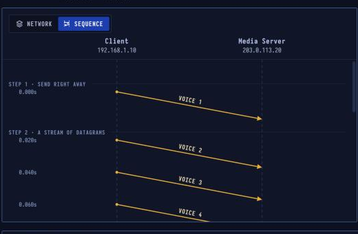

# UDP — Fast Datagrams

> **Layer 4 · Transport** | RFC 768

## What Is UDP?

UDP sends data in independent packets called datagrams, with no connection, no acknowledgements and no resends. That keeps it fast and light: right for voice, video, games and DNS, where a **late answer is worse than a missing one**.

| Property | Value |
|----------|-------|
| Layer | Transport (Layer 4) |
| Connection | None |
| Reliability | None (no ACKs, no resends) |
| Ordering | Not guaranteed |
| Header | **8 bytes** (TCP: 20+) |
| Defined In | RFC 768 |

---

## UDP vs TCP

| | TCP | UDP |
|-|-----|-----|
| Handshake | 3-way | None |
| Reliability | ACK + retransmit | None |
| Ordering | Guaranteed | No |
| Header overhead | 20–60 B | 8 B |
| Setup time | ~1 RTT | 0 |
| Use case | Web, email, file transfer | Voice, video, DNS, games |

---

## Sequence Diagram



No handshake. Voice frames go out every 20 ms. Frame 7 is dropped — no one asks for it back. The app handles the gap itself.

---

## Step-by-Step Walkthrough

### Step 1 · Send Right Away — No Handshake

A call app already knows the media server's address and port. It doesn't open a connection: the **very first datagram** already carries 20 ms of your voice behind an 8-byte UDP header.

| | |
|--|--|
| Setup | None |
| Header | 8 bytes |
| Ports | 50000 → 5004 |

```
UDP datagram:
  Source Port: 50000
  Dest Port:   5004
  Length:      100
  Checksum:    0xAB12
  [92 bytes of encoded audio]
```

### Step 2 · A Stream of Datagrams

The app keeps sending a datagram every 20 ms. Each one stands alone — no link to the others. UDP doesn't number them, and nothing comes back to confirm they arrived.

| | |
|--|--|
| Rate | 1 datagram / 20 ms |
| Numbering | None in UDP itself |
| Confirmation | None (no ACKs) |

### Step 3 · Lost on the Way

Frame 7 is dropped somewhere on the network. The media server never asks for it, and UDP never tells the client. The datagrams after it arrive as normal.

| | |
|--|--|
| Lost | Voice frame 7 |
| Resent | Never (no ACKs) |

### Step 4 · The App Decides

The call app numbers its own frames (RTP does this), so it sees that frame 7 is missing and **smooths over the 20 ms gap** instead of waiting. Waiting for a resend would make the whole call lag.

---

## UDP Header (8 bytes)

```
 0                   1                   2                   3
 0 1 2 3 4 5 6 7 8 9 0 1 2 3 4 5 6 7 8 9 0 1 2 3 4 5 6 7 8 9 0 1
+-+-+-+-+-+-+-+-+-+-+-+-+-+-+-+-+-+-+-+-+-+-+-+-+-+-+-+-+-+-+-+-+
|          Source Port          |       Destination Port        |
+-+-+-+-+-+-+-+-+-+-+-+-+-+-+-+-+-+-+-+-+-+-+-+-+-+-+-+-+-+-+-+-+
|             Length            |           Checksum            |
+-+-+-+-+-+-+-+-+-+-+-+-+-+-+-+-+-+-+-+-+-+-+-+-+-+-+-+-+-+-+-+-+
```

That's it — 8 bytes vs TCP's 20+. No sequence number, no ACK number, no window size.

---

## Common UDP Applications

| Application | Ports | Why UDP? |
|-------------|-------|----------|
| DNS | 53 | Short query/response, latency matters |
| DHCP | 67/68 | Broadcast-based, no connection possible |
| VoIP / RTP | 5004+ | Latency > reliability |
| Video streaming | varies | Jitter matters more than loss |
| QUIC (HTTP/3) | 443 | UDP base + application-layer reliability |
| NTP | 123 | Simple time query |
| SNMP | 161/162 | Management, polling |
| TFTP | 69 | Simple file transfer, no TCP overhead |

---

## Security Considerations

| Attack | Mechanism |
|--------|-----------|
| **UDP Amplification DDoS** | Small spoofed query → large response sent to victim (DNS, NTP, SSDP reflection) |
| **IP Spoofing** | No handshake = easy to forge source IP |
| **Port Scanning** | ICMP "port unreachable" reveals closed ports; no response = open/filtered |
| **UDP Flood** | Saturate bandwidth with junk datagrams |

**Key fact for DNS amplification:** A 40-byte DNS query can return a 3000-byte response — 75× amplification. Mitigated by BCP38 (ingress filtering), rate limiting, and Response Rate Limiting (RRL).
