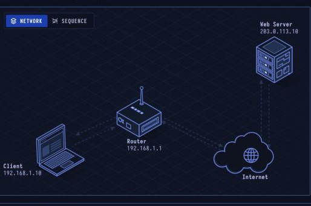

# IP — Addressing & Routing

> **Layer 3 · Network** | RFC 791 (IPv4), RFC 8200 (IPv6)

## What Is IP?

IP gives every device an address and moves packets from network to network. Each router looks only at the destination address to choose the **next hop**. IP is best effort: it doesn't promise delivery or order. TCP adds those on top.

| Property | Value |
|----------|-------|
| Layer | Network (Layer 3) |
| Address | 32 bits (IPv4), 128 bits (IPv6) |
| Header | 20–60 bytes (IPv4) |
| TTL | Lowered by 1 at each router |
| Delivery | Best effort |
| Defined In | RFC 791, RFC 8200 (IPv6) |

---

## Network Topology



The packet travels: Client → Router (NAT) → 11 internet routers → Web Server. Reply comes back via the same NAT translation.

---

## Step-by-Step Walkthrough

### Step 1 · Local or Not? — Subnet Check

The laptop is `192.168.1.10/24`, so its network is `192.168.1.0–255`. The destination `203.0.113.10` is **outside** that range → packet must go to the default gateway.

| | |
|--|--|
| Laptop | 192.168.1.10/24 |
| Local range | 192.168.1.0 – .255 |
| Gateway | 192.168.1.1 |

### Step 2 · Find the Router — ARP

On the local network, frames are delivered by **MAC address**, not IP. If the router's MAC isn't in the ARP cache, the laptop broadcasts:

```
Who has 192.168.1.1? Tell 192.168.1.10
→ Router replies: 192.168.1.1 is at aa:bb:cc:dd:ee:ff
```

| | |
|--|--|
| Protocol | ARP (Address Resolution Protocol) |
| Sent to | Broadcast (ff:ff:ff:ff:ff:ff) |
| Learns | Router's MAC address |

### Step 3 · Send the Packet

The IP header carries source/destination addresses, TTL, and the protocol inside (here: TCP).

```
IPv4 Header:
  Version:    4
  IHL:        20 bytes
  Src:        192.168.1.10
  Dst:        203.0.113.10
  TTL:        128  (Windows default; Linux/macOS use 64)
  Protocol:   6 (TCP)
```

### Step 4 · NAT, Then Hop by Hop

The home router performs **Network Address Translation (NAT)**:
- Rewrites source: `192.168.1.10:52344` → `198.51.100.7:40112`
- Notes the mapping in its NAT table
- Lowers TTL to 127
- Forwards to the internet

Then 11 more routers each choose the next hop by longest-prefix match and lower the TTL again.

| | |
|--|--|
| Routers | 12 each way (1 home + 11) |
| TTL at server | 116 (sent with 128) |
| Rewritten by NAT | Source out, destination back |

### Step 5 · The Reply Comes Back

The server answers to `198.51.100.7:40112`. The router looks that up in its NAT table, rewrites the destination back to `192.168.1.10:52344` and forwards it. The reply started at TTL 64 and arrives at the laptop with TTL 52.

---

## IPv4 Header

```
 0                   1                   2                   3
 0 1 2 3 4 5 6 7 8 9 0 1 2 3 4 5 6 7 8 9 0 1 2 3 4 5 6 7 8 9 0 1
+-+-+-+-+-+-+-+-+-+-+-+-+-+-+-+-+-+-+-+-+-+-+-+-+-+-+-+-+-+-+-+-+
|Version|  IHL  |Type of Service|          Total Length         |
+-+-+-+-+-+-+-+-+-+-+-+-+-+-+-+-+-+-+-+-+-+-+-+-+-+-+-+-+-+-+-+-+
|         Identification        |Flags|      Fragment Offset    |
+-+-+-+-+-+-+-+-+-+-+-+-+-+-+-+-+-+-+-+-+-+-+-+-+-+-+-+-+-+-+-+-+
|  Time to Live |    Protocol   |         Header Checksum       |
+-+-+-+-+-+-+-+-+-+-+-+-+-+-+-+-+-+-+-+-+-+-+-+-+-+-+-+-+-+-+-+-+
|                       Source Address                          |
+-+-+-+-+-+-+-+-+-+-+-+-+-+-+-+-+-+-+-+-+-+-+-+-+-+-+-+-+-+-+-+-+
|                    Destination Address                        |
+-+-+-+-+-+-+-+-+-+-+-+-+-+-+-+-+-+-+-+-+-+-+-+-+-+-+-+-+-+-+-+-+
|                    Options                    |    Padding    |
+-+-+-+-+-+-+-+-+-+-+-+-+-+-+-+-+-+-+-+-+-+-+-+-+-+-+-+-+-+-+-+-+
```

## Private IP Ranges (RFC 1918)

| Range | CIDR | Usage |
|-------|------|-------|
| 10.0.0.0–10.255.255.255 | /8 | Large organizations |
| 172.16.0.0–172.31.255.255 | /12 | Medium networks |
| 192.168.0.0–192.168.255.255 | /16 | Home/SOHO networks |

These are **not routable on the public internet** — NAT is required.

---

## Security Considerations

| Attack | Mechanism |
|--------|-----------|
| **IP Spoofing** | Forge source IP to impersonate a host or bypass IP-based filtering |
| **TTL manipulation** | Craft packets with low TTL to map network topology (traceroute) |
| **Fragmentation attacks** | Overlapping fragments to bypass firewalls that don't reassemble |
| **ARP spoofing** | Forge ARP replies to poison caches, enabling MITM on local network |
| **NAT traversal abuse** | Exploit NAT hole-punching for peer connections through firewalls |

**Useful commands:**

```bash
ip addr show             # show interfaces
ip route show            # show routing table
arp -n                   # show ARP cache
traceroute 203.0.113.10  # map hops with TTL probing
```
