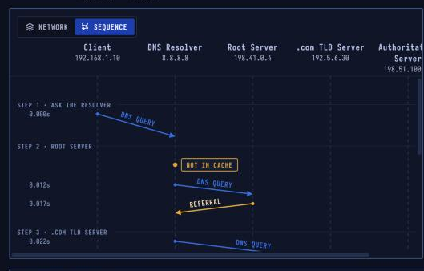

# DNS — Name Resolution

> **Layer 7 · Application** | Port `53` (UDP; TCP if response > 512B) | RFC 1034, RFC 1035

## What Is DNS?

DNS turns names like `www.example.com` into the IP addresses computers use to reach each other. No single server knows every name: the system is a **hierarchy of servers**, and answers are cached along the way so most lookups never have to go far.

| Property | Value |
|----------|-------|
| Layer | Application (Layer 7) |
| Port | 53, UDP (TCP if large) |
| Turns | Names into IP addresses |
| Hierarchy | Root → TLD → Authoritative |
| Caching | For each record's TTL |
| Defined In | RFC 1034, RFC 1035 |

---

## DNS Hierarchy

```
                    . (root)
                   /        \
               .com          .org
              /    \
      example.com  google.com
           |
     www.example.com  → 203.0.113.10
```

| Level | Server Type | Knows |
|-------|-------------|-------|
| Root | Root nameservers (13 names, 1000+ anycast) | Which servers handle each TLD |
| TLD | `.com`, `.org`, `.net` servers | Which nameservers each domain uses |
| Authoritative | Per-domain nameserver | Actual records for that domain |
| Recursive | Your ISP / Google 8.8.8.8 / Cloudflare 1.1.1.1 | Does the full lookup for you |

---

## Sequence Diagram



4 queries total: 1 from the laptop to the resolver, then 3 from the resolver (root → TLD → authoritative). Each level returns a referral until the authoritative server gives the final answer.

---

## Step-by-Step Walkthrough

### Step 1 · Ask the Resolver

The browser needs `www.example.com`'s IP. Neither it nor the OS has one cached. The laptop sends a query to `8.8.8.8` with the **RD (Recursion Desired)** flag set, asking it to do the whole lookup.

```
DNS Query:
  Question:  www.example.com   Type A
  Flags:     QR=0  RD=1
  Transport: UDP, port 53
```

### Step 2 · Root Server

The resolver's cache is empty. It asks a root server:

```
Resolver → Root: www.example.com A?
Root → Resolver: "I don't know, but try these .com servers:
                  a.gtld-servers.net (192.5.6.30)"
```

The root doesn't answer the actual question — it **refers** to the TLD server.

| | |
|--|--|
| Root servers | 13 names, 1,000+ anycast sites |
| Reply | Referral (13 .com servers) |

### Step 3 · .com TLD Server

```
Resolver → .com TLD: www.example.com A?
TLD → Resolver: "Try example.com's nameservers:
                 ns1.example.com (198.51.100.53)"
```

The TLD knows **which nameservers** each .com domain uses, but not the IP addresses themselves.

### Step 4 · Authoritative Server

Finally the resolver asks `example.com`'s own nameserver:

```
Resolver → Auth: www.example.com A?
Auth → Resolver: www.example.com  A  3600  203.0.113.10
                 (Authoritative bit set)
```

The domain owner set the TTL to **3600 seconds** (1 hour).

### Step 5 · Answer & Cache

The resolver sends the answer back and keeps a copy for 1 hour. The laptop caches it too. That's why the DNS step in the HTTP lesson took only 12 ms — the resolver already had it.

---

## DNS Record Types

| Type | Purpose | Example |
|------|---------|---------|
| A | IPv4 address | `www → 203.0.113.10` |
| AAAA | IPv6 address | `www → 2001:db8::1` |
| CNAME | Alias to another name | `blog → www.example.com` |
| MX | Mail exchanger | `example.com → mail.example.com` |
| TXT | Arbitrary text | SPF, DKIM, domain verification |
| NS | Nameservers for a domain | `example.com → ns1.example.com` |
| PTR | Reverse lookup (IP → name) | `10.113.0.203.in-addr.arpa → www` |
| SOA | Start of Authority | Zone serial, refresh, retry |
| SRV | Service location | `_https._tcp.example.com` |

---

## Security Considerations

| Attack | Mechanism |
|--------|-----------|
| **DNS Cache Poisoning** | Inject forged answers into resolver's cache (Kaminsky attack) |
| **DNS Amplification DDoS** | Spoofed ANY queries → large responses flood victim |
| **Zone Transfer (AXFR)** | Pull complete zone data if AXFR not restricted |
| **Subdomain Takeover** | Unclaimed CNAME target (e.g., deleted S3 bucket) hijacked |
| **DNS Tunneling** | Exfiltrate data encoded in DNS queries/responses |
| **NXDOMAIN hijacking** | ISP intercepts negative responses to redirect to ads |

```bash
# Enumerate DNS records
dig ANY example.com
dig AXFR example.com @ns1.example.com   # zone transfer attempt
nslookup -type=MX example.com

# Check DNSSEC
dig +dnssec example.com

# DNS over HTTPS
curl 'https://cloudflare-dns.com/dns-query?name=example.com&type=A' \
  -H 'Accept: application/dns-json'
```

**DNSSEC** signs zone data with public-key cryptography, preventing cache poisoning. Adoption is still partial — always verify before trusting.
