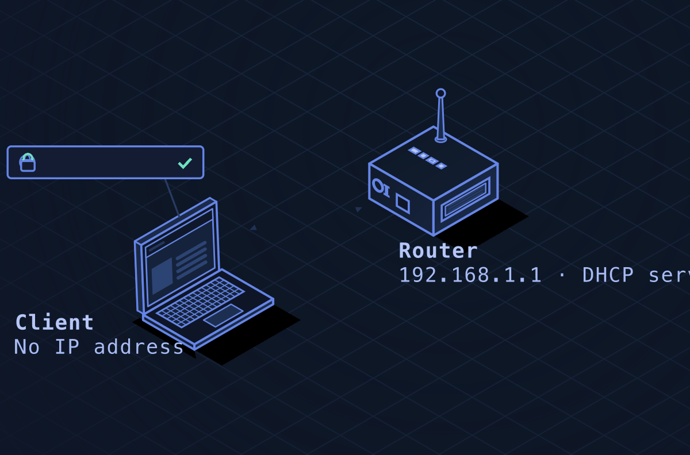
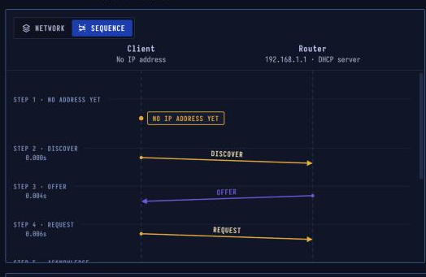

# DHCP — Getting an Address

> **Layer 7 · Application** | Ports `UDP 67` (server) / `68` (client) | RFC 2131, RFC 2132

## What Is DHCP?

DHCP hands a device everything it needs to use a network: an **IP address**, the subnet mask, the router to send traffic through and the DNS servers to ask. Addresses are **leased** for a set time and renewed while the device stays on the network.

| Property | Value |
|----------|-------|
| Layer | Application (Layer 7) |
| Ports | UDP 67 (server), 68 (client) |
| Hands out | IP, mask, gateway, DNS |
| Exchange | Discover → Offer → Request → Ack (DORA) |
| Lease | Renewed at half its time |
| Defined In | RFC 2131, RFC 2132 |

---


## Network Simulation


Watch the full DORA exchange: client broadcasts Discover with no IP, server offers an address, client requests it, server confirms — all four messages before the device has a working IP.

---

## Sequence Diagram



The **DORA** exchange — 4 messages to join a network. The client uses broadcast (no IP yet); the router's DHCP server responds with an offer; client accepts; server confirms.

---

## The DORA Exchange

### Step 1 · No Address Yet
The laptop has just connected. It has a MAC address built in, but no IP, no gateway, and no DNS server.

| | |
|--|--|
| IP address | None (uses 0.0.0.0) |
| MAC address | 00:00:5e:00:53:10 |
| Needs | IP, mask, gateway, DNS |

### Step 2 · DISCOVER — Broadcast to Everyone

Without an address, the laptop sends from `0.0.0.0` to broadcast `255.255.255.255`. Every device on the local network receives it. Only DHCP servers answer.

```
UDP: 0.0.0.0:68 → 255.255.255.255:67
DHCP DISCOVER:
  Client MAC:  00:00:5e:00:53:10
  Transaction: 0x3D1D
  Requested:   IP, subnet, router, DNS
```

### Step 3 · OFFER — Server Proposes an Address

The router's DHCP server picks a free address and offers it with the full settings. It goes directly to the client's MAC address.

```
UDP: 192.168.1.1:67 → 192.168.1.10:68
DHCP OFFER:
  Your IP:     192.168.1.10
  Subnet mask: 255.255.255.0
  Router:      192.168.1.1
  DNS:         8.8.8.8, 8.8.4.4
  Lease time:  86400s (24h)
```

### Step 4 · REQUEST — Accept Out Loud (Broadcast)

The laptop accepts the offer, still broadcasting — so any other DHCP server that made an offer learns it wasn't picked and can release its reserved address.

```
UDP: 0.0.0.0:68 → 255.255.255.255:67
DHCP REQUEST:
  Requested IP:  192.168.1.10
  Server ID:     192.168.1.1
```

### Step 5 · ACKNOWLEDGE — Address Confirmed

The server confirms. The laptop configures its interface. Many systems first check with **ARP** that no other device is already using the address (ARP probe).

```
UDP: 192.168.1.1:67 → 192.168.1.10:68
DHCP ACK:
  Your IP:     192.168.1.10
  Lease time:  86400s
```

| | |
|--|--|
| Address | 192.168.1.10/24 |
| Lease | 24 h, renewed at 12 h |

### Step 6 · RENEW — At Half Lease Time

12 hours later, the laptop sends a unicast REQUEST directly to the router to extend the lease. If the router doesn't answer, the laptop broadcasts at 87.5% of the lease time, then gives up and starts DORA again.

---

## DHCP Packet Fields

| Field | Size | Description |
|-------|------|-------------|
| op | 1 B | 1=request, 2=reply |
| htype | 1 B | Hardware type (1=Ethernet) |
| hlen | 1 B | Hardware address length (6 for MAC) |
| xid | 4 B | Transaction ID (random, links request to reply) |
| ciaddr | 4 B | Client IP (0.0.0.0 if unknown) |
| yiaddr | 4 B | Your IP (offered address) |
| siaddr | 4 B | Server IP |
| chaddr | 16 B | Client hardware address (MAC) |
| options | var | Message type, lease time, parameters |

---

## Security Considerations

| Attack | Mechanism |
|--------|-----------|
| **DHCP Starvation** | Flood server with DISCOVER messages (fake MACs) to exhaust the IP pool |
| **Rogue DHCP Server** | Respond to DISCOVER faster than legitimate server; set attacker-controlled gateway/DNS |
| **DHCP Snooping bypass** | On managed switches, test if snooping blocks untrusted DHCP server responses |
| **IP Spoofing via DHCP** | Claim another host's IP after it expires |

**Defense:**
- **DHCP Snooping** (switch feature) — only allow DHCP replies from trusted ports
- **Dynamic ARP Inspection (DAI)** — validate ARP packets against DHCP snooping table
- **Static DHCP bindings** — tie MAC to specific IP

```bash
# View DHCP leases on Linux router (ISC-DHCP)
cat /var/lib/dhcp/dhcpd.leases

# See current DHCP config on client
ip addr show
cat /etc/resolv.conf
```
