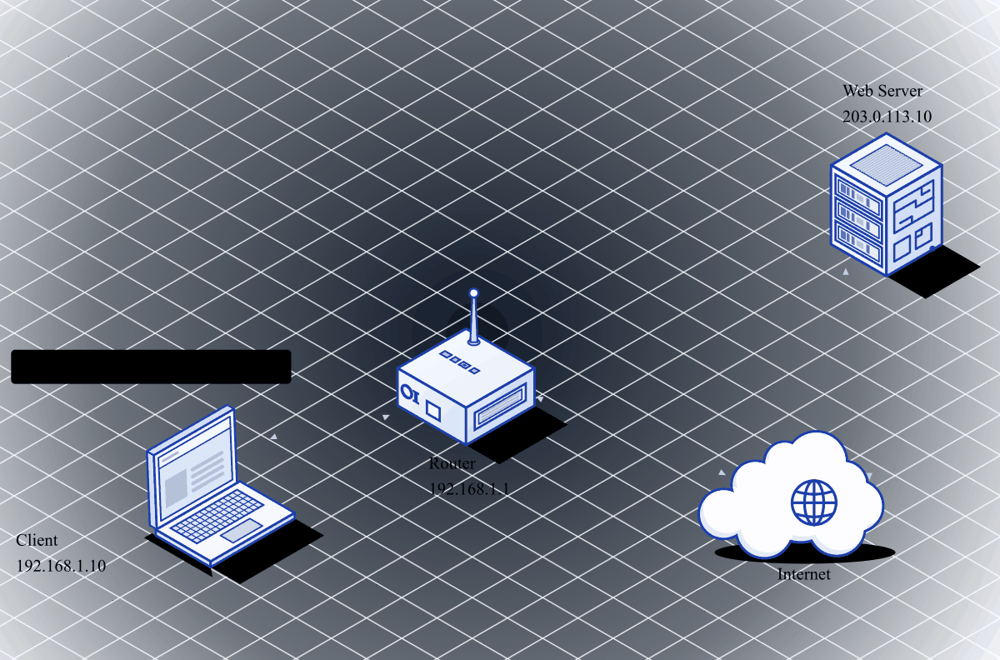
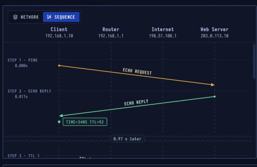

# ICMP — Network Diagnostics

> **Layer 3 · Network** | Carried in IP (Protocol 1) | RFC 792 (IPv6: RFC 4443)

## What Is ICMP?

ICMP is how the network reports back: a router says a packet's time ran out, a server says nothing is listening on a port. Tools like **ping** and **traceroute** are built from these messages. It travels inside IP but carries no application data.

| Property | Value |
|----------|-------|
| Layer | Network (Layer 3) |
| Carried in | IP (protocol 1) |
| Messages | A type and a code |
| Tools | ping, tracert / traceroute |
| Often | Filtered by firewalls |
| Defined In | RFC 792 (IPv6: RFC 4443) |

---


## Network Simulation


Ping: ICMP echo request travels from client to server, server echoes it back, TTL-exceeded messages surface unreachable hops.

---

## Sequence Diagram



ping sends an echo request (type 8), gets an echo reply (type 0) back. The TTL-based traceroute probes are shown below that — each hop's router sends "Time Exceeded" (type 11).

---

## ICMP Message Types

| Type | Code | Name | Triggered By |
|------|------|------|-------------|
| 0 | 0 | Echo Reply | Response to ping |
| 3 | 0 | Dest Unreachable: Net | No route to network |
| 3 | 1 | Dest Unreachable: Host | No route to host |
| 3 | 3 | Dest Unreachable: Port | Nothing listening on port |
| 8 | 0 | Echo Request | ping sends this |
| 11 | 0 | Time Exceeded: TTL | TTL hit 0 at a router (traceroute) |
| 12 | 0 | Parameter Problem | Bad IP header |

---

## Step-by-Step Walkthrough

### Step 1 · ping — Echo Request

`ping -n 1 203.0.113.10` sends one ICMP echo request (plain `ping` sends 4):

```
ICMP Echo Request:
  Type: 8  Code: 0
  Identifier: 0x0001
  Sequence:   1
  Data:       32 bytes of filler (Windows default)
  TTL:        128
```

| | |
|--|--|
| Type, code | 8, 0 (echo request) |
| Data | 32 bytes (Windows) |
| TTL | 128 |

### Step 2 · Echo Reply

The server's OS answers by itself — no application needed:

```
ICMP Echo Reply:
  Type: 0  Code: 0
  Identifier: 0x0001  (same)
  Sequence:   1       (same)
  Data:       same 32 bytes back
```

Output: `bytes=32 time=34ms TTL=52`

The TTL 52 means: server sent with TTL 64, 12 routers decremented it, arrived with 52.

| | |
|--|--|
| Round trip | 34 ms |
| Reply TTL | 52 (64 − 12 routers) |
| Path | 12 routers, server at hop 13 |

### Step 3 · traceroute — TTL=1

`ping -n 1 -i 1` (or `tracert`) sends with TTL=1. The home router decrements it to 0, drops the packet, and sends back **Time Exceeded**:

```
ICMP Time Exceeded:
  Type: 11  Code: 0
  From: 192.168.1.1  (home router)
  
Output: "Reply from 192.168.1.1: TTL expired in transit."
```

### Step 4 · TTL=2, TTL=3, ...

Each probe increases the TTL by 1, revealing the next router. At TTL=13, the packet finally reaches the destination server, which responds with a normal echo reply.

```
traceroute output:
  Hop  1: 192.168.1.1   (home router)         1 ms
  Hop  2: 198.51.100.1  (ISP edge)             8 ms
  Hop  3: ...
  Hop 13: 203.0.113.10  (destination)         34 ms
```

### Step 5 · Port Unreachable

If an app sends a UDP datagram to a port where nothing is listening, the OS sends back:

```
ICMP Destination Unreachable:
  Type: 3  Code: 3 (Port Unreachable)
  Includes: first 8 bytes of original UDP datagram
```

Many firewalls **drop** such packets silently instead of replying — that's why a port scan sees "open|filtered" for UDP.

---

## Security Considerations

| Attack | Mechanism |
|--------|-----------|
| **Ping Flood** | Overwhelm target with echo requests (ICMP flood) |
| **Smurf Attack** | Spoof victim's IP as source of broadcast echo request; all hosts reply to victim |
| **ICMP Redirect** | Forge redirect messages to change victim's routing table |
| **ICMP Tunneling** | Encode data in echo request/reply payload to bypass firewalls |
| **Path MTU Discovery exploit** | Craft oversized packets to cause fragmentation |

```bash
# Basic connectivity
ping -c 4 203.0.113.10

# Map route
traceroute 203.0.113.10        # Linux/macOS
tracert 203.0.113.10           # Windows

# Detect ICMP filtering
ping -c 1 203.0.113.10 && echo "ICMP allowed" || echo "ICMP blocked"

# ICMP tunneling (tool: icmptunnel, ptunnel)
# Firewalls that allow ping can often be used to exfiltrate data
```
