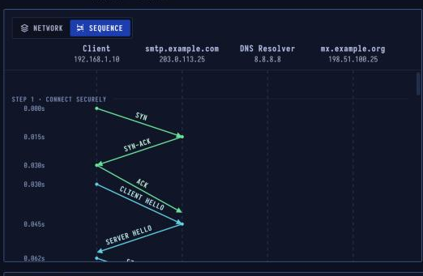

# SMTP — Sending Email

> **Layer 7 · Application** | Ports `465`/`587` (submit), `25` (relay) | RFC 5321, RFC 6409

## What Is SMTP?

SMTP moves email: from your mail app to your provider's server, and from that server to the recipient's. It is a conversation of short text commands, each answered with a **three-digit reply code**. Reading mail is a different job, done with IMAP or POP3.

| Property | Value |
|----------|-------|
| Layer | Application (Layer 7) |
| Ports | 465/587 submit, 25 relay |
| Transport | TCP, usually with TLS |
| Commands | EHLO, MAIL, RCPT, DATA |
| Replies | 2xx ok, 3xx go on, 4/5xx error |
| Defined In | RFC 5321, RFC 6409 |

---

## Sequence Diagram



The sequence shows Alice's client connecting to `smtp.example.com:465` (TLS from start), authenticating, sending the message, then Alice's provider relaying to Bob's server `mx.example.org:25` (STARTTLS upgrade).

---

## Two-Hop Email Delivery

```
Alice's mail app
      ↓  port 465, TLS (SMTPS)
Alice's provider (smtp.example.com)
      ↓  port 25, STARTTLS (SMTP relay)
Bob's mail server (mx.example.org)
      ↓  stored in mailbox
Bob fetches via IMAP/POP3
```

---

## Step-by-Step Walkthrough

### Step 1 · Connect Securely — Port 465

Alice's app connects to `smtp.example.com:465`. On this port TLS starts **immediately**, so the whole SMTP conversation (including her password) is encrypted.

```
TCP: 192.168.1.10 → smtp.example.com:465
TLS handshake (ClientHello, ServerHello, Certificate, Finished)
```

### Step 2 · Greeting & Login

```
S: 220 smtp.example.com ESMTP Postfix
C: EHLO laptop.local
S: 250-smtp.example.com
   250-PIPELINING
   250-SIZE 10240000
   250-AUTH PLAIN LOGIN
   250 STARTTLS

C: AUTH PLAIN AGFsaWNlAHNlY3JldA==   (base64: alice:secret)
S: 235 2.7.0 Authentication successful
```

### Step 3 · Send the Message

**MAIL FROM** and **RCPT TO** are the envelope (not the visible From/To headers). After `354`, the message follows, ended by a line with just `.`.

```
C: MAIL FROM:<alice@example.com>
S: 250 Ok

C: RCPT TO:<bob@example.org>
S: 250 Ok

C: DATA
S: 354 End data with <CR LF>.<CR LF>

C: From: Alice <alice@example.com>
   To: Bob <bob@example.org>
   Subject: Hello
   Date: Mon, 03 Nov 2026 10:00:00 +0000
   MIME-Version: 1.0
   Content-Type: text/plain

   Hi Bob!
   .

S: 250 Ok: queued as ABC123
```

### Step 4 · Find Bob's Server — MX Lookup

Alice's provider needs to deliver to `example.org`. It queries DNS:

```
DNS MX example.org → mx.example.org (priority 10)
DNS A mx.example.org → 198.51.100.25
```

### Step 5 · Server-to-Server Relay — Port 25 + STARTTLS

```
TCP: smtp.example.com → mx.example.org:25

S: 220 mx.example.org ESMTP
C: EHLO smtp.example.com
S: 250-STARTTLS
   250 ...

C: STARTTLS
S: 220 Go ahead
[TLS handshake]
```

After STARTTLS, the SMTP conversation repeats inside TLS.

### Step 6 · Deliver — With Authentication Headers

```
MAIL FROM:<alice@example.com>
RCPT TO:<bob@example.org>
DATA
...
DKIM-Signature: v=1; a=rsa-sha256; d=example.com; ...
Received: from smtp.example.com by mx.example.org
...
```

Bob's server checks **SPF**, **DKIM**, and **DMARC** before accepting.

---

## Email Authentication (Anti-Spam)

| Standard | Mechanism | What it checks |
|----------|-----------|----------------|
| **SPF** | DNS TXT record lists authorized sending IPs | Is the sending IP allowed by the domain? |
| **DKIM** | Cryptographic signature on message headers | Was the message signed by the sending domain? |
| **DMARC** | Policy: what to do if SPF/DKIM fail | Quarantine or reject failing messages |

```dns
# SPF record
example.com TXT "v=spf1 ip4:198.51.100.0/24 include:sendgrid.net ~all"

# DMARC record
_dmarc.example.com TXT "v=DMARC1; p=reject; rua=mailto:dmarc@example.com"
```

---

## Security Considerations

| Attack | Mechanism |
|--------|-----------|
| **Open relay** | SMTP server forwards mail from/to anyone — used for spam |
| **Header injection** | CR+LF in user-controlled fields adds extra headers |
| **STARTTLS stripping** | MITM removes STARTTLS capability from EHLO response |
| **Credential brute force** | AUTH against port 587 — rate limit and fail2ban |
| **Email spoofing** | Forged From header without SPF/DKIM/DMARC |
| **Reply-To phishing** | Legitimate From, malicious Reply-To |

```bash
# Test SMTP manually
openssl s_client -connect smtp.example.com:465

# Verify SPF record
dig TXT example.com

# Check if relay is open
telnet smtp.example.com 25
EHLO test
MAIL FROM:<external@attacker.com>
RCPT TO:<victim@otherdomain.com>
```
