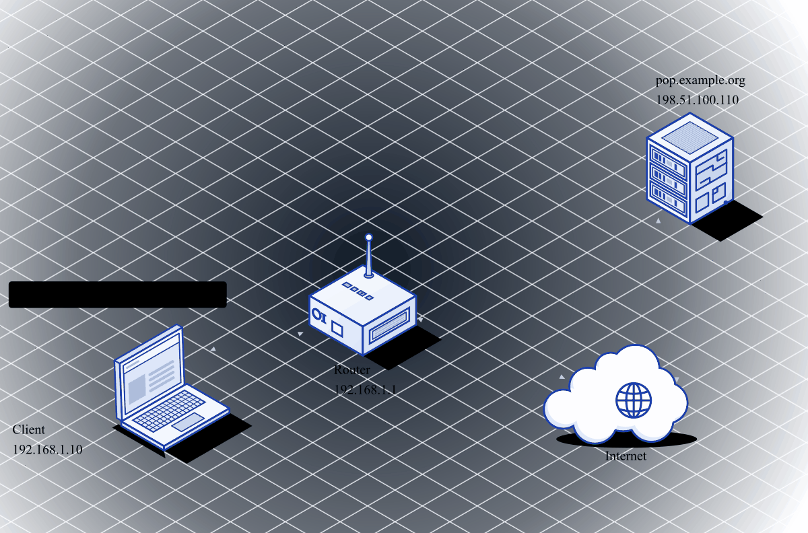
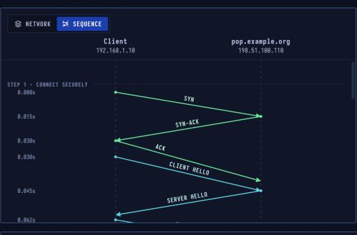
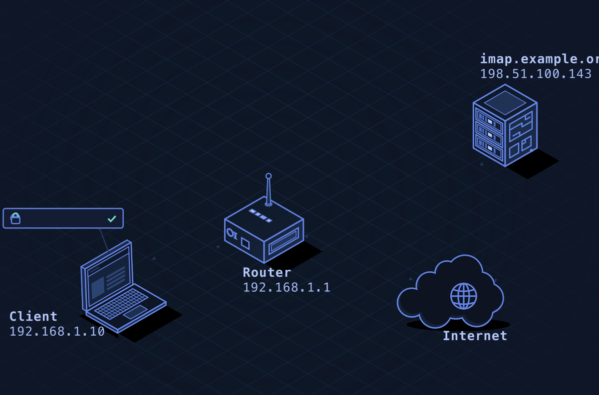
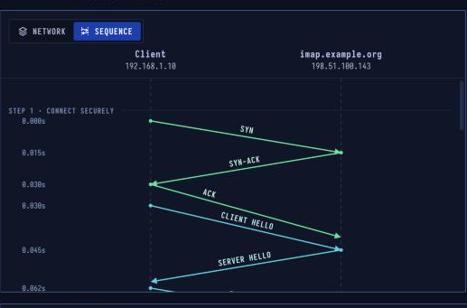

# POP3 & IMAP — Reading Email


## Network Simulation


POP3 download: connect on port 110, USER/PASS login, LIST to see messages, RETR to download each one, then DELE to remove from server.

---

## POP3 — Post Office Protocol v3

> **Layer 7 · Application** | Ports `995` (TLS), `110` (STLS) | RFC 1939

### What Is POP3?

POP3 lets a mail app download messages from a mailbox on a server. It was designed for **one device** that fetches mail and then removes it from the server. Commands are short words, and every reply starts with `+OK` or `-ERR`.

| Property | Value |
|----------|-------|
| Layer | Application (Layer 7) |
| Ports | 995 (TLS), 110 (STLS) |
| Transport | TCP |
| Model | Download, then delete |
| Replies | +OK or -ERR |
| Defined In | RFC 1939 |

### POP3 Sequence Diagram



Secure connect (port 995, TLS), login, check mailbox (STAT), list messages, retrieve message 1 (RETR 1), mark for deletion (DELE 1), quit (QUIT — deletion happens here).

### POP3 Session

```
TCP: 192.168.1.10 → pop.example.org:995
[TLS handshake]

S: +OK Dovecot ready.

C: USER bob
S: +OK

C: PASS secret123
S: +OK Logged in.

C: STAT
S: +OK 2 5120    (2 messages, 5120 bytes total)

C: LIST
S: +OK 2 messages:
   1 1904
   2 3216
   .

C: RETR 1
S: +OK 1904 octets
   From: Alice <alice@example.com>
   Subject: Hello
   ...
   .

C: DELE 1
S: +OK Marked to be deleted.

C: QUIT
S: +OK Logging out, deleted 1 messages.
```

**Key behavior:** `DELE` only marks — the server removes at `QUIT`. If the connection drops before `QUIT`, nothing is deleted.

### POP3 Limitations
- Downloads mail locally and deletes from server
- No folder sync across devices
- No server-side search
- If you use two devices, only one gets each message

---


## Network Simulation


IMAP sync: connect on port 143, LOGIN, SELECT INBOX, FETCH headers then body parts — messages stay on server so every device sees the same mailbox.

---

## IMAP — Internet Message Access Protocol

> **Layer 7 · Application** | Ports `993` (TLS), `143` (STARTTLS) | RFC 9051, RFC 3501

### What Is IMAP?

IMAP lets mail apps work with a mailbox that **stays on the server**. Folders, read/flagged marks and deletions are kept there, so a phone, a laptop and webmail all see the same mailbox. The server can also push new mail to an app as it arrives.

| Property | Value |
|----------|-------|
| Layer | Application (Layer 7) |
| Ports | 993 (TLS), 143 (STARTTLS) |
| Transport | TCP |
| Model | Mail stays on the server |
| Syncs | Folders and flags |
| Defined In | RFC 9051, RFC 3501 |

### IMAP Sequence Diagram



Connect (port 993, TLS), login with tagged command, SELECT INBOX, FETCH message 2 (sets `\Seen` on server), IDLE to wait for new mail push.

### IMAP Session

```
TCP: 192.168.1.10 → imap.example.org:993
[TLS handshake]

S: * OK [CAPABILITY IMAP4rev1 IDLE UIDPLUS] Service ready

C: a1 LOGIN bob secret123
S: a1 OK LOGIN completed

C: a2 SELECT INBOX
S: * 2 EXISTS
   * 0 RECENT
   * OK [UNSEEN 2] Message 2 is first unseen
   a2 OK [READ-WRITE] SELECT completed

C: a3 FETCH 2 BODY[]
S: * 2 FETCH (BODY[] {4096}
   From: Alice <alice@example.com>
   Subject: Re: Hello
   ...
   )
   a3 OK FETCH completed

C: a4 IDLE
S: + idling
   ...42 seconds later...
   * 3 EXISTS         ← server pushes new mail notification
   * 3 RECENT

C: DONE
S: a4 OK IDLE terminated

C: a5 FETCH 3 BODY[]
S: ...new message...
```

### Tagged Commands

Every IMAP command starts with a **client-chosen tag** (`a1`, `a2`, ...). The server ends its response with the same tag. This allows multiple commands to be **in flight simultaneously** (pipelining).

Lines starting with `*` are **untagged data** (server push, counters, flags).

---

## POP3 vs IMAP Comparison

| Feature | POP3 | IMAP |
|---------|------|------|
| Mail location | Downloaded locally | Stays on server |
| Multi-device | Poor (one device gets each email) | Excellent (all in sync) |
| Offline access | Yes (after download) | Partial (needs server for new mail) |
| Folder support | No | Yes |
| Server-side search | No | Yes (`SEARCH`) |
| New mail notification | Poll only | IDLE push |
| Bandwidth | Low (download once) | Higher (headers + on-demand body) |
| Use case | Single device, offline | Multiple devices, always-on |

---

## Security Considerations

| Attack | Mechanism |
|--------|-----------|
| **Credential brute force** | POP3/IMAP login over port 110/143 without rate limiting |
| **STARTTLS stripping** | MITM removes `STARTTLS` capability, forcing plaintext |
| **Password exposure** | Port 110/143 without TLS: credentials in plaintext |
| **Mail harvesting** | IMAP folder enumeration via `LIST` command |
| **IDLE abuse** | Keep persistent connections for state tracking |

```bash
# Manual IMAP test
openssl s_client -connect imap.example.org:993
a1 LOGIN user@example.org password
a2 LIST "" "*"
a3 SELECT INBOX
a4 FETCH 1 ENVELOPE
a5 LOGOUT

# Manual POP3 test
openssl s_client -connect pop.example.org:995
USER user@example.org
PASS password
STAT
LIST
RETR 1
QUIT
```
