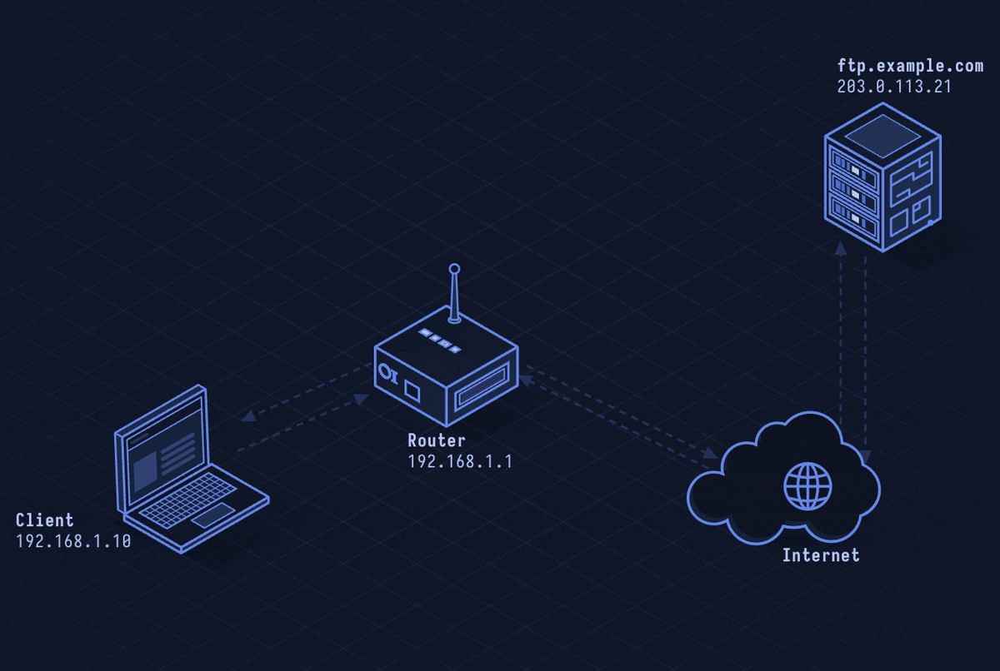
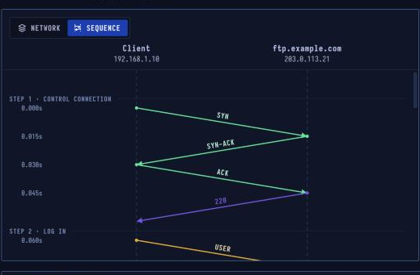

# FTP — Transferring Files

> **Layer 7 · Application** | Ports `21` (control), data port varies | RFC 959

## What Is FTP?

FTP moves files between a client and a server. It is unusual in using **two TCP connections**: one for commands and replies, and a fresh one for each file or listing. It dates from the early 1970s and sends everything — passwords included — as **plain text**.

| Property | Value |
|----------|-------|
| Layer | Application (Layer 7) |
| Ports | 21 control, data port varies |
| Connections | Control + one per transfer |
| Encryption | None (plain text) |
| Safer options | SFTP, or FTPS (FTP + TLS) |
| Defined In | RFC 959 |

---


## Network Simulation


Two connections in action: control channel (port 21) carries commands, a separate passive data channel opens for each file transfer.

---

## Sequence Diagram



Control connection to port 21, login (USER/PASS in plaintext), PASV to get data port, second TCP connection for the file transfer, file arrives, QUIT.

---

## The Two-Connection Model

```
Client ←→ Server:21   (Control connection — stays open whole session)
Client ←→ Server:50069 (Data connection — per file/listing)
```

The data connection carries the actual file bytes and directory listings. It opens fresh for each transfer and closes when the transfer ends.

---

## Step-by-Step Walkthrough

### Step 1 · Control Connection — Port 21

```
TCP: 192.168.1.10 → ftp.example.com:21

S: 220 (vsFTPd 3.0.5)
```

This connection carries commands and replies for the whole session. Like SMTP, every reply starts with a three-digit code.

### Step 2 · Login — Credentials in Plaintext

```
C: USER alice
S: 331 Please specify the password.

C: PASS secret
S: 230 Login successful.
```

The user name and password cross every network as **readable text**. Anyone sniffing the connection (ISP, same Wi-Fi, compromised router) sees them.

### Step 3 · Passive Mode — Get a Data Port

```
C: TYPE I       (binary transfer)
S: 200 Switching to Binary mode.

C: PASV
S: 227 Entering Passive Mode (203,0,113,21,195,149)
```

The reply encodes address and port: `195 × 256 + 149 = 50069`. The client connects **out** to that port — this works through NAT (unlike active mode where the server dials back in).

| | |
|--|--|
| Reply | 227 (203,0,113,21,195,149) |
| Data port | 195 × 256 + 149 = **50069** |
| Active mode | Server dials in — NAT blocks it |

### Step 4 · Data Connection

```
TCP: 192.168.1.10 → ftp.example.com:50069  (new connection)

C: RETR report.pdf       (on control connection)
S: 150 Opening BINARY mode data connection.
[file bytes stream on data connection]
S: 226 Transfer complete.
```

### Step 5 · File Arrives

The data connection closes when the transfer ends — the closing of the connection signals end-of-file. No explicit size header needed.

### Step 6 · Quit

```
C: QUIT
S: 221 Goodbye.
```

For anything sensitive, use **SFTP** (SSH File Transfer Protocol, runs over SSH) or **FTPS** (FTP inside TLS).

---

## Active vs Passive Mode

| Mode | Who opens data connection | NAT-friendly? |
|------|--------------------------|--------------|
| **Active** | Server connects back to client | ❌ No (client NAT blocks incoming) |
| **Passive** | Client connects to server | ✅ Yes |

Active mode: client tells server `PORT 192,168,1,10,200,52` → server dials `200×256+52 = 51252` on the client. Broken by most NAT/firewalls.

---

## FTP Reply Codes

| Code | Meaning |
|------|---------|
| 220 | Service ready |
| 230 | User logged in |
| 150 | Opening data connection |
| 226 | Transfer complete |
| 331 | Password required |
| 425 | Can't open data connection |
| 530 | Not logged in |
| 550 | File not found / access denied |

---

## Security Considerations

| Risk | Description |
|------|-------------|
| **Plaintext credentials** | Username + password visible on the wire |
| **Plaintext data** | Files transferred in clear — no confidentiality |
| **FTP Bounce attack** | Use PORT command to make server connect to third-party host (largely mitigated in modern servers) |
| **Anonymous FTP** | Misconfigured servers allow `anonymous:anything` login |
| **Passive port range** | Server opens many ports — firewall rules must allow them |

```bash
# Secure alternatives
sftp user@server                   # SSH-based, encrypted
ftps: use lftp or FileZilla with FTPS mode

# Check if anonymous FTP is allowed
ftp ftp.example.com
Name: anonymous
Password: test@test.com

# SFTP commands
sftp user@server
sftp> ls
sftp> get file.txt
sftp> put upload.txt
sftp> exit
```
