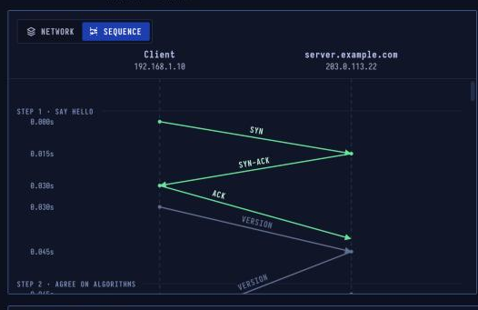

# SSH — Secure Remote Login

> **Layer 7 · Application** | Port `22` | RFC 4251–4254

## What Is SSH?

SSH gives you an encrypted, authenticated connection to another computer, to run commands on it, copy files (SFTP, scp) or carry other connections. The server proves who it is with a **host key**; you prove who you are with a **key pair** or a password.

| Property | Value |
|----------|-------|
| Layer | Application (Layer 7) |
| Port | 22 |
| Transport | TCP |
| Server proves | Host key (known_hosts) |
| You prove | Key pair or password |
| Defined In | RFC 4251 – 4254 |

---


## Network Simulation


Secure shell setup: algorithm negotiation, server host-key verification, Diffie-Hellman key exchange, then an encrypted authenticated session.

---

## Sequence Diagram



TCP handshake → version exchange (plain text) → KEXINIT → key exchange (hybrid post-quantum) → NEWKEYS (encryption on) → login with key pair → open channel → command.

---

## Step-by-Step Walkthrough

### Step 1 · Say Hello — Version Exchange

After the TCP handshake on port 22, each side sends **one line of plain text** naming the SSH version and its software. Everything else is binary.

```
Client → Server: SSH-2.0-OpenSSH_for_Windows_9.5
Server → Client: SSH-2.0-OpenSSH_9.6p1 Ubuntu-3ubuntu13.5
```

| | |
|--|--|
| Protocol | SSH-2.0 |
| Laptop | OpenSSH_for_Windows_9.5 |
| Server | OpenSSH_9.6p1 Ubuntu |

### Step 2 · Agree on Algorithms — KEXINIT

Each side sends a **KEXINIT** message listing every algorithm it supports:

```
Algorithms offered (client):
  Key exchange:   sntrup761x25519-sha512, curve25519-sha256, ...
  Host key:       ssh-ed25519, rsa-sha2-512, ...
  Encryption:     chacha20-poly1305, aes256-ctr, ...
  MAC:            umac-128, hmac-sha2-256, ...
  Compression:    none, zlib
```

The **first algorithm on the client's list that the server also supports** is chosen in each category.

| | |
|--|--|
| Key exchange | sntrup761x25519-sha512 |
| Host key | ssh-ed25519 |
| Cipher | chacha20-poly1305 |

### Step 3 · Key Exchange — Hybrid Post-Quantum

The client sends its half of a **hybrid exchange**: a Streamlined NTRU Prime key (quantum-resistant) + an X25519 key (classical). The server answers with its half, its host key and a **signature** over the exchange.

```
Client → Server: ECDH_INIT  (sntrup761 pubkey + X25519 pubkey)
Server → Client: ECDH_REPLY (server pubkey + server host pubkey + signature)
                 NEWKEYS     ← encryption switches on
Client → Server: NEWKEYS
```

The client checks the server's host key against `~/.ssh/known_hosts`. On first connection it shows the fingerprint and asks to confirm (TOFU — Trust On First Use).

**NEWKEYS** switches encryption on. Everything from here is encrypted and authenticated.

### Step 4 · Log In with a Key — Sign, Don't Send a Secret

The server lists the login methods it accepts. For public key auth:

```
Client → Server: USERAUTH_REQUEST  method=publickey  alg=ssh-ed25519  pubkey=<Alice's public key>
Server → Client: USERAUTH_PK_OK    (yes, I'd accept that key)
Client → Server: USERAUTH_REQUEST  method=publickey  alg=ssh-ed25519  pubkey=<key>  sig=<signature>
Server → Client: USERAUTH_SUCCESS
```

The private key **never leaves the client**. The server checks the signature against `~/.ssh/authorized_keys`.

### Step 5 · Open a Session Channel

One SSH connection can carry **many channels**: a shell, file transfers, forwarded ports. The client opens a session channel:

```
Client → Server: CHANNEL_OPEN  type=session
Server → Client: CHANNEL_OPEN_CONFIRMATION
Client → Server: CHANNEL_REQUEST  type=pty-req  (request a terminal)
Client → Server: CHANNEL_REQUEST  type=shell    (request a shell)
Server → Client: CHANNEL_SUCCESS
Server → Client: [welcome text, shell prompt]
```

### Step 6 · Type a Command

```
Client → Server: CHANNEL_DATA  "p\r"
Client → Server: CHANNEL_DATA  "w\r"
Client → Server: CHANNEL_DATA  "d\r"
Client → Server: CHANNEL_DATA  "\r"  (enter)
Server → Client: CHANNEL_DATA  "pwd\r\n/home/alice\r\n$ "
```

Since OpenSSH 9.5, keystrokes are sent on a **20 ms beat** with decoy packets added, making typing rhythm harder to read from timing.

---

## SSH Architecture

```
SSH Transport Layer (RFC 4253)
  ├── Version exchange
  ├── Algorithm negotiation
  ├── Key exchange
  └── Encryption + integrity

SSH User Authentication Layer (RFC 4252)
  ├── Password auth
  ├── Public key auth
  └── GSSAPI, keyboard-interactive

SSH Connection Layer (RFC 4254)
  ├── Session channels (shell, exec, subsystem)
  ├── TCP/IP forwarding channels
  └── X11 forwarding channels
```

## Key Types

| Type | Algorithm | Notes |
|------|-----------|-------|
| `id_ed25519` | Ed25519 | Recommended — fast, small, secure |
| `id_rsa` | RSA-4096 | Still common, larger keys |
| `id_ecdsa` | ECDSA P-256 | Good but weaker than Ed25519 |
| Host key | `ssh-ed25519`, `rsa-sha2-512` | Verified against `known_hosts` |

---

## Security Considerations

| Attack | Mechanism |
|--------|-----------|
| **Brute force password** | Automated login attempts on port 22 — use fail2ban, keys only |
| **Weak host key acceptance** | TOFU bypassed by MITM on first connect |
| **Old KEX algorithms** | `diffie-hellman-group1-sha1` (1024-bit) is broken |
| **Private key theft** | Unencrypted key on disk or in backup |
| **SSH tunneling** | SSH used to bypass firewalls by tunneling other protocols |
| **Authorized_keys persistence** | Backdoor by adding attacker's pubkey to `~/.ssh/authorized_keys` |

```bash
# Key generation
ssh-keygen -t ed25519 -C "alice@example.com"

# Copy public key to server
ssh-copy-id user@server

# Check server's host key fingerprint
ssh-keyscan -t ed25519 server | ssh-keygen -lf -

# Port forwarding (tunnel)
ssh -L 8080:internal-server:80 user@jumphost   # local forward
ssh -R 8080:localhost:80 user@public-server     # remote forward
ssh -D 1080 user@server                          # SOCKS proxy

# Check active sessions
who
w
last
```
