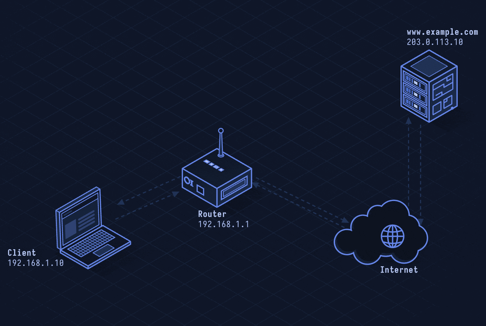
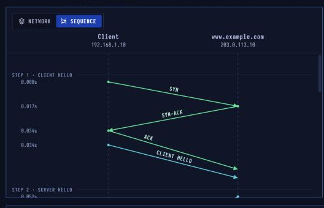

# TLS/SSL — Encryption Explained

> **Layer 6 · Presentation** | Port: app's own (443, 993, ...) | RFC 8446 (TLS 1.3)

## What Is TLS?

TLS puts a secure channel on top of TCP. It **proves the server's identity** with a certificate, **agrees on fresh keys**, then encrypts and authenticates everything sent. HTTPS, secure email and many other protocols run inside it. SSL was the name of its predecessor.

| Property | Value |
|----------|-------|
| Sits | Between TCP and the app layer |
| OSI layer | Often placed at 6 (Presentation) |
| Current | TLS 1.3 (RFC 8446) |
| Retired | SSL 2 and 3, TLS 1.0 and 1.1 |
| Proves | Server identity (certificate) |
| Port | The app's own (443, 993 …) |

---


## Network Simulation


TLS 1.3 handshake in one round trip: ClientHello with key share, ServerHello with certificate, server Finished, client Finished, then encrypted application data.

---

## Sequence Diagram



TLS 1.3 completes in **one round trip**: ClientHello → ServerHello+Certificate+Finished → client Finished → then encrypted data flows.

---

## TLS 1.3 Handshake (1 RTT)

```
Client                                Server

TCP SYN     ─────────────────────────►
            ◄─────────────────────── SYN-ACK
TCP ACK     ─────────────────────────►

ClientHello ─────────────────────────►
  supported versions: TLS 1.3, TLS 1.2
  cipher suites: TLS_AES_128_GCM_SHA256, ...
  key shares: X25519MLKEM768, X25519
  SNI: www.example.com
  ALPN: h2, http/1.1
                        ◄─────────── ServerHello
                                       chosen: TLS 1.3
                                       chosen: TLS_AES_128_GCM_SHA256
                                       key share: X25519MLKEM768
                        ◄─────────── {Certificate}        🔒 encrypted
                        ◄─────────── {CertificateVerify}  🔒
                        ◄─────────── {Finished}            🔒

{Finished}  ─────────────────────────►  🔒
{GET / HTTP/1.1} ────────────────────►  🔒 ← application data flows
                        ◄─────────── {200 OK ...}          🔒
```

---

## Step-by-Step Walkthrough

### Step 1 · ClientHello — Everything the Browser Supports

After the TCP handshake, the browser sends ClientHello listing what it can do:

```
TLS 1.3 ClientHello:
  Versions:     TLS 1.3, TLS 1.2
  Ciphers:      TLS_AES_128_GCM_SHA256
                TLS_AES_256_GCM_SHA384
                TLS_CHACHA20_POLY1305_SHA256
  Key shares:   X25519MLKEM768  (post-quantum hybrid)
                X25519
  SNI:          www.example.com   ← server name (visible in plaintext)
  ALPN:         h2, http/1.1
```

| | |
|--|--|
| Versions | TLS 1.3, TLS 1.2 |
| Key shares | X25519MLKEM768, X25519 |
| SNI, ALPN | www.example.com; h2, http/1.1 |

### Step 2 · ServerHello — Choices Made, Keys Computed

The server picks TLS 1.3, the cipher suite and the hybrid group, and sends its own key share. From the two shares, **both sides independently compute the same session secret** — it never crosses the network.

```
ServerHello:
  Version:  TLS 1.3
  Cipher:   TLS_AES_128_GCM_SHA256
  Group:    X25519MLKEM768
  Key share: [server's half]
```

**Everything after this is encrypted.**

### Step 3 · Certificate — Who the Server Is, Proven

Still in the same flight (encrypted now):

```
Certificate:
  Leaf:         site cert (www.example.com, RSA-2048)
  Intermediate: CA's intermediate cert
  Root:         (sent sometimes, but browser has it already)

CertificateVerify:
  sig = RSA-sign(private key, hash of all handshake messages)
```

The browser verifies:
1. Certificate chain leads to a trusted root CA
2. Certificate covers `www.example.com` (CN or SAN)
3. Certificate is not expired or revoked (OCSP)
4. `CertificateVerify` signature is valid

### Step 4 · Finished — One Round Trip, Then Data

The server sends `Finished`: a **verify_data** value over all handshake messages, keyed with the session secret. Any tampering with the hellos would change this value.

The browser sends its own `Finished`, then immediately sends the first HTTP request — same flight.

| | |
|--|--|
| Setup | 1 round trip (TLS 1.3) |
| TLS 1.2 | 2 round trips |

### Step 5 · Encrypted Data — Records, Tags, Tickets

HTTP now travels in **TLS records**. Each record has a 16-byte authentication tag that exposes any change. The server also sends **session tickets**: next visit the browser can resume with one, skipping the certificate step.

```
TLS Record:
  Content type: application_data (23)
  Version:      TLS 1.2 compat (0x0303)
  Length:       N+16 bytes
  Payload:      [encrypted HTTP] + [16-byte AEAD tag]
```

### Step 6 · Closing — close_notify Alert

After 75 idle seconds the server closes. It first sends a `close_notify` alert (encrypted), so the browser knows the data ended intentionally — not cut by a network attacker.

---

## Certificate Chain

```
Root CA (self-signed, in browser/OS trust store)
  └── Intermediate CA (signed by Root)
         └── Leaf cert (signed by Intermediate)
                  covers: www.example.com
                  valid:  2026-01-01 to 2026-12-31
                  key:    RSA-2048 or EC P-256
```

**Certificate fields that matter:**
- `Subject Alternative Name (SAN)` — `DNS:*.example.com, DNS:example.com`
- `Not Before / Not After` — validity window
- `Key Usage / Extended Key Usage` — `TLS Web Server Authentication`
- `OCSP Must-Staple` — force revocation check

---

## Cipher Suites

TLS 1.3 supports only 5 (all AEAD, forward-secret):

| Cipher Suite | Key Exchange | AEAD | Hash |
|-------------|-------------|------|------|
| `TLS_AES_128_GCM_SHA256` | ECDHE | AES-128-GCM | SHA-256 |
| `TLS_AES_256_GCM_SHA384` | ECDHE | AES-256-GCM | SHA-384 |
| `TLS_CHACHA20_POLY1305_SHA256` | ECDHE | ChaCha20-Poly1305 | SHA-256 |

TLS 1.2 (legacy) has hundreds of cipher suites including weak ones (RC4, DES, NULL).

---

## Security Considerations

| Attack | Mechanism |
|--------|-----------|
| **TLS downgrade** | MITM forces connection to TLS 1.2/1.1 to use broken ciphers |
| **Certificate forgery** | Compromised/rogue CA issues cert for a domain it doesn't own |
| **BEAST, CRIME, BREACH** | Historical attacks on CBC mode / compression in TLS 1.0 |
| **Padding oracle (POODLE)** | Attack on SSL 3.0 / TLS 1.0 CBC padding — now patched |
| **Certificate Transparency bypass** | CT logs should be monitored for unexpected certs |
| **SNI fingerprinting** | Server name visible in ClientHello before encryption |

```bash
# Check certificate
openssl s_client -connect www.example.com:443 </dev/null | \
  openssl x509 -noout -text

# Test TLS versions supported
nmap --script ssl-enum-ciphers -p 443 example.com

# Check HSTS, certificate chain
curl -Iv https://www.example.com 2>&1 | grep -E "SSL|TLS|certificate|HSTS"

# Verify with testssl.sh
testssl.sh https://example.com
```
