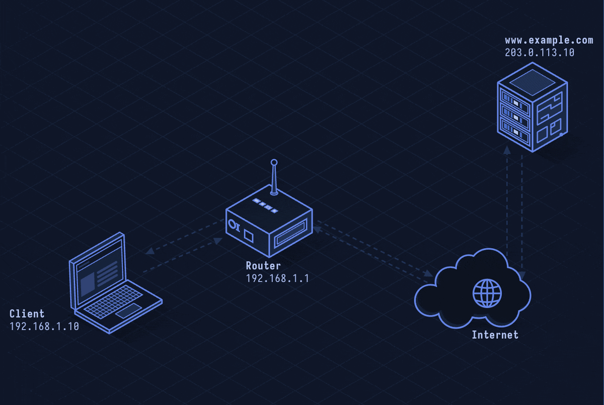

# WebSocket — Full-Duplex Web Communication

> **Layer 7 · Application** | Port: 80 (ws://) / 443 (wss://) | RFC 6455

## What Is WebSocket?

WebSocket upgrades an HTTP connection into a persistent, full-duplex channel. After a one-time HTTP handshake, both sides send frames freely in either direction without polling overhead.

| Property | Value |
|----------|-------|
| Layer | Application (Layer 7) |
| Transport | TCP |
| Connection | Persistent after HTTP upgrade |
| Direction | Full-duplex (simultaneous both ways) |
| Port | 80 (ws), 443 (wss) |
| Defined In | RFC 6455 |

---

## Network Simulation



Client sends HTTP Upgrade request, server responds 101 Switching Protocols, then bidirectional frames flow on the same TCP connection — no new handshake per message.

## Sequence Diagram


Shows: HTTP Upgrade handshake, server 101 response, client→server text frame, server→client binary frame, server-initiated push frame, and clean Close handshake (opcode 0x8).

---

## Step-by-Step Walkthrough

### Step 1 · HTTP Upgrade Handshake

Client sends a standard HTTP/1.1 request with upgrade headers:

```
GET /chat HTTP/1.1
Host: example.com
Upgrade: websocket
Connection: Upgrade
Sec-WebSocket-Key: dGhlIHNhbXBsZSBub25jZQ==
Sec-WebSocket-Version: 13
```

Server accepts:

```
HTTP/1.1 101 Switching Protocols
Upgrade: websocket
Connection: Upgrade
Sec-WebSocket-Accept: s3pPLMBiTxaQ9kYGzzhZRbK+xOo=
```

The `Sec-WebSocket-Accept` is `base64(SHA-1(key + GUID))` — proves the server understood the upgrade.

### Step 2 · Frame Exchange

After upgrade, the TCP socket stays open. Each party wraps data in WebSocket frames:

```
 0                   1                   2                   3
 0 1 2 3 4 5 6 7 8 9 0 1 2 3 4 5 6 7 8 9 0 1 2 3 4 5 6 7 8 9 0 1
+-+-+-+-+-------+-+-------------+-------------------------------+
|F|R|R|R| opcode|M| Payload len |    Extended payload length    |
|I|S|S|S|  (4)  |A|     (7)     |             (16/64)           |
|N|V|V|V|       |S|             |                               |
| |1|2|3|       |K|             |                               |
+-+-+-+-+-------+-+-------------+-------------------------------+
```

| Opcode | Meaning |
|--------|---------|
| 0x0 | Continuation frame |
| 0x1 | Text frame (UTF-8) |
| 0x2 | Binary frame |
| 0x8 | Close |
| 0x9 | Ping |
| 0xA | Pong |

Client frames must be masked (XOR with 4-byte key). Server frames are unmasked.

### Step 3 · Server Push

Unlike HTTP, server can push at any time without a client request:

```
Server → Client: TEXT frame  "{"event":"price","value":42.1}"
Server → Client: TEXT frame  "{"event":"price","value":42.3}"
```

This eliminates long-polling and SSE's one-direction limit.

### Step 4 · Close Handshake

Either side sends a Close frame (opcode 0x8), optionally with a status code:

```
Client → Server: CLOSE (1000 Normal Closure)
Server → Client: CLOSE (1000)
```

TCP connection closes after both sides send Close.

---

## Security Considerations

| Attack | Mechanism |
|--------|-----------|
| **Cross-Site WebSocket Hijacking** | Attacker page initiates WebSocket connection using victim's cookies |
| **Man-in-the-Middle** | ws:// is plaintext; use wss:// |
| **Denial of Service** | High-frequency frame floods exhaust server resources |
| **Message Injection** | No built-in message integrity; application must validate |
| **Origin Bypass** | Server must check `Origin` header; browser sets it, non-browser clients can forge it |

**Mitigations:** Always use `wss://`, validate `Origin` header server-side, use CSRF tokens in the initial handshake query string, rate-limit per connection.

---

*Previous: [lesson-14-tls-ssl.md](lesson-14-tls-ssl.md)*
