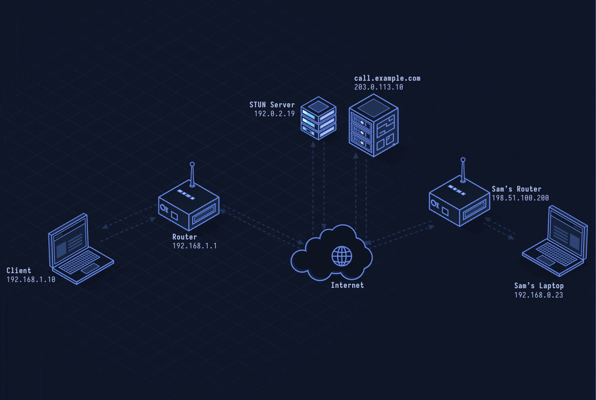

# WebRTC — Real-Time Peer-to-Peer Communication

> **Layer 7 · Application** | No fixed port (dynamic UDP) | RFC 8825

## What Is WebRTC?

WebRTC (Web Real-Time Communication) enables direct browser-to-browser audio, video, and data transfer without plugins or intermediate servers. A signaling server helps peers discover each other, then media flows peer-to-peer.

| Property | Value |
|----------|-------|
| Layer | Application (Layer 7) |
| Transport | UDP (via SRTP/DTLS) |
| Connection | Peer-to-peer after ICE negotiation |
| Media | Audio/video via SRTP, data via SCTP |
| Signaling | Out-of-band (WebSocket, SIP, etc.) |
| Defined In | RFC 8825–8835 suite |

---

## Network Simulation



Two browsers exchange SDP offers via signaling server, ICE candidates are gathered and exchanged, STUN probes find the best path, DTLS handshake secures the channel, and SRTP media packets flow peer-to-peer.

## Sequence Diagram


Shows: SDP Offer/Answer exchange, ICE candidate trickling, DTLS-SRTP key negotiation, media flowing peer-to-peer, and TURN relay fallback when direct path fails.

---

## Step-by-Step Walkthrough

### Step 1 · Signaling (Out-of-Band)

WebRTC has no built-in signaling. Apps use WebSocket, HTTP, or any channel to exchange SDP (Session Description Protocol) blobs:

```
Caller creates offer:
  v=0
  o=- 1234 1 IN IP4 0.0.0.0
  s=-
  m=audio 9 UDP/TLS/RTP/SAVPF 111
  a=rtpmap:111 opus/48000/2
  a=ice-ufrag:xyz
  a=ice-pwd:secretpassword
  ...

Callee creates answer (mirror structure)
```

### Step 2 · ICE Candidate Gathering

Each browser collects network candidates: host (local IP), server-reflexive (public IP via STUN), and relayed (via TURN):

```
a=candidate:1 1 UDP 2130706431 192.168.1.5 50001 typ host
a=candidate:2 1 UDP 1694498815 203.0.113.42 50001 typ srflx raddr 192.168.1.5
a=candidate:3 1 UDP 16777215 198.51.100.1 3478 typ relay raddr 203.0.113.42
```

ICE performs connectivity checks (STUN binding requests) on all candidate pairs and picks the best working path.

### Step 3 · DTLS Handshake

Once an ICE path is selected, DTLS (Datagram TLS) runs over it to establish a secure channel:

```
Peer A → Peer B: ClientHello
Peer B → Peer A: ServerHello + Certificate
Peer A → Peer B: Certificate + Finished
       Key material derived for SRTP
```

The certificate fingerprint was pre-exchanged in the SDP, preventing MITM.

### Step 4 · SRTP Media Flow

Audio/video packets use SRTP (Secure RTP), encrypted with keys from DTLS:

```
Peer A → Peer B: SRTP audio packet (Opus, 20ms frames)
Peer B → Peer A: SRTP video packet (H.264/VP8 keyframe)
```

RTCP (Real-time Control Protocol) packets carry stats, jitter, and loss feedback.

### Step 5 · NAT Traversal

Most peers are behind NAT. ICE uses STUN to discover public addresses. If NAT is symmetric, ICE falls back to TURN relay:

```
Client A → TURN server: Allocate
TURN → A: Relay address 198.51.100.1:3478
Client A → TURN: Send(B, data)
TURN → B: Data
```

---

## Security Considerations

| Attack | Mechanism |
|--------|-----------|
| **ICE Leak** | Exposed host candidates reveal private IP via WebRTC even with VPN |
| **TURN Credential Theft** | Stolen TURN credentials allow relay bandwidth abuse |
| **SDP Injection** | Malformed SDP causes codec negotiation failure or buffer overflows |
| **Fingerprint Mismatch** | Attacker replaces certificate fingerprint in SDP to MITM |
| **Bandwidth Abuse** | High-bitrate streams exhaust target's upload capacity |

**Mitigations:** Disable non-proxied UDP when privacy required, use short-lived TURN credentials (HMAC-time), validate SDP carefully, enforce bitrate caps.

---

*Previous: [lesson-15-websocket.md](lesson-15-websocket.md)*
