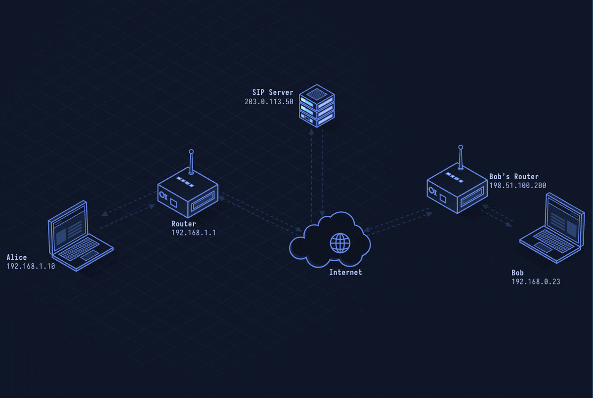

# SIP — Session Initiation Protocol

> **Layer 7 · Application** | Port: 5060 (UDP/TCP) / 5061 (TLS) | RFC 3261

## What Is SIP?

SIP is the signaling protocol behind VoIP calls. It sets up, modifies, and tears down multimedia sessions — deciding who calls whom and negotiating media parameters. Actual audio travels via RTP, not SIP.

| Property | Value |
|----------|-------|
| Layer | Application (Layer 7) |
| Transport | UDP or TCP (5060), TLS (5061) |
| Format | Text-based (like HTTP) |
| Role | Signaling only (not media) |
| Media | RTP/SRTP (negotiated via SDP) |
| Defined In | RFC 3261 |

---

## Network Simulation



Alice's SIP client sends INVITE through Proxy A to Proxy B to Bob's phone. 100 Trying, 180 Ringing, and 200 OK traverse back; ACK completes the handshake; RTP audio flows directly peer-to-peer; BYE ends the call.

## Sequence Diagram


Shows: INVITE with SDP offer, provisional 100/180, 200 OK with SDP answer, ACK, bidirectional RTP audio, BYE, and 200 OK.

---

## Step-by-Step Walkthrough

### Step 1 · REGISTER

Alice's phone registers with the SIP proxy so it can receive calls:

```
REGISTER sip:example.com SIP/2.0
Via: SIP/2.0/UDP 192.168.1.5:5060;branch=z9hG4bK776asdhds
To: sip:alice@example.com
From: sip:alice@example.com;tag=1928301774
Call-ID: a84b4c76e66710@pc33.atlanta.com
CSeq: 1 REGISTER
Contact: sip:alice@192.168.1.5:5060
Expires: 3600
```

### Step 2 · INVITE

Bob's phone receives INVITE containing an SDP offer (codec list, IP, port for RTP):

```
INVITE sip:bob@biloxi.com SIP/2.0
...
Content-Type: application/sdp

v=0
o=alice 2890844526 1 IN IP4 pc33.atlanta.com
m=audio 49172 RTP/AVP 0
a=rtpmap:0 PCMU/8000
```

### Step 3 · Provisional Responses

```
SIP/2.0 100 Trying
SIP/2.0 180 Ringing
```

These are informational. The phone rings on Bob's end.

### Step 4 · 200 OK + ACK

Bob answers, sending 200 OK with SDP answer (his chosen codec and RTP port). Alice sends ACK to complete the three-way handshake:

```
SIP/2.0 200 OK
Content-Type: application/sdp
m=audio 3456 RTP/AVP 0

ACK sip:bob@biloxi.com SIP/2.0
```

### Step 5 · RTP Media

Actual voice flows as RTP packets directly between Alice and Bob (not through the proxy):

```
RTP: PT=0 (PCMU), Seq=1234, TS=160, SSRC=0x1234ABCD
Payload: 160 bytes G.711 audio (20 ms)
```

### Step 6 · BYE

Either party hangs up with BYE:

```
BYE sip:alice@pc33.atlanta.com SIP/2.0
...
SIP/2.0 200 OK
```

---

## Security Considerations

| Attack | Mechanism |
|--------|-----------|
| **SIP Toll Fraud** | Compromise SIP credentials to make free calls billed to victim |
| **INVITE Flood** | Flood proxy with INVITE requests to exhaust resources |
| **Eavesdropping** | UDP SIP + RTP is plaintext; sniff audio and call metadata |
| **Registration Hijacking** | Re-REGISTER with attacker's Contact address to intercept calls |
| **Caller ID Spoofing** | No authentication of `From` header; spoof any caller ID |

**Mitigations:** Use TLS for signaling (port 5061), use SRTP for media, require digest authentication for REGISTER/INVITE, validate `From`/`Contact` headers at proxy.
