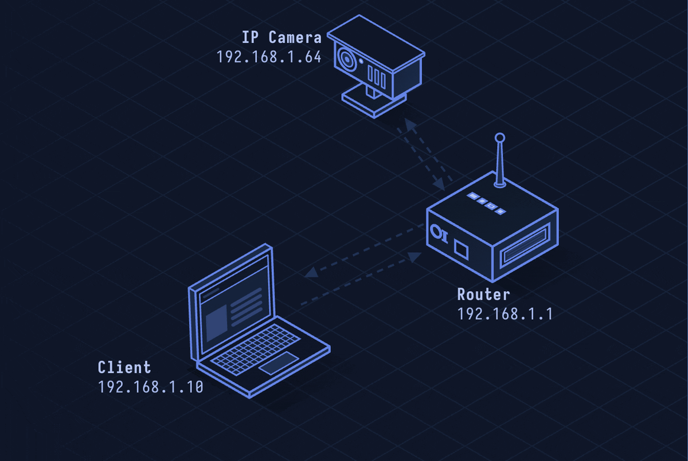

# RTSP — Real Time Streaming Protocol

> **Layer 7 · Application** | Port: 554 (TCP/UDP) | RFC 7826

## What Is RTSP?

RTSP controls media servers — it's the "VCR remote control" of streaming. It sends PLAY, PAUSE, and RECORD commands to start or stop delivery of audio/video streams. Actual media data flows via RTP on a separate channel.

| Property | Value |
|----------|-------|
| Layer | Application (Layer 7) |
| Control port | 554 TCP |
| Format | Text-based (HTTP-like) |
| Role | Control only (not media delivery) |
| Media | RTP (interleaved or separate UDP) |
| Defined In | RFC 7826 (RTSP 2.0) |

---

## Network Simulation



Client sends OPTIONS to discover capabilities, DESCRIBE to get stream metadata (SDP), SETUP to allocate RTP/RTCP ports, PLAY to begin, and TEARDOWN to stop. RTP video packets flow in parallel.

## Sequence Diagram


Shows: OPTIONS, DESCRIBE with SDP response, SETUP with Transport header, PLAY, interleaved RTP frames, PAUSE, PLAY resume, and TEARDOWN.

---

## Step-by-Step Walkthrough

### Step 1 · OPTIONS

Client discovers what methods the server supports:

```
OPTIONS rtsp://camera.example.com/live RTSP/1.0
CSeq: 1
User-Agent: LibVLC/3.0.0

RTSP/1.0 200 OK
CSeq: 1
Public: OPTIONS, DESCRIBE, SETUP, PLAY, PAUSE, TEARDOWN
```

### Step 2 · DESCRIBE

Client fetches stream metadata as an SDP document:

```
DESCRIBE rtsp://camera.example.com/live RTSP/1.0
CSeq: 2
Accept: application/sdp

RTSP/1.0 200 OK
Content-Type: application/sdp

v=0
m=video 0 RTP/AVP 96
a=rtpmap:96 H264/90000
a=control:rtsp://camera.example.com/live/trackID=0
```

### Step 3 · SETUP

Client allocates ports for RTP and RTCP:

```
SETUP rtsp://camera.example.com/live/trackID=0 RTSP/1.0
CSeq: 3
Transport: RTP/AVP;unicast;client_port=4588-4589

RTSP/1.0 200 OK
Session: 12345678
Transport: RTP/AVP;unicast;client_port=4588-4589;server_port=6970-6971
```

### Step 4 · PLAY

Client starts playback:

```
PLAY rtsp://camera.example.com/live RTSP/1.0
CSeq: 4
Session: 12345678
Range: npt=0.000-

RTSP/1.0 200 OK
Session: 12345678
RTP-Info: url=rtsp://camera.example.com/live/trackID=0;seq=9810;rtptime=3450012
```

RTP video packets now flow from server to client on UDP port 4588.

### Step 5 · TEARDOWN

Client ends the session:

```
TEARDOWN rtsp://camera.example.com/live RTSP/1.0
CSeq: 8
Session: 12345678

RTSP/1.0 200 OK
```

---

## Security Considerations

| Attack | Mechanism |
|--------|-----------|
| **Unauthenticated Streams** | Many IP cameras expose RTSP streams with no credentials |
| **Cleartext Credentials** | RTSP digest auth is optional; basic auth sends credentials in base64 |
| **Stream Interception** | RTP over UDP is unencrypted; sniff video from network |
| **Session Hijacking** | Guess session ID to issue PAUSE/TEARDOWN to other clients |
| **Shodan-exposed Cameras** | Thousands of IP cameras discoverable via RTSP port 554 on public internet |

**Mitigations:** Require digest authentication, use RTSPS (RTSP over TLS), put IP cameras on isolated VLAN, disable RTSP access from WAN.
