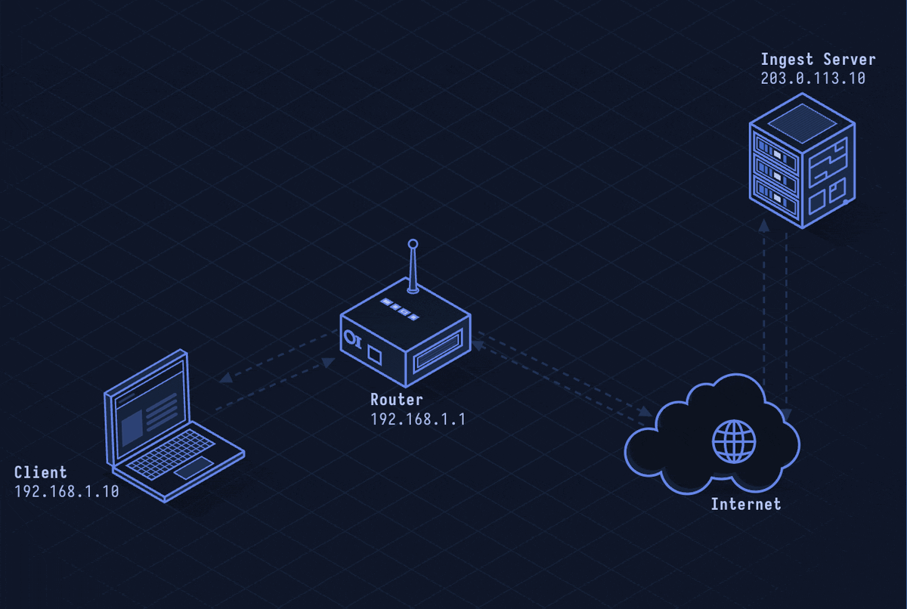

# RTMP — Real-Time Messaging Protocol

> **Layer 7 · Application** | Port: 1935 (TCP) | Adobe specification

## What Is RTMP?

RTMP was Adobe Flash's live-streaming protocol. Though Flash is dead, RTMP survives as the ingest standard: OBS, streaming hardware, and encoders push live streams to platforms (Twitch, YouTube) via RTMP, which the platform then re-distributes via HLS or DASH.

| Property | Value |
|----------|-------|
| Layer | Application (Layer 7) |
| Transport | TCP |
| Port | 1935 (plain), 443 (RTMPS/TLS) |
| Direction | Publisher → Server (ingest) |
| Latency | 1–5 seconds |
| Format | Binary, multiplexed chunks |
| Origin | Adobe (proprietary, later reverse-engineered) |

---

## Network Simulation



Encoder performs TCP connect, C0/C1/C2 handshake, sends AMF connect command, creates stream, publishes metadata, then streams audio and video chunks to the ingest server.

## Sequence Diagram


Shows: TCP handshake, RTMP C0/S0/C1/S1/C2/S2 handshake, connect command, createStream, publish command, metadata SetDataFrame, then continuous audio/video chunks.

---

## Step-by-Step Walkthrough

### Step 1 · TCP + RTMP Handshake

RTMP uses a custom handshake after TCP connect:

```
Client → Server: C0 (1 byte: RTMP version = 3)
Client → Server: C1 (1536 bytes: timestamp + random data)
Server → Client: S0 (version)
Server → Client: S1 + S2 (echo C1)
Client → Server: C2 (echo S1)
```

### Step 2 · connect Command

Client sends AMF (Action Message Format) encoded commands:

```
connect {
  app: "live",
  flashVer: "FMLE/3.0",
  tcUrl: "rtmp://live.twitch.tv/live/stream_key"
}
```

Server responds with _result or _error.

### Step 3 · createStream

```
Client → Server: createStream {}
Server → Client: _result { stream_id: 1 }
```

### Step 4 · publish

```
Client → Server: publish { streamName: "my_stream_key", type: "live" }
Server → Client: onStatus { code: "NetStream.Publish.Start" }
```

### Step 5 · Audio/Video Chunks

RTMP multiplexes multiple message streams over one TCP connection using 128-byte chunks by default:

```
Chunk Stream 4: Video (H.264 keyframe, 150KB)
Chunk Stream 5: Audio (AAC frame, 400 bytes)
Chunk Stream 4: Video (H.264 P-frame, 8KB)
...
```

Each chunk has a 3-byte timestamp, type, stream ID, and payload.

### Step 6 · RTMPS (Secure)

For secure ingest, RTMPS wraps RTMP in TLS on port 443 — mandatory for most platforms since 2019.

```
TLS ClientHello
TLS ServerHello + Certificate
TLS Finished
[RTMP handshake inside TLS tunnel]
```

---

## Security Considerations

| Attack | Mechanism |
|--------|-----------|
| **Stream Key Theft** | Stream key in RTMP URL grants publish access to channel; treat as password |
| **Port 1935 Scanning** | RTMP servers on 1935 are scannable; exposed admin interfaces |
| **RTMP Hijacking** | On plaintext RTMP, MITM can inject or replace stream data |
| **Credential Enumeration** | RTMP auth (optional) susceptible to brute force |
| **Re-streaming Piracy** | Capture RTMP stream, re-publish elsewhere |

**Mitigations:** Use RTMPS (port 443/TLS), rotate stream keys, never hardcode keys in public repos, block port 1935 at firewall for consumer deployments.
