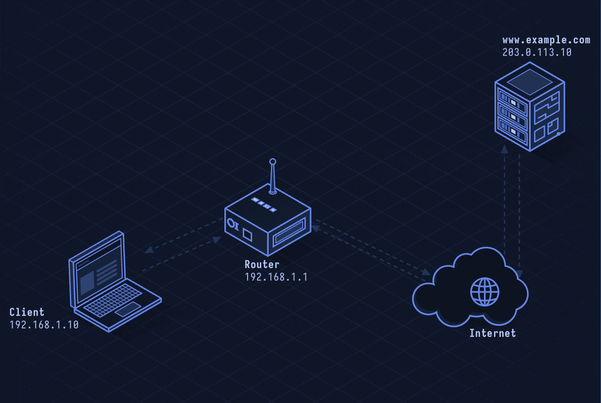

# QUIC — Quick UDP Internet Connections

> **Layer 4 · Transport** | Port: 443 (UDP) | RFC 9000

## What Is QUIC?

QUIC is a transport protocol built on UDP that delivers TCP's reliability with TLS 1.3 baked in, plus multiplexed streams with no head-of-line blocking. HTTP/3 runs over QUIC. Google designed it; it's now an IETF standard.

| Property | Value |
|----------|-------|
| Layer | Transport (Layer 4) |
| Transport | UDP |
| Port | 443 (typically) |
| Security | TLS 1.3 built-in (not add-on) |
| Streams | Multiple independent streams per connection |
| Head-of-line blocking | None (stream-level, not connection-level) |
| Connection migration | Yes (connection ID survives IP change) |
| Defined In | RFC 9000 |

---

## Network Simulation



Client sends QUIC Initial packet with TLS ClientHello, server replies with TLS ServerHello + certificate in a single RTT, then HTTP/3 request flows on stream 0, response on stream 0, and a second request begins on stream 4 without waiting for stream 0 to finish.

## Sequence Diagram


Shows: 1-RTT handshake (Initial, Handshake, 1-RTT packets), 0-RTT resumption on second connection, multiplexed streams, and connection migration when client IP changes.

---

## Step-by-Step Walkthrough

### Step 1 · QUIC Initial (1-RTT Handshake)

QUIC combines the transport and TLS handshake:

```
Client → Server: Initial packet
  CRYPTO frame: TLS ClientHello
                (supported ciphers, QUIC transport params)

Server → Client: Initial + Handshake packets
  CRYPTO: TLS ServerHello + Certificate + Finished

Client → Server: Handshake packet
  CRYPTO: TLS Finished
  → Handshake complete, 1-RTT keys derived
```

TCP + TLS 1.3 also does 1 RTT, but QUIC does it in a single round trip including transport negotiation.

### Step 2 · 0-RTT Resumption

On reconnect, client can send data before the handshake completes using session ticket from prior connection:

```
Client → Server: Initial packet
  CRYPTO: ClientHello + early_data extension
  STREAM 0 (0-RTT protected): "GET / HTTP/3\r\n"
```

0-RTT is vulnerable to replay attacks; servers must handle idempotent requests only.

### Step 3 · Multiplexed Streams (No Head-of-Line Blocking)

QUIC streams are independent. A lost packet stalls only the stream it belongs to:

```
Stream 0: GET /index.html → response in progress
Stream 4: GET /style.css  → response arrives fully, delivered immediately
Stream 8: GET /script.js  → starts while stream 0 still in flight
```

TCP's HOL blocking: a single lost segment stalls ALL data on the connection.

### Step 4 · Connection ID and Migration

QUIC identifies connections by Connection ID (not 5-tuple). Client can change IP and keep the connection alive:

```
Client IP: 192.168.1.5 → mobile handover → 10.0.0.2
Client sends PATH_CHALLENGE on new path
Server sends PATH_RESPONSE
Connection migrates seamlessly — no TCP reconnect needed
```

### Step 5 · QUIC Packet Structure

```
+---------------+
| Header Form   | 1 bit (long/short)
| Fixed Bit     | 1 bit (always 1)
| Packet Type   | 2 bits
| Connection ID | 0–20 bytes
| Packet Number | 1–4 bytes
| Payload       | encrypted frames
+---------------+
```

All frames are encrypted. Even ACKs are encrypted, preventing observers from measuring loss.

---

## Security Considerations

| Attack | Mechanism |
|--------|-----------|
| **Amplification** | QUIC has amplification limits; server cannot send more than 3× received until address validated |
| **0-RTT Replay** | 0-RTT data can be replayed by intermediaries; use only for idempotent requests |
| **UDP Blocking** | Firewalls that block UDP block QUIC; falls back to TCP |
| **Version Negotiation Downgrade** | Attacker forges Version Negotiation to force older QUIC version |
| **Connection Migration Abuse** | Force connection to migrate to attacker-controlled path |

**Mitigations:** Servers must validate client addresses before large responses, limit 0-RTT to safe GET requests, include RETRY token for address validation.

---

*See also: [lesson-05-udp.md](lesson-05-udp.md) for UDP fundamentals, [lesson-03-https.md](lesson-03-https.md) for TLS context.*
