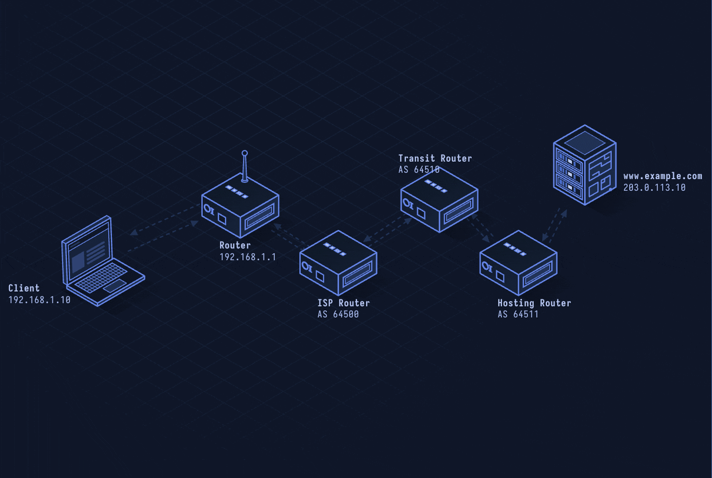

# BGP — Border Gateway Protocol

> **Layer 7 · Application** | Port: 179 (TCP) | RFC 4271

## What Is BGP?

BGP is the routing protocol of the internet. It exchanges reachability information between autonomous systems (AS) — the independent networks (ISPs, cloud providers, enterprises) that make up the internet. Every IP prefix your traffic traverses was advertised via BGP.

| Property | Value |
|----------|-------|
| Layer | Application (Layer 7) |
| Transport | TCP port 179 |
| Type | Path-vector routing protocol |
| Scope | Between autonomous systems (eBGP) or within (iBGP) |
| Metric | AS-PATH length + policy attributes |
| Scale | ~1 million prefixes in global routing table |
| Defined In | RFC 4271 |

---

## Network Simulation



Two routers establish a TCP connection on port 179, exchange OPEN messages with AS numbers, send KEEPALIVE to establish session, then exchange UPDATE messages advertising IP prefixes. A route withdrawal appears as an UPDATE with an empty NLRI.

## Sequence Diagram


Shows: TCP 3-way handshake, OPEN (AS number, hold time), KEEPALIVE, UPDATE (prefix advertisement), periodic KEEPALIVE, UPDATE (withdrawal), and NOTIFICATION on error.

---

## Step-by-Step Walkthrough

### Step 1 · TCP Session Setup

BGP runs over TCP port 179. Two BGP speakers (routers) establish a TCP session first:

```
Router A (AS 65001) → Router B (AS 65002): TCP SYN → SYN-ACK → ACK
```

BGP routers are called **peers** or **neighbors**.

### Step 2 · OPEN Message

Each side sends an OPEN to introduce itself:

```
BGP OPEN:
  Version: 4
  My AS: 65001
  Hold Time: 90 (seconds of silence before session teardown)
  BGP Identifier: 203.0.113.1 (router ID)
  Optional Parameters: capabilities (MP-BGP, route-refresh, etc.)
```

### Step 3 · KEEPALIVE

Both sides send KEEPALIVE to confirm OPEN acceptance. After this, the session is ESTABLISHED.

```
BGP KEEPALIVE (19 bytes, header only)
```

KeepaliveInterval = HoldTime / 3 (30 seconds by default).

### Step 4 · UPDATE — Route Advertisement

Router A advertises its prefixes to Router B:

```
BGP UPDATE:
  WITHDRAWN ROUTES: (none)
  PATH ATTRIBUTES:
    ORIGIN: IGP
    AS_PATH: 65001
    NEXT_HOP: 203.0.113.1
    LOCAL_PREF: 100
  NLRI (Network Layer Reachability Information):
    198.51.100.0/24
    203.0.113.0/24
```

Router B stores this in its BGP RIB (Routing Information Base) and decides whether to install it in the forwarding table.

### Step 5 · Path Selection

When multiple paths to the same prefix exist, BGP selects via ordered criteria:

1. Highest LOCAL_PREF (prefer local policy)
2. Shortest AS_PATH (fewer hops)
3. Lowest MED (Multi-Exit Discriminator)
4. eBGP over iBGP
5. Lowest IGP cost to next-hop
6. Lowest router ID (tie-breaker)

### Step 6 · NOTIFICATION and Teardown

Errors cause NOTIFICATION followed by TCP close:

```
BGP NOTIFICATION:
  Error Code: 3 (UPDATE Message Error)
  Error Subcode: 1 (Malformed Attribute List)
```

---

## Security Considerations

| Attack | Mechanism |
|--------|-----------|
| **BGP Hijacking** | Advertise more-specific prefix to attract traffic away from legitimate owner |
| **Route Leak** | Accidentally re-advertise customer routes to other providers, causing global rerouting |
| **BGP Session Reset** | Forge TCP RST to tear down BGP session (BGP runs over plain TCP) |
| **Prefix Deaggregation** | Advertise /24s to override legitimate /8 or /16 announcements |
| **BGP Poisoning** | Prepend victim AS number to AS_PATH to cause them to drop their own routes |

**Mitigations:** RPKI (Resource Public Key Infrastructure) validates prefix ownership, BGPsec signs AS paths, GTSM (Generalized TTL Security Mechanism) blocks off-link session attacks, MD5 authentication on TCP sessions.

---

*See also: [lesson-01-osi-model.md](lesson-01-osi-model.md) for routing layer context, [lesson-07-dns.md](lesson-07-dns.md) for DNS-BGP interaction.*
