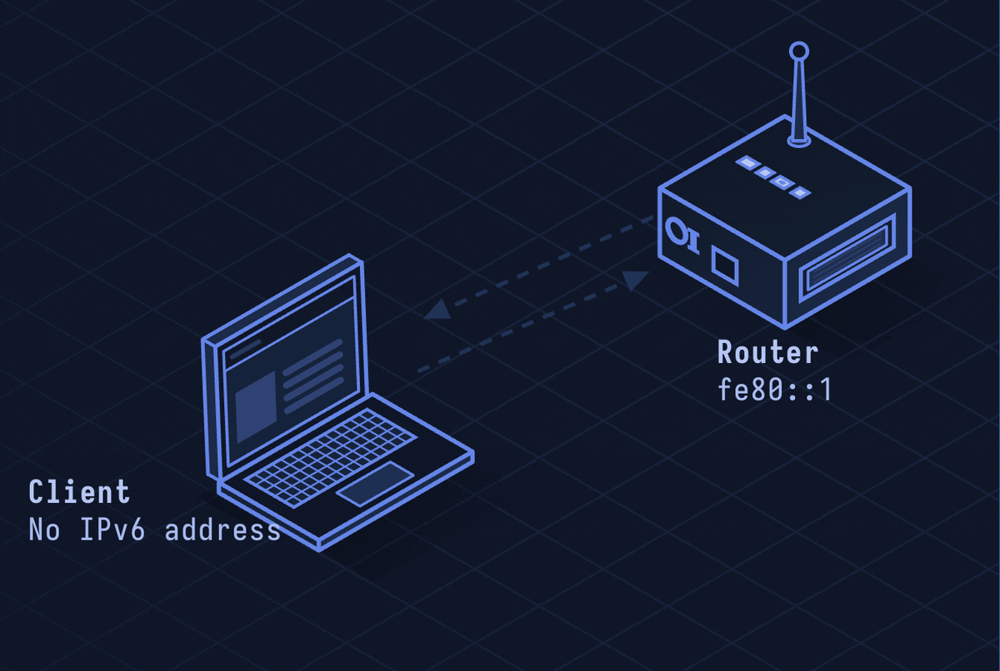

# IPv6 — Internet Protocol Version 6

> **Layer 3 · Network** | No fixed port | RFC 8200

## What Is IPv6?

IPv6 replaces IPv4's 32-bit addresses with 128-bit addresses — roughly 3.4 × 10³⁸ unique addresses. It also simplifies the header, removes broadcast, and builds in stateless autoconfiguration. The internet runs dual-stack today (IPv4 and IPv6 simultaneously).

| Property | Value |
|----------|-------|
| Layer | Network (Layer 3) |
| Address size | 128 bits (vs 32-bit IPv4) |
| Notation | 8 groups of 4 hex digits: `2001:db8::1` |
| Header | 40 bytes fixed (vs variable IPv4) |
| Fragmentation | Only at source (not routers) |
| Broadcast | Replaced by multicast |
| Autoconfiguration | SLAAC (Stateless Address Autoconfiguration) |
| Defined In | RFC 8200 |

---

## Network Simulation



Host sends Router Solicitation (ICMPv6), router replies with Router Advertisement containing prefix. Host generates SLAAC address using prefix + EUI-64 MAC. Host sends Neighbor Solicitation to verify address uniqueness (DAD), then sends IPv6 packets.

## Sequence Diagram


Shows: Router Solicitation/Advertisement, SLAAC address formation, Duplicate Address Detection (DAD), Neighbor Discovery (NS/NA replacing ARP), and an IPv6 packet exchange.

---

## Step-by-Step Walkthrough

### Step 1 · IPv6 Address Anatomy

```
2001:0db8:85a3:0000:0000:8a2e:0370:7334

Compressed:
2001:db8:85a3::8a2e:370:7334
  ↑ leading zeros dropped
     ↑ :: replaces longest run of all-zero groups
```

Special addresses:
- `::1` — loopback (localhost)
- `fe80::/10` — link-local (auto-configured, not routable)
- `2001:db8::/32` — documentation range
- `::/0` — default route

### Step 2 · IPv6 Header (Simpler Than IPv4)

```
+-+-+-+-+-+-+-+-+-+-+-+-+-+-+-+-+-+-+-+-+-+-+-+-+-+-+-+-+-+-+-+-+
|Version| Traffic Class |           Flow Label                  |
+-+-+-+-+-+-+-+-+-+-+-+-+-+-+-+-+-+-+-+-+-+-+-+-+-+-+-+-+-+-+-+-+
|         Payload Length        |  Next Header  |   Hop Limit   |
+-+-+-+-+-+-+-+-+-+-+-+-+-+-+-+-+-+-+-+-+-+-+-+-+-+-+-+-+-+-+-+-+
|                                                               |
+                         Source Address                        +
|                        (128 bits)                             |
+-+-+-+-+-+-+-+-+-+-+-+-+-+-+-+-+-+-+-+-+-+-+-+-+-+-+-+-+-+-+-+-+
|                                                               |
+                      Destination Address                      +
|                        (128 bits)                             |
+-+-+-+-+-+-+-+-+-+-+-+-+-+-+-+-+-+-+-+-+-+-+-+-+-+-+-+-+-+-+-+-+
```

No checksum (removed — TCP/UDP already have checksums). No fragmentation fields (routers don't fragment). Options via Extension Headers chained via Next Header field.

### Step 3 · SLAAC Autoconfiguration

Host configures its own address without DHCP:

1. Host generates link-local address: `fe80::` + EUI-64 (derived from MAC)
2. Host sends **Router Solicitation** (ICMPv6 type 133) to `ff02::2` (all routers)
3. Router replies with **Router Advertisement** (ICMPv6 type 134): prefix `2001:db8::/64`, lifetime
4. Host forms global address: router prefix + EUI-64

```
Prefix:     2001:0db8:0000:0000:
Interface:  08:00:27:FF:FE:AB:CD:EF  (EUI-64 of MAC 08:00:27:AB:CD:EF)
Result:     2001:db8::800:27ff:feab:cdef
```

### Step 4 · Neighbor Discovery (Replaces ARP)

IPv6 uses ICMPv6 Neighbor Discovery instead of ARP:

```
Host A → ff02::1:ffAB:CDEF (solicited-node multicast):
  Neighbor Solicitation: "Who has 2001:db8::1?"

Host B → Host A:
  Neighbor Advertisement: "I have 2001:db8::1, my MAC is 00:11:22:33:44:55"
```

### Step 5 · Extension Headers

Options are chained via Next Header:

```
IPv6 Header (NH=43: Routing)
  → Routing Header (NH=44: Fragment)
    → Fragment Header (NH=6: TCP)
      → TCP Segment
```

---

## Security Considerations

| Attack | Mechanism |
|--------|-----------|
| **SLAAC Rogue Router** | Attacker sends Router Advertisements with malicious prefix/gateway |
| **NDP Spoofing** | Fake Neighbor Advertisement redirects traffic (like ARP spoofing) |
| **IPv6 Scanning** | 128-bit space makes random scanning impractical, but DHCPv6 logs and DNS reveal real addresses |
| **Extension Header Abuse** | Long chains of extension headers can bypass firewalls that stop parsing early |
| **Dual-Stack Leakage** | IPv4-only security controls missed on IPv6 traffic on dual-stack hosts |

**Mitigations:** RA Guard on switches (drop unauthorized Router Advertisements), SeND (Secure Neighbor Discovery), firewall both v4 and v6, disable IPv6 if not in use.

---

*See also: [lesson-06-ip.md](lesson-06-ip.md) for IPv4 context, [lesson-07-dns.md](lesson-07-dns.md) for AAAA records.*
