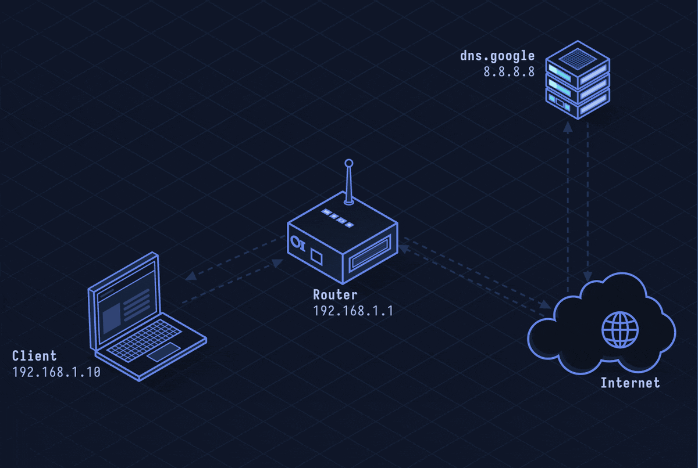

# DNS over HTTPS (DoH) — Private DNS Resolution

> **Layer 7 · Application** | Port: 443 | RFC 8484

## What Is DoH?

DNS over HTTPS sends DNS queries inside HTTPS requests, hiding them from ISPs, network administrators, and eavesdroppers. Standard DNS sends queries in plaintext UDP; DoH wraps them in TLS-encrypted HTTP/2 or HTTP/3 so they look like ordinary web traffic.

| Property | Value |
|----------|-------|
| Layer | Application (Layer 7) |
| Transport | TCP + TLS (HTTPS) |
| Port | 443 |
| Format | DNS wire format in HTTP body |
| Privacy | Queries hidden from network path |
| Performance | Slower first query (TLS handshake), cacheable |
| Defined In | RFC 8484 |

---

## Network Simulation



Client establishes TLS session to 1.1.1.1:443, sends POST request with DNS wire-format body, server decodes the DNS query, resolves it, and returns DNS response in the HTTP body — all encrypted.

## Sequence Diagram


Shows: TLS handshake to DoH server, HTTP/2 POST /dns-query, DNS response body, and comparison with plaintext DNS query on port 53.

---

## Step-by-Step Walkthrough

### Step 1 · Standard DNS (Plaintext Problem)

Traditional DNS query is visible to anyone on the network path:

```
Client → 8.8.8.8:53 (UDP):
  QUERY: www.example.com A?
  
Visible to: ISP, Wi-Fi access point, any MITM
```

### Step 2 · DoH Query

Client sends DNS query inside HTTPS POST:

```
POST /dns-query HTTP/2
Host: cloudflare-dns.com
Content-Type: application/dns-message
Accept: application/dns-message
Content-Length: 29

[DNS wire-format binary: 0x00 0x00 0x01 0x00 0x00 0x01 ...]
```

The binary body is a standard DNS message in RFC 1035 wire format, just transported inside HTTP.

### Step 3 · DoH Response

Server returns DNS answer in HTTP body:

```
HTTP/2 200 OK
Content-Type: application/dns-message
Cache-Control: max-age=1799

[DNS wire-format binary response:
  ANSWER: www.example.com 1799 IN A 93.184.216.34]
```

### Step 4 · GET Method (Alternative)

RFC 8484 also allows GET with base64url-encoded query:

```
GET /dns-query?dns=AAABAAABAAAAAAAA... HTTP/2
Host: cloudflare-dns.com
```

GET responses are cacheable by HTTP proxies.

### Step 5 · Browser Integration

Modern browsers (Firefox, Chrome) have built-in DoH. Firefox calls it "Trusted Recursive Resolver" and routes DNS to Cloudflare (1.1.1.1) or NextDNS by default, bypassing the OS resolver.

```
Firefox setting:
  network.trr.mode = 2 (DoH with fallback to OS)
  network.trr.uri = https://mozilla.cloudflare-dns.com/dns-query
```

---

## Security Considerations

| Attack/Concern | Detail |
|----------------|--------|
| **Split-horizon bypass** | DoH bypasses internal DNS resolvers used for private corporate domains |
| **Canary domain** | Firefox checks `use-application-dns.net` — if it resolves, DoH is disabled (opt-out for enterprise) |
| **DoH provider trust** | All queries visible to DoH provider (Cloudflare, Google) instead of ISP |
| **Blocking DoH** | Enterprises block DoH to maintain DNS visibility for security monitoring |
| **DNS rebinding** | DoH doesn't prevent DNS rebinding attacks |

**vs DNS over TLS (DoT):**
- DoT uses port 853 — easily blocked/filtered by enterprise firewalls
- DoH uses port 443 — blends with HTTPS traffic, harder to block

**Mitigations:** Enterprises configure canary domain to disable browser DoH, deploy internal DoH resolvers (NextDNS, Pi-hole with DoH), use split-horizon DNS with DoH support.

---

*See also: [lesson-07-dns.md](lesson-07-dns.md) for DNS fundamentals, [lesson-24-dnssec.md](lesson-24-dnssec.md) for DNS integrity.*
