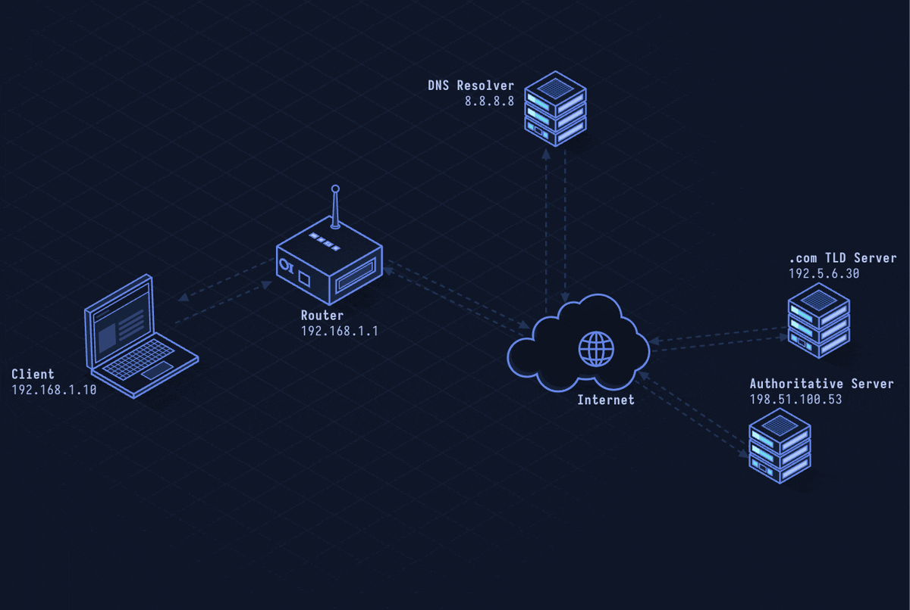

# DNSSEC — DNS Security Extensions

> **Layer 7 · Application** | Port: 53 (UDP/TCP) | RFC 4033–4035

## What Is DNSSEC?

DNSSEC adds cryptographic signatures to DNS records so resolvers can verify responses haven't been tampered with. It doesn't encrypt DNS (see DoH for that) — it authenticates it, preventing cache poisoning and forged responses.

| Property | Value |
|----------|-------|
| Layer | Application (Layer 7) |
| Port | 53 (same as DNS) |
| Protection | Integrity + authenticity (not confidentiality) |
| Signing algorithm | ECDSA P-256, RSA-SHA256 |
| Root of trust | ICANN DNS root key |
| Defined In | RFC 4033, 4034, 4035 |

---

## Network Simulation



Resolver queries for `www.example.com`, receives A record plus RRSIG signature record, fetches the zone's public key (DNSKEY), verifies the signature, then walks up the chain: validates example.com key via DS record in .com zone, validates .com via DS in root zone.

## Sequence Diagram


Shows: DNS query with DO bit set, response with RRSIG + NSEC records, DNSKEY fetch, DS record chain from root to leaf zone, and validation result (SECURE or BOGUS).

---

## Step-by-Step Walkthrough

### Step 1 · Standard DNS Query With DO Bit

DNSSEC-aware resolvers set the DNSSEC OK (DO) bit in the OPT record:

```
DNS QUERY:
  www.example.com A?
  EDNS0 OPT: DO=1 (please include DNSSEC records)
```

### Step 2 · Signed Response

The authoritative server returns the A record plus an RRSIG:

```
DNS RESPONSE:
  www.example.com 3600 IN A 93.184.216.34
  www.example.com 3600 IN RRSIG A 13 3 3600 (
    20241201000000 20241101000000 12345 example.com.
    <base64-encoded ECDSA signature> )
```

The RRSIG covers: type, TTL, owner name, and all records in the RRset.

### Step 3 · DNSKEY Record

The zone publishes its public key:

```
example.com 3600 IN DNSKEY 257 3 13 (
    <base64 public key>  )
```

Flags `257` = Zone Signing Key with Key Signing Key flag (KSK).

### Step 4 · Chain of Trust

Trust flows from the root down. Each zone's key is authenticated by the parent's DS (Delegation Signer) record:

```
Root zone signs "."  DNSKEY
  → DS record in root delegates trust to ".com" DNSKEY
    → DS record in ".com" delegates trust to "example.com" DNSKEY
      → DNSKEY used to verify "www.example.com" RRSIG
```

The root KSK public key is hardcoded into every DNSSEC-validating resolver (trust anchor).

### Step 5 · Authenticated Denial of Existence

DNSSEC must prove records *don't* exist without revealing what does exist. It uses NSEC or NSEC3:

```
NSEC: Shows sorted owner names; proves no name exists between two entries
NSEC3: Hashed owner names (prevents zone walking enumeration)

No record for "nonexistent.example.com":
example.com NSEC3 (hash covers "nonexistent" range is absent)
```

### Step 6 · Validation Result

Resolvers classify responses:
- **SECURE** — signatures valid, chain of trust intact
- **BOGUS** — validation failed — resolver refuses to return
- **INSECURE** — zone not signed (no DS record from parent)
- **INDETERMINATE** — can't determine (no trust anchor)

---

## Security Considerations

| Attack/Issue | Detail |
|--------------|--------|
| **Zone Enumeration** | NSEC allows walking all names in a zone; NSEC3 hides names but hashes are offline-crackable |
| **Key Compromise** | KSK compromise invalidates entire zone's trust chain |
| **DNSSEC Amplification** | DNSSEC responses are large (KB vs bytes); useful for DNS amplification DDoS |
| **Rollover Complexity** | Key rollovers require carefully timed DS updates at parent zone |
| **No Confidentiality** | DNSSEC doesn't encrypt queries; combine with DoH/DoT for privacy |

**Mitigations:** Use NSEC3 with high iterations to slow enumeration, automate key rollovers (RFC 7344 CDS/CDNSKEY), monitor DNSSEC validation failures.

---

*See also: [lesson-07-dns.md](lesson-07-dns.md) for DNS fundamentals, [lesson-23-dns-over-https.md](lesson-23-dns-over-https.md) for DNS privacy.*
