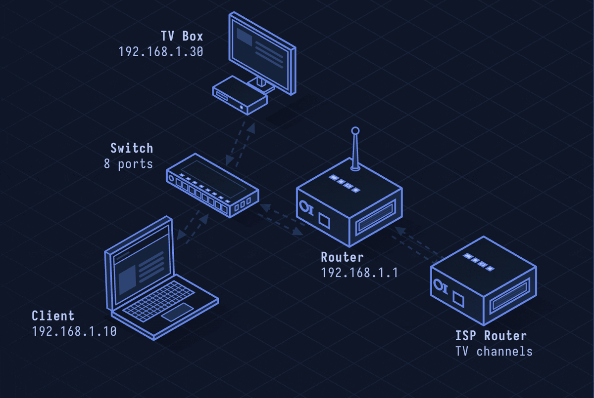

# IGMP — Internet Group Management Protocol

> **Layer 3 · Network** | Protocol 2 (IP) | RFC 3376

## What Is IGMP?

IGMP lets hosts tell routers which multicast groups they want to receive. Without IGMP, routers would flood multicast traffic everywhere. With it, routers only forward multicast streams to segments with interested receivers — essential for IPTV, video conferencing, and financial market data feeds.

| Property | Value |
|----------|-------|
| Layer | Network (Layer 3) |
| Carried in | IP packets (Protocol 2) |
| TTL | 1 (link-local) |
| Current version | IGMPv3 (RFC 3376) |
| IPv6 equivalent | MLD (Multicast Listener Discovery) |
| Defined In | RFC 3376 |

---

## Network Simulation



Host sends IGMP Membership Report joining multicast group 224.0.1.1, router records membership and starts forwarding that multicast stream to the host's segment. When host leaves, it sends a Leave Group message; router sends a query, gets no response, and stops forwarding.

## Sequence Diagram


Shows: Host Membership Report, Router General Query, Host response, multicast data flowing, host Leave Group, router Last Member Query, silence, router stops forwarding.

---

## Step-by-Step Walkthrough

### Step 1 · Joining a Multicast Group

Host wants to receive multicast stream on 224.0.1.1 (e.g., an IPTV channel):

```
Host → 224.0.1.1 (IP dst): IGMPv3 Membership Report
  Record Type: IS_EX (is excluding nothing = join all sources)
  Multicast Address: 224.0.1.1
```

Earlier versions (IGMPv1/v2) sent to `224.0.0.1` (all-hosts).

### Step 2 · Router General Query

Router periodically queries all hosts for active memberships:

```
Router → 224.0.0.1 (all hosts): IGMP General Query
  Max Response Time: 10 seconds
  Group Address: 0.0.0.0 (general = all groups)
```

### Step 3 · Membership Report Response

Hosts respond with their active group memberships (randomized delay to suppress duplicate reports):

```
Host → 224.0.1.1: Membership Report
  Multicast Address Record: 224.0.1.1 (IN_EX, no source filter)
```

### Step 4 · Source-Specific Multicast (IGMPv3)

IGMPv3 adds source filtering — only receive from specific senders:

```
Host → 224.0.2.1: IGMPv3 Membership Report
  Record: IS_IN (include sources)
  Multicast: 224.0.2.1
  Sources: 192.0.2.5 (only receive from this source)
```

### Step 5 · Leaving a Group

```
Host → 224.0.0.2 (all-routers): IGMPv2 Leave Group
  Group Address: 224.0.1.1

Router → 224.0.1.1: Group-Specific Query (is anyone still interested?)
(No response within Max Response Time)
Router stops forwarding 224.0.1.1 to this segment
```

### Step 6 · IGMP Message Format

```
 0                   1                   2                   3
 0 1 2 3 4 5 6 7 8 9 0 1 2 3 4 5 6 7 8 9 0 1 2 3 4 5 6 7 8 9 0 1
+-+-+-+-+-+-+-+-+-+-+-+-+-+-+-+-+-+-+-+-+-+-+-+-+-+-+-+-+-+-+-+-+
|  Type (8)     | Max Resp (8)  |           Checksum (16)       |
+-+-+-+-+-+-+-+-+-+-+-+-+-+-+-+-+-+-+-+-+-+-+-+-+-+-+-+-+-+-+-+-+
|                       Group Address (32)                      |
+-+-+-+-+-+-+-+-+-+-+-+-+-+-+-+-+-+-+-+-+-+-+-+-+-+-+-+-+-+-+-+-+
```

Type values: 0x11 (Query), 0x12 (v1 Report), 0x16 (v2 Report), 0x17 (Leave), 0x22 (v3 Report).

---

## Security Considerations

| Attack | Mechanism |
|--------|-----------|
| **Multicast Group Join Flood** | Attacker joins thousands of groups, consuming router memory |
| **Leave Group Spoofing** | Forge Leave message to cut off legitimate receiver from stream |
| **IGMP Snooping Bypass** | Switches use IGMP snooping to limit multicast; forged queries can disable it |
| **Multicast Amplification** | Send to multicast address to reach many hosts simultaneously |
| **Rogue IGMP Router** | Fake router sends queries to gather group membership intel |

**Mitigations:** Enable IGMP snooping on managed switches, rate-limit IGMP messages, use SSM (Source-Specific Multicast) to restrict senders, filter IGMP at network edge.
