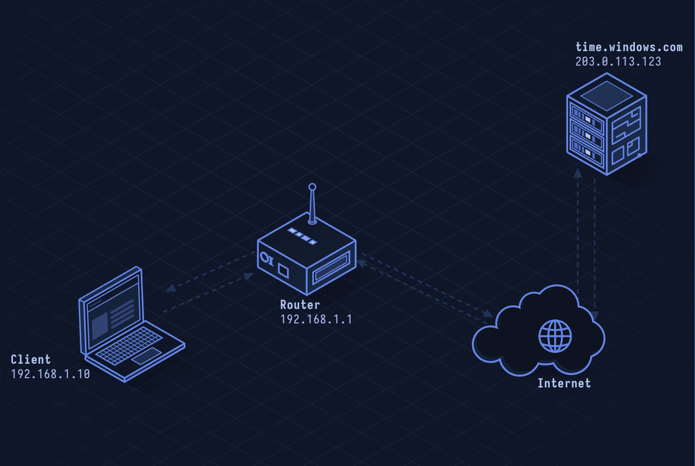

# NTP — Network Time Protocol

> **Layer 7 · Application** | Port: 123 (UDP) | RFC 5905

## What Is NTP?

NTP synchronizes computer clocks over the network, achieving microsecond accuracy over the internet. Almost every protocol that cares about time (TLS certificate validity, Kerberos tickets, log correlation, DNSSEC signatures) depends on NTP.

| Property | Value |
|----------|-------|
| Layer | Application (Layer 7) |
| Transport | UDP port 123 |
| Accuracy | ~1 ms on LAN, ~10–100 ms on internet |
| Hierarchy | Stratum 0 (atomic clock) → Stratum 1 (server) → Stratum 2 → ... |
| Current version | NTPv4 (RFC 5905) |
| Defined In | RFC 5905 |

---

## Network Simulation



Client sends NTP request with its current timestamp to a stratum-2 server. Server stamps receive time and transmit time. Client calculates round-trip delay and clock offset, adjusts local clock by the computed offset.

## Sequence Diagram


Shows: NTP Request with T1 (originate timestamp), T2 (receive at server), T3 (transmit from server), T4 (receive at client), offset and delay calculations.

---

## Step-by-Step Walkthrough

### Step 1 · NTP Hierarchy (Stratum)

```
Stratum 0: Atomic clock, GPS receiver (reference clock, not on network)
Stratum 1: Server directly connected to stratum 0 (e.g., time.nist.gov)
Stratum 2: Synced from stratum 1 (e.g., pool.ntp.org servers)
Stratum 3: Synced from stratum 2
...
Stratum 15: Maximum usable
Stratum 16: Unsynchronized (clock not trusted)
```

### Step 2 · NTP Packet

Client sends a NTP request:

```
UDP to 203.0.113.1:123

NTP Packet:
  LI (Leap Indicator): 0 (no warning)
  VN (Version): 4
  Mode: 3 (client)
  Stratum: 0 (unspecified)
  Poll: 6 (64-second poll interval)
  Precision: -20 (~1 µs)
  Reference Timestamp: 0
  Originate Timestamp (T1): client's current time
  Receive Timestamp (T2): 0 (filled by server)
  Transmit Timestamp (T3): 0 (filled by server)
```

### Step 3 · Server Response

Server fills in timestamps and returns:

```
NTP Packet:
  Mode: 4 (server)
  Stratum: 2
  Reference Timestamp: last sync time
  Originate Timestamp (T1): copied from client's request
  Receive Timestamp (T2): when server received request
  Transmit Timestamp (T3): when server sent response
```

### Step 4 · Clock Offset Calculation

Client records T4 (when it received the response):

```
Round-trip delay = (T4 - T1) - (T3 - T2)
Clock offset    = ((T2 - T1) + (T3 - T4)) / 2
```

Client adjusts its clock by the offset. If offset > 128ms, ntpd steps the clock; smaller offsets are slewed (gradual adjustment to avoid log timestamp discontinuities).

### Step 5 · NTP Pool

The public NTP pool (`pool.ntp.org`) uses DNS round-robin to distribute load across thousands of volunteer servers:

```
$ nslookup pool.ntp.org
Address: 185.209.85.222  ← different IP each query
Address: 162.159.200.1
Address: 46.226.227.73
```

### Step 6 · NTPsec and Chrony

Modern deployments use NTPsec (security-hardened NTPv4) or Chrony (better handling of intermittent connectivity):

```
# /etc/chrony.conf
pool pool.ntp.org iburst
makestep 1.0 3
rtcsync
```

---

## Security Considerations

| Attack | Mechanism |
|--------|-----------|
| **NTP Amplification DDoS** | Old `monlist` command returns up to 600 clients in one response; 1 small request → 100× larger reply |
| **Time Spoofing** | Fake NTP responses to shift victim's clock, breaking TLS/Kerberos/TOTP |
| **Kiss-of-Death Flood** | Forge KoD (rate limit) packets to block client from syncing |
| **Interleaved Attack** | Manipulate timestamps to cause constant clock adjustments |
| **Leap Second Exploit** | Incorrect leap second handling has caused crashes (Linux 2012 incident) |

**Mitigations:** Disable `monlist` (ntpdc -c 'disable monitor'), use NTP authentication (symmetric keys or autokey), use multiple servers, deploy NTPsec/Chrony, block UDP 123 from untrusted sources.

---

*See also: [lesson-05-udp.md](lesson-05-udp.md) for UDP fundamentals.*
