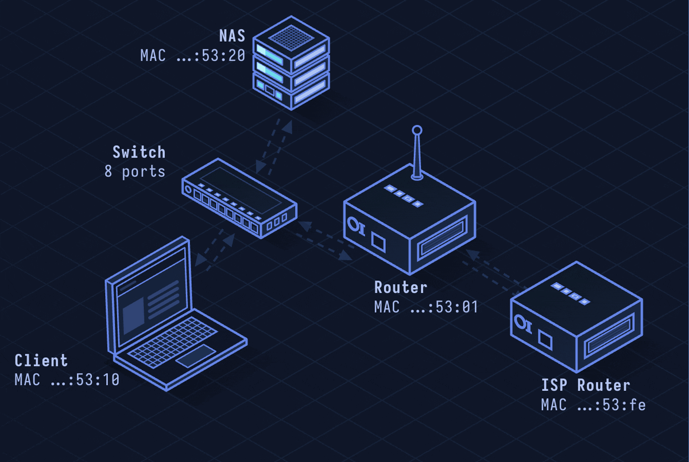

# Ethernet — The LAN Standard

> **Layer 2 · Data Link** | No port (MAC addressing) | IEEE 802.3

## What Is Ethernet?

Ethernet is the dominant wired networking standard. It defines how bits are encoded on physical media and how devices on the same network segment address each other using MAC addresses. Almost everything above it (IP, TCP, HTTP) rides on Ethernet frames at the bottom.

| Property | Value |
|----------|-------|
| Layer | Data Link (Layer 2) |
| Addressing | 48-bit MAC addresses |
| Frame size | 64–1518 bytes (standard), up to 9000 (jumbo) |
| Speed | 10 Mbps → 400 Gbps (various standards) |
| Media | Twisted pair (Cat5e/6/8), fiber, coax |
| Defined In | IEEE 802.3 |

---

## Network Simulation



Host A looks up Host B's MAC via ARP, then sends Ethernet frames through a switch. Switch learns MAC-to-port mappings, forwards frame to correct port. VLAN tags shown on trunk link between switches.

## Sequence Diagram


Shows: ARP request/reply exchange, switch MAC table learning, Ethernet frame structure with 802.1Q VLAN tag, and frame forwarding decision.

---

## Step-by-Step Walkthrough

### Step 1 · MAC Address

Every network interface has a hardware address burned in at manufacture:

```
Format: XX:XX:XX:XX:XX:XX (48 bits, hex)
Example: 00:1A:2B:3C:4D:5E

Bits 0-23: OUI (Organizationally Unique Identifier) — identifies vendor
  00:1A:2B → Dell
Bits 24-47: Device-specific portion

Special addresses:
  FF:FF:FF:FF:FF:FF — broadcast (all devices on segment)
  01:00:5E:xx:xx:xx — IPv4 multicast
  33:33:xx:xx:xx:xx — IPv6 multicast
```

### Step 2 · Ethernet Frame Structure

```
Preamble (7B) | SFD (1B) | Dst MAC (6B) | Src MAC (6B) | EtherType (2B) | Payload | FCS (4B)

Preamble: 10101010... synchronization bits
SFD: 10101011 — Start Frame Delimiter
EtherType: 0x0800=IPv4, 0x0806=ARP, 0x86DD=IPv6, 0x8100=802.1Q VLAN
FCS: CRC-32 error detection
```

### Step 3 · ARP (Address Resolution Protocol)

IP knows the destination IP but needs the MAC for Ethernet framing:

```
Src: 192.168.1.5 (MAC aa:bb:cc:11:22:33)
Dst: 192.168.1.10 — what MAC is this?

ARP Request:
  Ethernet dst: FF:FF:FF:FF:FF:FF (broadcast)
  "Who has 192.168.1.10? Tell 192.168.1.5"

ARP Reply:
  Ethernet dst: aa:bb:cc:11:22:33
  "192.168.1.10 is at dd:ee:ff:44:55:66"
```

### Step 4 · Switch Operation

A Layer 2 switch learns MAC addresses from incoming frames:

```
Port 1 receives frame from aa:bb:cc:11:22:33 → record: aa:bb:cc:11:22:33 → port 1
Frame dst: dd:ee:ff:44:55:66
  Known in table → port 3: forward only to port 3
  Unknown in table: flood to all ports except incoming
```

### Step 5 · 802.1Q VLAN Tagging

VLANs segment traffic on shared switches. Tagged frames have an extra 4-byte header:

```
Dst MAC | Src MAC | 0x8100 (VLAN tag) | PCP(3b) | DEI(1b) | VID(12b) | EtherType | Payload | FCS

VID 0–4094: VLAN ID
PCP: Priority Code Point (QoS, 0–7)
```

Trunk ports carry tagged frames for multiple VLANs; access ports strip/add tags.

### Step 6 · Duplex and Speed Autonegotiation

Modern Ethernet uses autonegotiation (IEEE 802.3u) to agree on speed and duplex:

```
Fast Ethernet: 10/100 Mbps, half/full duplex
Gigabit: 1000BASE-T, full duplex required
10GbE: 10GBASE-T (Cat6a/7), SFP+ fiber
```

Half-duplex uses CSMA/CD (Carrier Sense Multiple Access with Collision Detection) — listen before transmitting, back off on collision. Full-duplex (switches) has no collisions.

---

## Security Considerations

| Attack | Mechanism |
|--------|-----------|
| **ARP Spoofing/Poisoning** | Send gratuitous ARP replies to associate attacker MAC with victim IP |
| **MAC Flooding** | Fill switch CAM table with fake MACs; switch enters hub mode, floods all frames |
| **VLAN Hopping** | Double-tagging attack: outer tag stripped by first switch, inner tag sends to target VLAN |
| **MAC Cloning** | Spoof legitimate MAC to bypass MAC-based access control |
| **Rogue Switch** | Connect unauthorized switch with trunk port to access all VLANs |

**Mitigations:** Dynamic ARP Inspection (DAI), port security (limit MACs per port), 802.1X port authentication, disable unused trunk negotiation (switchport nonegotiate), native VLAN isolation.

---

*See also: [lesson-01-osi-model.md](lesson-01-osi-model.md) for layer context, [lesson-08-dhcp.md](lesson-08-dhcp.md) for IP assignment over Ethernet.*
