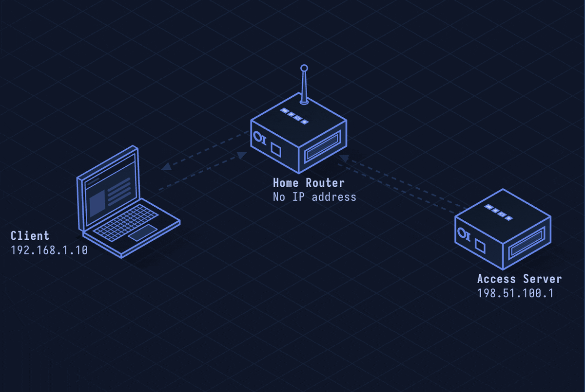

# PPPoE — Point-to-Point Protocol over Ethernet

> **Layer 2 · Data Link** | EtherType 0x8863/0x8864 | RFC 2516

## What Is PPPoE?

PPPoE wraps PPP (Point-to-Point Protocol) inside Ethernet frames. DSL internet connections typically use it: your router runs a PPPoE client that authenticates with the ISP's PPPoE server (BRAS) to get an IP address, handling authentication before DHCP-like assignment.

| Property | Value |
|----------|-------|
| Layer | Data Link (Layer 2) |
| EtherType | 0x8863 (discovery), 0x8864 (session) |
| Auth protocols | PAP, CHAP (over PPP) |
| Use cases | DSL (ADSL/VDSL), some fiber ONT connections |
| IP assignment | IPCP (not DHCP) |
| Defined In | RFC 2516 |

---

## Network Simulation



Router broadcasts PADI (discovery), ISP's BRAS responds with PADO, router sends PADR to chosen server, server sends PADS to establish session ID, PPP LCP negotiation runs, CHAP authentication, IPCP assigns IP, then data flows in PPP frames.

## Sequence Diagram


Shows: PADI broadcast, PADO unicast, PADR, PADS with session ID, LCP negotiation, CHAP challenge/response, IPCP IP assignment, data transfer, PADT teardown.

---

## Step-by-Step Walkthrough

### Step 1 · PPPoE Discovery Phase

Client finds available PPPoE servers:

```
Client → FF:FF:FF:FF:FF:FF (broadcast):
  EtherType: 0x8863
  PADI (PPPoE Active Discovery Initiation)
  Service-Name: "" (any)
  Host-Uniq: 0xdeadbeef (client's cookie)

Server → Client:
  PADO (PPPoE Active Discovery Offer)
  AC-Name: "ISP-BRAS-01"
  Service-Name: "internet"
  Host-Uniq: 0xdeadbeef (echoed back)

Client → Server:
  PADR (PPPoE Active Discovery Request)
  Service-Name: "internet"

Server → Client:
  PADS (PPPoE Active Discovery Session-confirmation)
  SESSION_ID: 0x0023   ← Session established
```

### Step 2 · PPP LCP Negotiation

PPP Link Control Protocol negotiates connection parameters:

```
Client → Server: LCP Configure-Request
  Max-Receive-Unit: 1492 (Ethernet 1500 - 8 byte PPPoE header)
  Auth-Protocol: CHAP
  Magic-Number: 0x12345678

Server → Client: LCP Configure-Ack
```

### Step 3 · Authentication (CHAP)

Challenge Handshake Authentication Protocol:

```
Server → Client: CHAP Challenge
  ID: 1
  Challenge: 0x9f3a2b1c... (random 16 bytes)
  Name: "ISP-BRAS-01"

Client → Server: CHAP Response
  ID: 1
  Response: MD5(ID || password || challenge)
  Name: "user@isp.com"

Server → Client: CHAP Success (or Failure)
  "Welcome"
```

### Step 4 · IPCP — IP Address Assignment

IP Control Protocol negotiates IP addresses:

```
Client → Server: IPCP Configure-Request
  IP-Address: 0.0.0.0 (requesting assignment)
  Primary DNS: 0.0.0.0

Server → Client: IPCP Configure-Nak
  IP-Address: 203.0.113.42 (suggested)
  Primary DNS: 8.8.8.8

Client → Server: IPCP Configure-Request
  IP-Address: 203.0.113.42 (accepting)

Server → Client: IPCP Configure-Ack
```

### Step 5 · Data Transfer

IP packets encapsulated in PPP frames inside PPPoE:

```
Ethernet: | Dst MAC | Src MAC | 0x8864 | SESSION_ID | Length |
PPP:      | 0xFF03 | Protocol (0x0021=IP) |
IP:       | IP Header | TCP/UDP | ...
```

MTU is 1492 (Ethernet 1500 - 8 byte PPPoE header) — apps must handle this.

### Step 6 · Teardown

```
Client or Server → other: PADT (PPPoE Active Discovery Termination)
  SESSION_ID: 0x0023
Session ends, LCP Terminate-Request/Ack exchange
```

---

## Security Considerations

| Attack | Mechanism |
|--------|-----------|
| **PADI Flood** | Flood PADI packets to exhaust BRAS session table |
| **PADO Spoofing** | Rogue PPPoE server on LAN intercepts authentication credentials |
| **CHAP Downgrade** | Force PAP (plaintext) authentication if server allows it |
| **PPPoE Starvation** | Fill SESSION_ID space to deny service to legitimate users |
| **MTU Black Hole** | 1492 MTU causes silent drops for PMTUD-broken paths |

**Mitigations:** PPPoE BRAS-side rate limiting, enforce CHAP only (never PAP), clamp TCP MSS to 1452 to handle MTU issues, 802.1X port auth on DSL access nodes.
