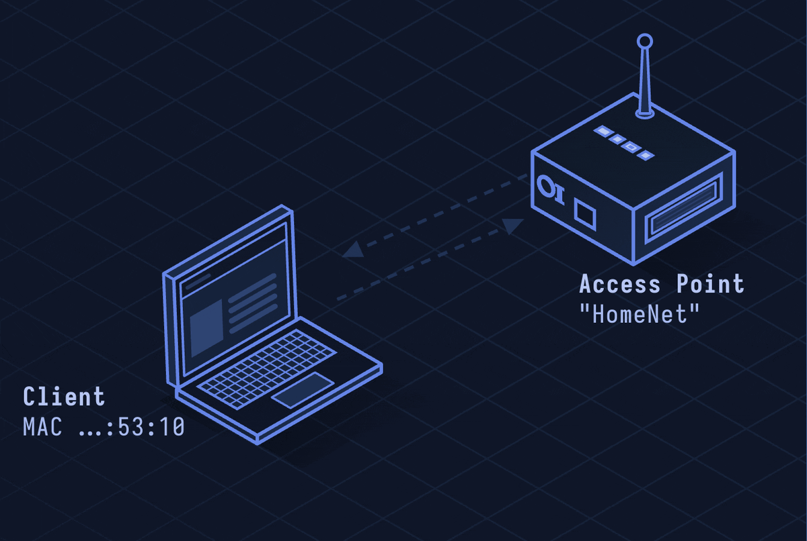

# Wi-Fi / WPA2 — Wireless LAN Security

> **Layer 2 · Data Link** | No fixed port | IEEE 802.11 / IEEE 802.11i

## What Is WPA2?

WPA2 (Wi-Fi Protected Access 2) is the security layer for Wi-Fi networks. It replaced WEP (broken) and WPA (interim fix). WPA2 uses AES-CCMP encryption and 802.1X or Pre-Shared Key (PSK) authentication. Most home and business Wi-Fi runs WPA2 or its successor WPA3.

| Property | Value |
|----------|-------|
| Layer | Data Link (Layer 2) |
| Standard | IEEE 802.11i |
| Encryption | AES-128 (CCMP mode) |
| Auth modes | Personal (PSK), Enterprise (802.1X/EAP) |
| Key exchange | 4-Way Handshake (EAPOL) |
| PTK size | 512 bits (derived per session) |
| Defined In | IEEE 802.11i-2004 |

---

## Network Simulation



Device sends 802.11 Probe Request, AP responds with Probe Response (SSID, capabilities), Association Request/Response, then 4-Way EAPOL handshake derives session keys, and encrypted 802.11 data frames flow.

## Sequence Diagram


Shows: Probe/Association, 4-Way EAPOL handshake (ANonce, SNonce, MIC verification, GTK delivery), data encryption with PTK, and deauthentication.

---

## Step-by-Step Walkthrough

### Step 1 · Discovery and Association

Client finds the AP and joins:

```
Client (Station) → Broadcast: Probe Request (SSID: "MyNetwork" or wildcard)
AP → Client: Probe Response (SSID, BSSID, RSN IE: AES/CCMP supported)
Client → AP: Authentication Request (open system)
AP → Client: Authentication Response (success)
Client → AP: Association Request (SSID, RSN IE: choosing AES/CCMP)
AP → Client: Association Response (Association ID assigned)
```

### Step 2 · PMK Derivation

For WPA2-Personal (PSK):

```
PMK = PBKDF2-HMAC-SHA1(passphrase, SSID, 4096 iterations, 32 bytes)
```

For WPA2-Enterprise (802.1X): PMK is derived from EAP authentication (RADIUS).

The PMK is shared secret used to generate session keys.

### Step 3 · 4-Way Handshake (EAPOL)

Derives unique per-session PTK (Pairwise Transient Key):

```
Message 1: AP → Client:  ANonce (random AP nonce)
Message 2: Client → AP:  SNonce + MIC
  Client derives PTK = PRF-512(PMK, "Pairwise key expansion",
                               AP_MAC + Client_MAC + ANonce + SNonce)
  MIC computed with KCK (key confirmation key portion of PTK)
Message 3: AP → Client:  GTK (Group Temporal Key, encrypted) + MIC
  AP independently derives same PTK, verifies client's MIC
  Installs PTK, sends GTK for broadcast/multicast
Message 4: Client → AP:  ACK (MIC)
  Both sides install keys — connection is now encrypted
```

PTK components:
- KCK (128b): Key Confirmation Key — MIC calculation
- KEK (128b): Key Encryption Key — encrypts GTK in msg 3
- TK (128b): Temporal Key — actual AES-CCMP data key

### Step 4 · AES-CCMP Frame Encryption

Each 802.11 data frame encrypted with AES-128-CCM:

```
MPDU Header | Ext IV (PN counter, Key ID) | Encrypted MSDU | MIC (8 bytes)
```

PN (Packet Number) prevents replay attacks — increments with each frame; AP discards out-of-order PNs.

### Step 5 · Deauthentication

Connection ends with deauth or disassociation frame (unprotected in WPA2 — fixed in WPA3):

```
AP or Client: Deauthentication frame
  Reason Code: 3 (Leaving)
```

Management frame protection (MFP / 802.11w) is optional in WPA2, mandatory in WPA3.

---

## Security Considerations

| Attack | Mechanism |
|--------|-----------|
| **KRACK** | Key Reinstallation Attack: force nonce reuse in 4-Way Handshake by replaying msg 3 |
| **PMKID Attack** | Capture single frame from AP (no 4-Way needed) to brute-force PSK offline |
| **Deauth Attack** | Forge deauthentication frames to kick clients, capture 4-Way handshake on reconnect |
| **Evil Twin AP** | Fake AP with same SSID; client connects and traffic is intercepted |
| **WPS PIN Brute Force** | 8-digit WPS PIN verifiable in halves; ~11,000 attempts to break |
| **Weak Password** | WPA2-PSK passphrase in dictionary is offline-crackable from captured handshake |

**Mitigations:** WPA3-SAE (see [lesson-30-wpa3.md](lesson-30-wpa3.md)), enable MFP (802.11w), disable WPS, use strong random passphrase (20+ chars), Enterprise 802.1X for large deployments.

---

*See also: [lesson-12-ssh.md](lesson-12-ssh.md) for secure remote access over Wi-Fi, [lesson-30-wpa3.md](lesson-30-wpa3.md) for the successor protocol.*
