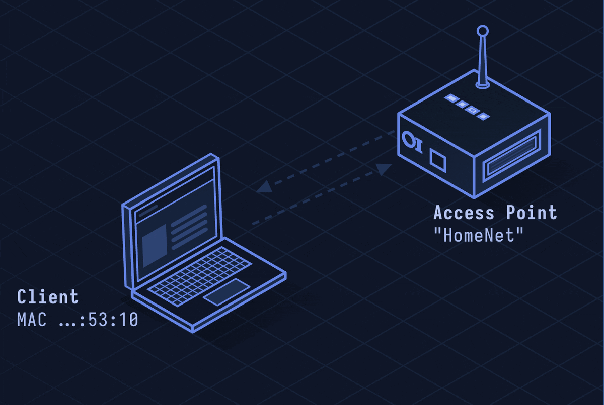

# WPA3 — Next-Generation Wi-Fi Security

> **Layer 2 · Data Link** | No fixed port | IEEE 802.11-2020 / Wi-Fi Alliance

## What Is WPA3?

WPA3 is the current Wi-Fi security standard, addressing WPA2's major weaknesses: offline dictionary attacks, deauthentication frame spoofing, and poor open-network security. Its key improvement is SAE (Simultaneous Authentication of Equals) — a password-authenticated key exchange that prevents offline cracking.

| Property | Value |
|----------|-------|
| Layer | Data Link (Layer 2) |
| Auth (Personal) | SAE (Dragonfly key exchange) |
| Auth (Enterprise) | 192-bit suite (GCMP-256, HMAC-SHA384) |
| Encryption | AES-256-GCM (Enterprise) / AES-128-CCM (Personal) |
| MFP | Mandatory (management frame protection) |
| Open network | OWE (Opportunistic Wireless Encryption) |
| Defined In | Wi-Fi Alliance WPA3 Spec 3.0 |

---

## Network Simulation



Client and AP exchange SAE Commit messages (DH values), then SAE Confirm messages, derive PMK without it being derivable from captured frames, complete 4-Way handshake for session keys, and exchange encrypted frames with PFS.

## Sequence Diagram


Shows: SAE Commit (Element + Scalar), SAE Confirm (Confirm value), PMK derivation, 4-Way EAPOL handshake with PTK, and OWE handshake for open networks.

---

## Step-by-Step Walkthrough

### Step 1 · SAE Handshake (Dragonfly)

WPA3-Personal replaces PSK with SAE:

```
Both sides know: password, AP MAC, Client MAC

Commit Phase:
  Client → AP: SAE Commit
    scalar_c = random, element_c = point on elliptic curve
    (derived from password via "hunting and pecking" or hash-to-curve)
  AP → Client: SAE Commit
    scalar_a, element_a

Confirm Phase:
  Both derive PMK = H(keyseed, ...) without exchanging it
  Client → AP: SAE Confirm (verify_c)
  AP → Client: SAE Confirm (verify_a)
```

Key property: **forward secrecy** — capturing the exchange doesn't allow offline brute-force.

### Step 2 · Why SAE Beats WPA2-PSK

WPA2-PSK flaw:
```
Attacker captures 4-Way handshake → offline brute force:
  Try "password123" → compute PMK → verify against MIC → match = cracked
```

WPA3-SAE:
```
No offline attack possible — PMK never transmitted
Attacker must interact with AP per guess (online only, rate-limited)
```

### Step 3 · OWE (Open Networks)

WPA3 replaces open (unencrypted) Wi-Fi with OWE — unauthenticated but encrypted:

```
Client and AP perform ECDH key exchange during association:
  Client → AP: DH public key (in Association Request)
  AP → Client: DH public key (in Association Response)
  Both derive shared secret → used for 4-Way handshake
  Result: encrypted but no identity verification
```

Coffee shop Wi-Fi with WPA3: still no authentication, but traffic is encrypted (passive sniffing blocked).

### Step 4 · Mandatory Management Frame Protection

WPA3 requires 802.11w (MFP):

```
Deauth, Disassoc frames are now protected with MIC
Forged deauth frames rejected — deauth attacks fail
```

### Step 5 · WPA3-Enterprise (192-bit)

Higher security mode for sensitive environments:

```
Suite B cryptography:
  GCMP-256 (AES-256-GCM) for data encryption
  BIP-GMAC-256 for management frame protection
  TLS 1.2+ with P-384 or P-521 for EAP
  HMAC-SHA-384 for key derivation
```

---

## Security Considerations

| Attack/Issue | Detail |
|--------------|--------|
| **Dragonblood** | Side-channel and timing attacks against SAE's hunting-and-pecking; patched by hash-to-curve method |
| **Transition Mode Downgrade** | Mixed WPA2/WPA3 networks allow clients to downgrade to WPA2 |
| **WPA3-Personal Still Weak PSKs** | SAE prevents offline cracking but not weak passwords used in online attacks |
| **OWE MITM** | OWE encrypts but doesn't authenticate the AP; evil twin still possible |
| **Implementation Bugs** | Early WPA3 implementations had SAE side-channels (Hostapd, iwd) |

**Mitigations:** WPA3-only mode (disable WPA2 compatibility), use strong passphrase, deploy 802.11w MFP as mandatory, patch hostapd/wpa_supplicant regularly.

---

*Previous: [lesson-29-wifi-wpa2.md](lesson-29-wifi-wpa2.md)*
