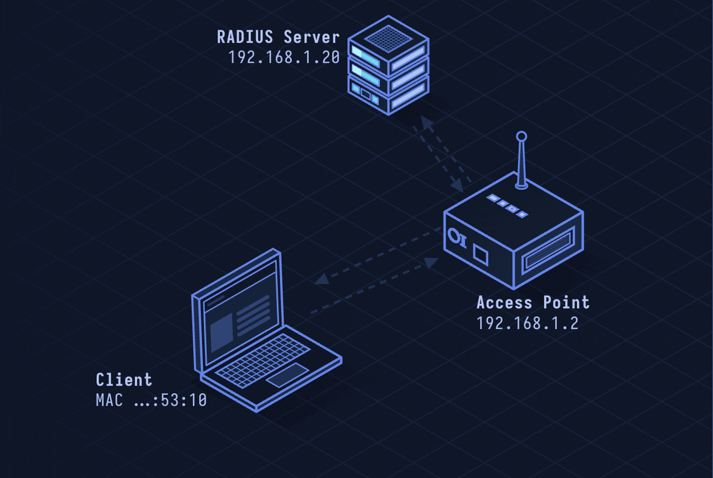

# RADIUS — Remote Authentication Dial-In User Service

> **Layer 7 · Application** | Port: 1812 (Auth) / 1813 (Accounting) UDP | RFC 2865

## What Is RADIUS?

RADIUS is the AAA (Authentication, Authorization, Accounting) protocol behind enterprise Wi-Fi, VPNs, and ISP dial-up. When you log into a corporate network with your username and password, a RADIUS server validates your credentials and tells the network device what you're allowed to access.

| Property | Value |
|----------|-------|
| Layer | Application (Layer 7) |
| Transport | UDP 1812 (auth), 1813 (accounting) |
| Security | Shared secret + MD5 (weak), use with TLS (RadSec) |
| AAA | Authentication, Authorization, Accounting |
| Use cases | Enterprise Wi-Fi (802.1X), VPN, ISP |
| Defined In | RFC 2865, 2866 |

---

## Network Simulation



Wi-Fi client authenticates to AP using EAP. AP (NAS) forwards credentials in RADIUS Access-Request to RADIUS server. Server validates against user database, returns Access-Accept with VLAN attributes. AP grants network access per the policy.

## Sequence Diagram


Shows: 802.1X EAP initiation, EAP-Request/Response, RADIUS Access-Request, RADIUS Access-Challenge (EAP), RADIUS Access-Accept with attributes, and Accounting-Start.

---

## Step-by-Step Walkthrough

### Step 1 · 802.1X EAP Supplicant

RADIUS is used with 802.1X authentication. Three roles:

```
Supplicant: the client (laptop, phone)
Authenticator: the network device (AP, switch) = NAS
Authentication Server: RADIUS server
```

Client connects to AP port. Port starts blocked (uncontrolled port only):

```
AP → Client: EAP-Request/Identity
Client → AP: EAP-Response/Identity "alice@company.com"
```

### Step 2 · RADIUS Access-Request

AP (NAS) packages the EAP message and sends to RADIUS:

```
RADIUS Access-Request:
  Code: 1 (Access-Request)
  Identifier: 42
  Authenticator: [16-byte random value]
  Attributes:
    User-Name: "alice@company.com"
    NAS-IP-Address: 10.0.0.1
    NAS-Port: 1
    EAP-Message: [EAP identity response]
    Message-Authenticator: HMAC-MD5(packet, shared-secret)
```

### Step 3 · EAP Method (PEAP/EAP-TLS)

RADIUS server challenges client for credentials:

```
RADIUS Access-Challenge → AP → Client: EAP-Request/PEAP (TLS Start)
Client → AP → RADIUS: EAP-Response/PEAP (TLS ClientHello)
...TLS handshake inside EAP tunnel...
Client sends MSCHAPv2 credentials inside TLS
RADIUS validates against Active Directory / LDAP
```

Common EAP methods:
| Method | Inner auth | Security |
|--------|-----------|---------|
| EAP-TLS | Client certificate | Strongest |
| PEAP-MSCHAPv2 | Username/Password | Good (TLS tunnel) |
| EAP-TTLS | Various | Good |
| LEAP | Proprietary | Weak (deprecated) |

### Step 4 · Access-Accept with Attributes

RADIUS server approves and returns policy attributes:

```
RADIUS Access-Accept:
  Code: 2
  Identifier: 42
  Attributes:
    Tunnel-Type: VLAN
    Tunnel-Medium-Type: IEEE 802
    Tunnel-Private-Group-ID: "100"   ← place user in VLAN 100
    Session-Timeout: 3600
    EAP-Message: [EAP Success]
```

AP unblocks port and places client in VLAN 100.

### Step 5 · Accounting

After session starts, AP sends accounting:

```
RADIUS Accounting-Request (Start):
  Code: 4
  Acct-Status-Type: Start
  Acct-Session-Id: "00000042"
  User-Name: "alice@company.com"
  NAS-IP-Address: 10.0.0.1
  Framed-IP-Address: 192.168.100.5
```

Accounting records session duration and bytes transferred for billing/auditing.

---

## Security Considerations

| Attack | Mechanism |
|--------|-----------|
| **RADIUS Blast RADIUS** | 2024 vulnerability — MD5 authenticator allows chosen-prefix collision attack to forge Access-Accept |
| **Credential Harvesting** | Rogue AP with fake RADIUS server captures MSCHAPv2 challenges for offline cracking |
| **Shared Secret Brute Force** | Weak RADIUS shared secret breaks Message-Authenticator integrity |
| **Accounting Manipulation** | Forge Accounting-Stop to end billing records early |
| **EAP Downgrade** | Force weak EAP method if server allows LEAP or EAP-MD5 |

**Mitigations:** Use RadSec (RADIUS over TLS/TCP port 2083), enforce EAP-TLS with client certificates, use strong random shared secrets (32+ bytes), patch against Blast RADIUS (salt the MD5 authenticator), use certificate pinning for PEAP inner tunnel validation.

---

*See also: [lesson-29-wifi-wpa2.md](lesson-29-wifi-wpa2.md) for 802.1X in Wi-Fi context.*
