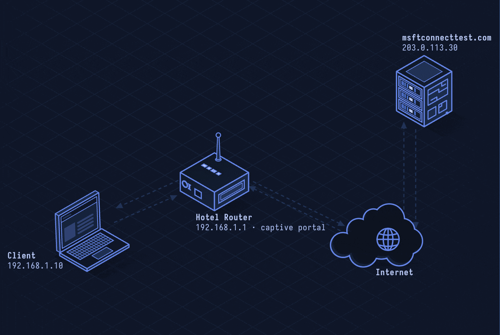

# Captive Portal — Gated Network Access

> **Layer 7 · Application** | Port: 80/443 (HTTP/HTTPS) | No single RFC

## What Is a Captive Portal?

A captive portal intercepts all HTTP traffic from a newly connected client and redirects them to a web page (login, terms of service, payment) before granting internet access. Hotels, airports, coffee shops, and conference networks use them. Technically it's a combination of DHCP, DNS hijacking, and HTTP redirection.

| Property | Value |
|----------|-------|
| Layer | Application (Layer 7) |
| Transport | HTTP/HTTPS |
| Mechanism | DNS redirect + HTTP 302/TCP reset |
| Detection | NoCaptivePortal API, probe URLs |
| Security | Varies widely (often none) |
| Standards | RFC 7710 (DHCP/RA option), RFC 8908 (Captive Portal API) |

---

## Network Simulation



Client connects to Wi-Fi, gets DHCP IP with captive portal option. Client's browser probe to detectportal.firefox.com gets redirected to portal page. User logs in. RADIUS or local rule unblocks client's MAC/IP. Browser probe succeeds, internet access opens.

## Sequence Diagram


Shows: DHCP with Option 114 (captive portal URL), HTTP probe redirect to portal, TLS portal page, authentication, ACL rule update, probe success, full internet access.

---

## Step-by-Step Walkthrough

### Step 1 · Network Connection and DHCP

Client connects to Wi-Fi, receives DHCP offer. Modern captive portals include portal URL in DHCP:

```
DHCP ACK:
  Your IP: 192.168.100.42
  Gateway: 192.168.100.1
  DNS: 192.168.100.1 (portal's DNS, hijacks all queries)
  Option 114 (Captive Portal): https://portal.hotel.com/login
```

### Step 2 · OS Detection Probe

Operating systems probe known URLs to detect captive portals:

```
iOS/macOS: GET http://captive.apple.com/hotspot-detect.html
Android:   GET http://connectivitycheck.gstatic.com/generate_204
Windows:   GET http://www.msftconnecttest.com/connecttest.txt
Firefox:   GET http://detectportal.firefox.com/success.txt
```

Expected response: 200 OK with specific content (or 204 No Content).
Captive portal response: 302 redirect to `https://portal.hotel.com/login`.

### Step 3 · DNS Hijacking

Before login, portal's DNS server redirects all queries to portal IP:

```
Client: DNS query → www.google.com A?
Portal DNS: → 192.168.100.1 (portal itself, not Google)

Result: HTTP request to any host → receives portal redirect
HTTPS requests: TCP RST or certificate error (can't redirect HTTPS cleanly)
```

### Step 4 · Portal Authentication

User authenticates via web form:

```
GET https://portal.hotel.com/login → TLS portal page
POST /login: username=guest&password=roomcode123&terms=accept
```

Portal validates credentials (or just accepts terms).

### Step 5 · Access Grant

Portal updates firewall/ACL to allow client:

```
Client MAC/IP added to allowed list:
  iptables -A FORWARD -s 192.168.100.42 -j ACCEPT
  
Or NAS sends RADIUS CoA (Change of Authorization):
  RADIUS CoA: Acct-Session-Id + Filter-Id update
```

### Step 6 · Captive Portal API (RFC 8908)

Modern standard: clients query a JSON endpoint instead of relying on HTTP probes:

```
GET https://portal.hotel.com/api/captiveportal/status

{
  "captive": true,
  "user-portal-url": "https://portal.hotel.com/login",
  "venue-info-url": "https://portal.hotel.com/info"
}
```

---

## Security Considerations

| Attack/Issue | Detail |
|--------------|--------|
| **HTTPS Bypass** | HTTPS sites can't be redirected; clients get certificate errors or just fail silently |
| **Evil Twin** | Attacker clones SSID and runs own portal to harvest credentials |
| **Credential Theft** | Portal login over HTTP exposes username/password on the wire |
| **MAC Spoofing** | Spoof authorized MAC to bypass portal entirely |
| **DNS Hijacking Scope** | Portal DNS hijacks all queries including DNSSEC, breaking validation |
| **Privacy** | Portal can log all visited domains via DNS while in captive state |

**Mitigations:** Only authenticate over HTTPS, use Captive Portal API (RFC 8908), implement per-session tokens, rotate MAC addresses (iOS 14+ does this), use VPN immediately after bypassing portal.
