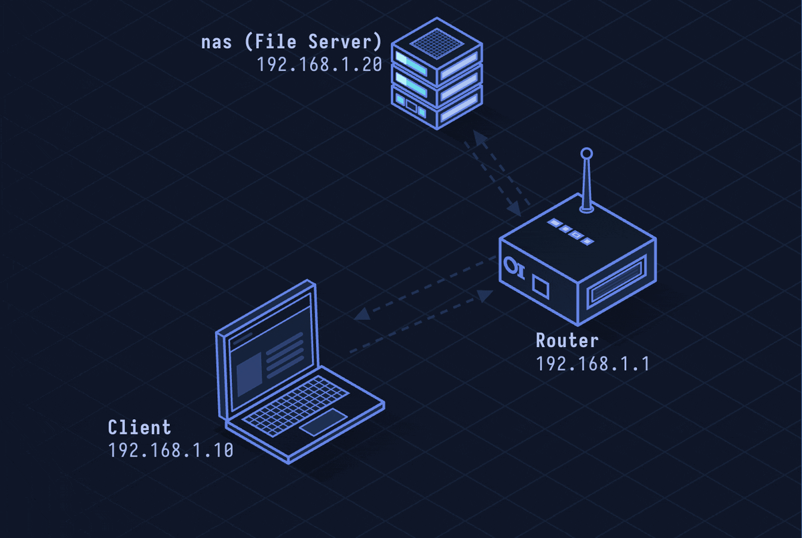

# SMB — Server Message Block

> **Layer 7 · Application** | Port: 445 (TCP) | Microsoft / Samba

## What Is SMB?

SMB is Windows' file sharing protocol. It lets clients browse, read, write, and execute files on remote servers as if they were local. Active Directory, Windows file shares, printers, and many internal Windows services depend on SMB. It's also one of the most attacked protocols in enterprise environments.

| Property | Value |
|----------|-------|
| Layer | Application (Layer 7) |
| Transport | TCP port 445 |
| Auth | NTLM or Kerberos |
| Current version | SMB 3.1.1 (Windows 10/Server 2016+) |
| Linux impl | Samba |
| Encryption | SMB 3.0+: AES-128-CCM/GCM |
| Defined In | MS-SMB2 (open specification) |

---

## Network Simulation



Client establishes TCP connection to port 445. SMB Negotiate selects dialect. Session Setup authenticates with Kerberos ticket. Tree Connect maps a share. Create/Read/Close operations access a file. Logoff and TCP close.

## Sequence Diagram


Shows: TCP connect, SMB Negotiate (dialect list → selected), Session Setup (NTLMSSP or Kerberos SPNEGO), Tree Connect, Create (open file), Read, Write, Close, Tree Disconnect, Logoff.

---

## Step-by-Step Walkthrough

### Step 1 · SMB Negotiate

Client and server agree on SMB dialect:

```
SMB2 Negotiate Request:
  DialectRevisions: [0x0202, 0x0210, 0x0300, 0x0302, 0x0311]
  Capabilities: DFS, LEASING, LARGE_MTU, MULTI_CHANNEL, PERSISTENT_HANDLES, ENCRYPTION

SMB2 Negotiate Response:
  DialectRevision: 0x0311 (SMB 3.1.1)
  NegotiateContexts:
    PreauthIntegrityCapabilities: SHA-512
    EncryptionCapabilities: AES-128-GCM
```

### Step 2 · Session Setup (Authentication)

Kerberos SPNEGO (preferred in domain):

```
SMB2 Session Setup Request:
  SecurityBlob: SPNEGO → KerberosV5 AP-REQ
    (Kerberos ticket for cifs/server.domain.com)

SMB2 Session Setup Response:
  Status: STATUS_SUCCESS
  SessionId: 0x0000000000000001
  SessionFlags: ENCRYPT_DATA
```

NTLM fallback (when Kerberos unavailable):

```
Session Setup Request:  NTLMSSP_NEGOTIATE
Session Setup Response: NTLMSSP_CHALLENGE (nonce)
Session Setup Request:  NTLMSSP_AUTH (username, NTLMv2 response)
```

### Step 3 · Tree Connect

Client mounts a share:

```
SMB2 Tree Connect Request:
  Path: \\fileserver.corp.com\Finance

SMB2 Tree Connect Response:
  TreeId: 0x00000001
  ShareType: DISK
  ShareFlags: ACCESS_BASED_DIRECTORY_ENUM | FORCE_LEVELII_OPLOCK
```

### Step 4 · File Operations

```
SMB2 Create Request:
  FileName: "Q4-Report.xlsx"
  CreateDisposition: OPEN
  DesiredAccess: FILE_READ_DATA | FILE_WRITE_DATA

SMB2 Create Response:
  FileId: 0x0000000000000001 (handle)

SMB2 Read Request:
  FileId: ..., Offset: 0, Length: 65536

SMB2 Read Response:
  Data: [65536 bytes of file content] (encrypted)

SMB2 Write Request:
  FileId: ..., Offset: 0, Data: [modified content]

SMB2 Close Request: FileId
```

### Step 5 · SMB Signing and Encryption

SMB 3.0+ can encrypt all traffic:

```
SMB3 Packet:
  Transform Header:
    ProtocolId: 0xFD534D42
    EncryptionAlgorithm: AES-128-GCM
    SessionId: 0x01
    Nonce: [unique per packet]
  Encrypted SMB Message
  Auth Tag: 16 bytes
```

---

## Security Considerations

| Attack | Mechanism |
|--------|-----------|
| **EternalBlue (MS17-010)** | SMBv1 buffer overflow; used by WannaCry ransomware to worm across networks |
| **NTLM Relay** | Capture NTLM auth challenge, relay to other service to authenticate as victim |
| **Pass-the-Hash** | Use stolen NTLM hash directly without cracking it |
| **SMB Brute Force** | Enumerate user accounts, brute-force passwords via SMB |
| **Ransomware Propagation** | Ransomware spread via SMB shares using stolen credentials or EternalBlue |
| **PrintNightmare** | SMB-exposed print spooler RPC allowed arbitrary code execution as SYSTEM |

**Mitigations:** Disable SMBv1 (Get-SmbServerConfiguration | Set-SmbServerConfiguration -EnableSMB1Protocol $false), enable SMB signing, block port 445 from internet, require SMB encryption (Set-SmbServerConfiguration -EncryptData $true), Kerberos over NTLM.
