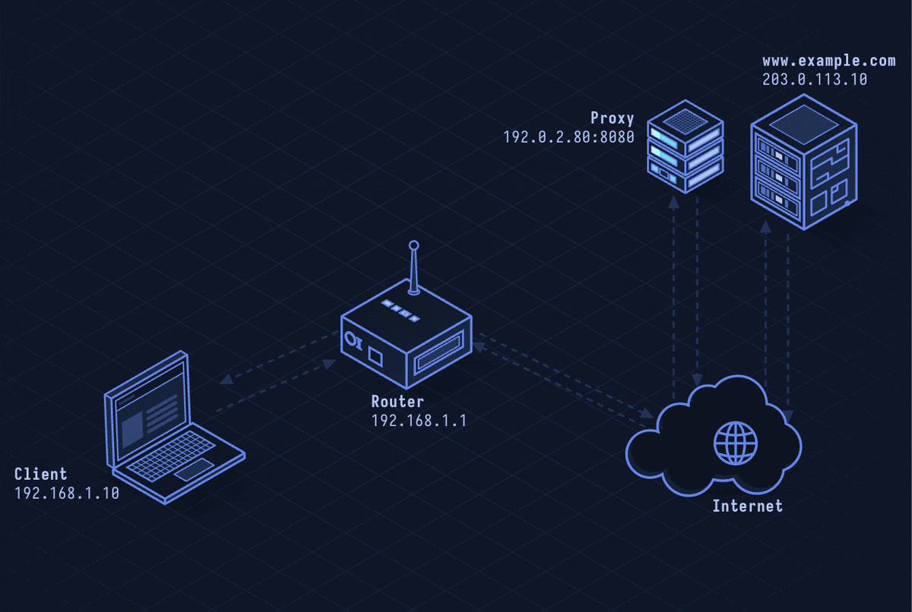

# HTTP Proxy / CONNECT — Traffic Forwarding

> **Layer 7 · Application** | Port: 3128 / 8080 (proxy), 443 (CONNECT) | RFC 7231, RFC 7235

## What Is an HTTP Proxy?

An HTTP proxy sits between clients and servers, forwarding HTTP requests on behalf of clients. Organizations use forward proxies for content filtering, caching, and logging. The CONNECT method tunnels HTTPS and other TCP protocols through a proxy.

| Property | Value |
|----------|-------|
| Layer | Application (Layer 7) |
| Transport | TCP |
| Proxy port | 3128 (Squid), 8080 (common), 8888 |
| CONNECT tunnel | TCP tunnel through proxy |
| Auth | Basic, Digest, NTLM, Negotiate |
| Use cases | Corporate filtering, caching, anonymization |
| Defined In | RFC 7231 §4.3.6 (CONNECT), RFC 7235 (auth) |

---

## Network Simulation



Client configures proxy. Plain HTTP: client sends full URL in GET request to proxy; proxy fetches and returns. HTTPS: client sends CONNECT to proxy; proxy opens TCP tunnel; client does TLS inside tunnel — proxy sees only encrypted data.

## Sequence Diagram


Shows: Client→Proxy HTTP GET with absolute URI, Proxy→Server HTTP GET, Server→Proxy response, Proxy→Client response. Then: CONNECT tunnel — Client→Proxy CONNECT, Proxy TCP connect to destination, 200 Connection Established, TLS ClientHello through tunnel.

---

## Step-by-Step Walkthrough

### Step 1 · Plain HTTP Forward Proxy

For HTTP (not HTTPS), the client sends the full URL to the proxy:

```
Client → Proxy:3128:

GET http://www.example.com/page.html HTTP/1.1
Host: www.example.com
Proxy-Connection: keep-alive
```

Note: The request line includes the full URL (`http://...`), not just the path (`/page.html`). This tells the proxy where to forward the request.

Proxy fetches from origin server and returns to client.

### Step 2 · Proxy Authentication

If proxy requires auth:

```
Client → Proxy: GET http://example.com/ HTTP/1.1

Proxy → Client: 407 Proxy Authentication Required
  Proxy-Authenticate: Basic realm="Proxy"

Client → Proxy: GET http://example.com/ HTTP/1.1
  Proxy-Authorization: Basic dXNlcjpwYXNz
```

NTLM/Negotiate auth requires multiple round trips (challenge-response).

### Step 3 · CONNECT Tunnel (HTTPS)

For HTTPS and other TCP protocols, client requests a raw tunnel:

```
Client → Proxy: CONNECT www.example.com:443 HTTP/1.1
Host: www.example.com:443

Proxy → www.example.com: TCP connect (3-way handshake)

Proxy → Client: HTTP/1.1 200 Connection Established

[From here: raw TCP data forwarded in both directions]

Client → Proxy → Server: TLS ClientHello
Server → Proxy → Client: TLS ServerHello + Certificate
[Full TLS session inside the tunnel]
```

The proxy cannot see the TLS content — it only sees encrypted bytes.

### Step 4 · SSL Inspection (Corporate MITM)

Corporate proxies break TLS to inspect HTTPS traffic:

```
Client → Proxy: CONNECT target.com:443
Proxy → Client: 200 Connection Established

[Proxy performs TLS as server to client]
Client: TLS ClientHello
Proxy: TLS ServerHello + forged certificate (signed by corporate CA)
Client trusts it because corporate CA is in system trust store

[Proxy performs TLS as client to real server]
Proxy: TLS ClientHello to target.com
Server: real certificate

Proxy decrypts, inspects, re-encrypts — full visibility into HTTPS
```

### Step 5 · Proxy Auto-Configuration (PAC)

Browsers and OS proxy settings use PAC files to decide when to use proxy:

```javascript
// proxy.pac served from internal server
function FindProxyForURL(url, host) {
  if (shExpMatch(host, "*.corp.internal")) return "DIRECT";
  if (isInNet(dnsResolve(host), "10.0.0.0", "255.0.0.0")) return "DIRECT";
  return "PROXY proxy.corp.com:3128; DIRECT";
}
```

WPAD (Web Proxy Auto-Discovery) automatically finds the PAC file via DHCP option 252 or DNS lookup for `wpad.domain.com`.

---

## Security Considerations

| Attack | Mechanism |
|--------|-----------|
| **SSRF via Proxy** | Server-side code using proxy to fetch URLs; attacker controls URL to reach internal services |
| **WPAD Hijacking** | Attacker controls `wpad.domain.com` to serve malicious PAC file; routes all traffic through attacker proxy |
| **Open Proxy** | Misconfigured proxy allows anyone to relay traffic, used for anonymization or scanning |
| **Proxy Header Injection** | Inject X-Forwarded-For, Forwarded headers to spoof client IP |
| **CONNECT to Internal Services** | Proxy allows CONNECT to any host:port; attacker tunnels to internal Redis/Elasticsearch |

**Mitigations:** Restrict CONNECT destinations to port 443, block WPAD DNS names, require proxy auth, log all CONNECT targets, use allowlist for proxy destinations.

---

*See also: [lesson-36-reverse-proxy.md](lesson-36-reverse-proxy.md) for server-side proxy, [lesson-35-socks5.md](lesson-35-socks5.md) for layer-agnostic tunneling.*
