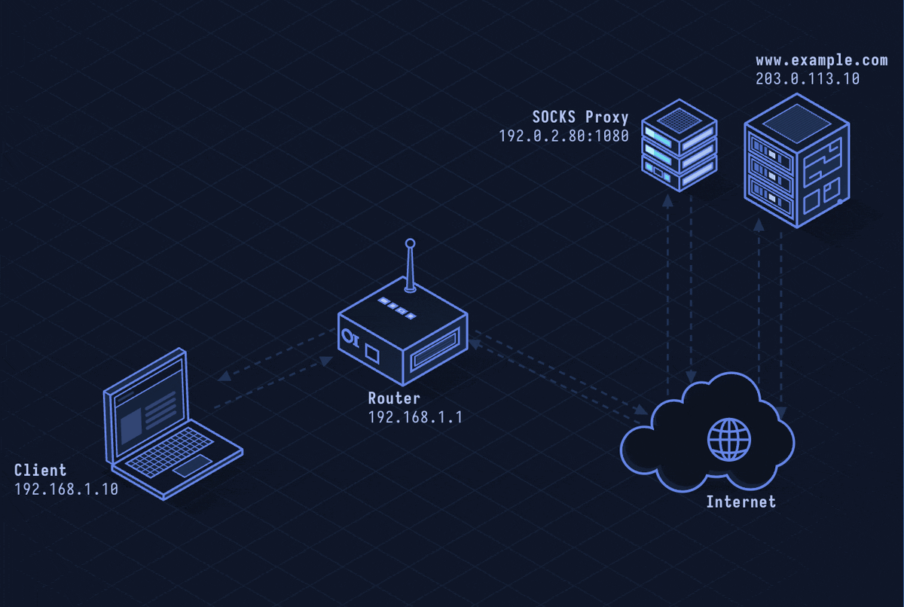

# SOCKS5 — Generic Proxy Protocol

> **Layer 5 · Session** | Port: 1080 (TCP) | RFC 1928

## What Is SOCKS5?

SOCKS5 is a universal proxy protocol that tunnels any TCP or UDP traffic — not just HTTP. SSH dynamic port forwarding creates a SOCKS5 proxy. Tor uses SOCKS5 as its exit interface. VPN clients and anonymization tools expose SOCKS5 endpoints.

| Property | Value |
|----------|-------|
| Layer | Session (Layer 5) |
| Transport | TCP (also UDP for ASSOCIATE) |
| Port | 1080 (default) |
| Protocol | SOCKS version 5 |
| Auth | None, Username/Password, GSSAPI |
| TCP proxy | Yes (CONNECT command) |
| UDP proxy | Yes (UDP ASSOCIATE command) |
| DNS | Optional (DNS requests forwarded through proxy) |
| Defined In | RFC 1928 |

---

## Network Simulation



Client connects to SOCKS5 proxy on port 1080. Auth negotiation. Client sends CONNECT command for target host:port. Proxy opens TCP connection to target. Data flows through the tunnel. UDP ASSOCIATE shown for DNS-over-SOCKS.

## Sequence Diagram


Shows: Greeting (auth methods), server method selection, username/password auth, CONNECT request with IPv4/hostname/IPv6, BND reply with bound address, TCP tunnel established, bidirectional data, and UDP ASSOCIATE flow.

---

## Step-by-Step Walkthrough

### Step 1 · Greeting — Method Negotiation

```
Client → Proxy: 
  VER: 0x05 (SOCKS5)
  NMETHODS: 0x02
  METHODS: [0x00 (no auth), 0x02 (username/password)]

Proxy → Client:
  VER: 0x05
  METHOD: 0x02 (username/password selected)
```

Methods:
- `0x00`: No authentication
- `0x01`: GSSAPI
- `0x02`: Username/password
- `0xFF`: No acceptable method (connection refused)

### Step 2 · Authentication (Username/Password)

```
Client → Proxy:
  VER: 0x01 (sub-version for auth)
  ULEN: 5
  UNAME: "alice"
  PLEN: 8
  PASSWD: "s3cr3t!!"

Proxy → Client:
  VER: 0x01
  STATUS: 0x00 (success)
```

### Step 3 · CONNECT Request

```
Client → Proxy:
  VER: 0x05
  CMD: 0x01 (CONNECT)
  RSV: 0x00 (reserved)
  ATYP: 0x03 (domain name)
  DST.ADDR: 0x0B + "example.com" (length-prefixed)
  DST.PORT: 0x01BB (443)

Proxy → Client:
  VER: 0x05
  REP: 0x00 (success)
  RSV: 0x00
  BNDADR: 0x01 (IPv4) + proxy's outbound IP
  BND.PORT: proxy's outbound port
```

Proxy opens TCP connection to `example.com:443`. All subsequent data forwarded transparently.

### Step 4 · DNS Proxying

SOCKS5 with ATYP=0x03 (domain name) lets the proxy resolve the domain — the client never does DNS:

```
Hostname in CONNECT command → proxy resolves it
Client's DNS traffic bypasses local DNS entirely
Privacy benefit: ISP can't see queried domains
```

### Step 5 · SSH Dynamic Port Forwarding (SOCKS5)

SSH creates a SOCKS5 proxy locally:

```bash
ssh -D 1080 user@jump-host.example.com
```

Configure browser to use `socks5h://127.0.0.1:1080` — all browser traffic routed through the SSH tunnel.

The `h` in `socks5h` means DNS resolved by the proxy (the SSH server), not locally.

### Step 6 · UDP ASSOCIATE

For UDP proxying (DNS, gaming, media):

```
Client → Proxy: CMD: 0x03 (UDP ASSOCIATE)
Proxy → Client: BND.ADDR + BND.PORT (UDP relay endpoint)

Client → UDP relay:
  RSV (2B) + FRAG (1B) + ATYP + DST.ADDR + DST.PORT + DATA

Proxy relays UDP packets to destination and back
```

---

## Security Considerations

| Attack | Mechanism |
|--------|-----------|
| **Open SOCKS Proxy** | Exposed 1080 port allows anyone to relay traffic through your IP |
| **SOCKS Proxy for Malware C2** | Malware installs SOCKS proxy on victim, attackers proxy through it |
| **DNS Leak** | SOCKS4 (not SOCKS5) doesn't support domain names; DNS resolved locally, leaks destinations |
| **Credential Interception** | SOCKS5 auth in plaintext; sniff username/password on network |
| **Fingerprinting** | Timing and flow patterns can reveal SOCKS usage even without decryption |

**Mitigations:** Bind SOCKS proxy to localhost only (127.0.0.1), require auth, use SOCKS5h for DNS privacy, wrap in TLS (SSH, Shadowsocks), monitor for unexpected port 1080 listeners.

---

*See also: [lesson-13-ssh.md](lesson-13-ssh.md) for SSH tunneling, [lesson-34-http-proxy.md](lesson-34-http-proxy.md) for HTTP-specific proxying.*
