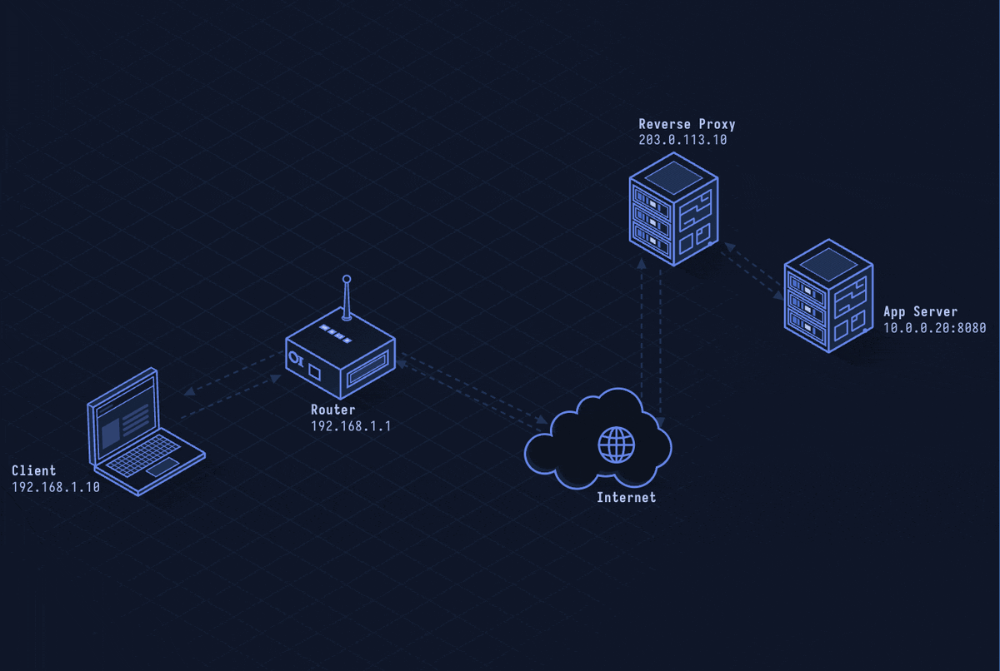

# Reverse Proxy — Server-Side Traffic Gateway

> **Layer 7 · Application** | Port: 80/443 | No single RFC

## What Is a Reverse Proxy?

A reverse proxy sits in front of web servers and accepts client requests on their behalf. Unlike a forward proxy (which serves clients), a reverse proxy serves the server side — handling TLS termination, load balancing, caching, authentication, and DDoS protection. Nginx, Caddy, HAProxy, and AWS ALB are common reverse proxies.

| Property | Value |
|----------|-------|
| Layer | Application (Layer 7) |
| Faces | Public internet (clients) |
| Hides | Backend servers |
| Functions | TLS termination, LB, caching, WAF, auth |
| Common software | Nginx, Apache, HAProxy, Caddy, Envoy |
| Cloud services | AWS ALB/NLB, Cloudflare, Fastly |

---

## Network Simulation



Client connects to reverse proxy on 443. Proxy terminates TLS. Proxy selects backend server via load balancing policy. Proxy forwards request via HTTP to backend on port 8080. Backend responds. Proxy adds headers and returns to client.

## Sequence Diagram


Shows: Client TLS to proxy, proxy terminates TLS, proxy HTTP to backend 1 and backend 2 (load balanced), proxy adds X-Forwarded-For and X-Real-IP headers, response with caching headers, and 503 failover when backend is down.

---

## Step-by-Step Walkthrough

### Step 1 · TLS Termination

Client connects to `https://api.example.com`:

```
Client → Proxy:443: TLS handshake
  SNI: api.example.com
  → Proxy presents certificate for api.example.com
  → TLS session established

Proxy → Backend:8080: plain HTTP (internal network)
  GET /users HTTP/1.1
  Host: api.example.com
  X-Forwarded-For: 203.0.113.42 (original client IP)
  X-Forwarded-Proto: https
  X-Real-IP: 203.0.113.42
```

Backend sees plaintext HTTP; TLS overhead handled by proxy.

### Step 2 · Load Balancing

Proxy distributes requests across backend pool:

```nginx
upstream api_backend {
  least_conn;  # algorithm: least connections
  server 10.0.1.1:8080 weight=3;
  server 10.0.1.2:8080 weight=1;
  server 10.0.1.3:8080 backup;
}
```

Algorithms:
| Algorithm | Use case |
|-----------|---------|
| Round-robin | Equal servers |
| Least connections | Long-lived connections |
| IP hash | Session stickiness |
| Weighted | Servers with different capacity |

### Step 3 · Health Checks

Proxy monitors backends, removes unhealthy ones:

```
Proxy → Backend: GET /health HTTP/1.1
Backend → Proxy: 200 OK {"status": "ok"}

If 3 consecutive failures: mark backend DOWN
  → remove from rotation
  → failover to remaining backends
```

### Step 4 · Request Rewriting

Proxy can modify requests before forwarding:

```nginx
location /api/ {
  proxy_pass http://api_backend/;    # strip /api/ prefix
  proxy_set_header Host $http_host;
  proxy_set_header X-Forwarded-For $remote_addr;
  proxy_hide_header Server;          # hide backend server identity
  add_header X-Frame-Options DENY;  # security header
}
```

### Step 5 · Caching

Proxy caches responses to reduce backend load:

```
Client: GET /static/logo.png
Proxy: Cache miss → fetch from backend
  Store with key: host + URI + Vary headers
  Set Expires / Cache-Control headers

Client (second request): GET /static/logo.png
Proxy: Cache hit → return cached response (no backend request)
```

### Step 6 · Web Application Firewall (WAF)

Many reverse proxies include WAF capabilities:

```
Request: GET /users?id=1 OR 1=1--
WAF Rule: SQL injection pattern detected
Action: Block request → return 403 Forbidden
Log: WAF_BLOCK src=203.0.113.42 rule=942100 msg="SQL Injection"
```

---

## Security Considerations

| Attack | Mechanism |
|--------|-----------|
| **Request Smuggling** | Ambiguous Content-Length vs Transfer-Encoding causes proxy and backend to disagree on request boundaries |
| **Host Header Injection** | Proxy passes untrusted Host header; backend uses it for redirects or cache poisoning |
| **SSRF via Proxy** | Proxy forwards requests to internal backends; attacker manipulates Host to reach internal services |
| **TLS Downgrade** | Proxy configured for TLS 1.0 or no HSTS; attacker downgrades connection |
| **Backend IP Leakage** | Error pages or headers expose internal backend IPs |
| **Cache Poisoning** | Forge cache key headers to store malicious response in proxy cache |

**Mitigations:** Normalize Host headers, enable HSTS at proxy, strip or override backend headers (Server, X-Powered-By), validate backend certificates (don't skip TLS verification on backend), use `proxy_pass` with explicit upstream (not user-supplied host), configure CSP and security headers at proxy layer.

---

*See also: [lesson-34-http-proxy.md](lesson-34-http-proxy.md) for forward proxy, [lesson-02-http.md](lesson-02-http.md) for HTTP fundamentals.*
