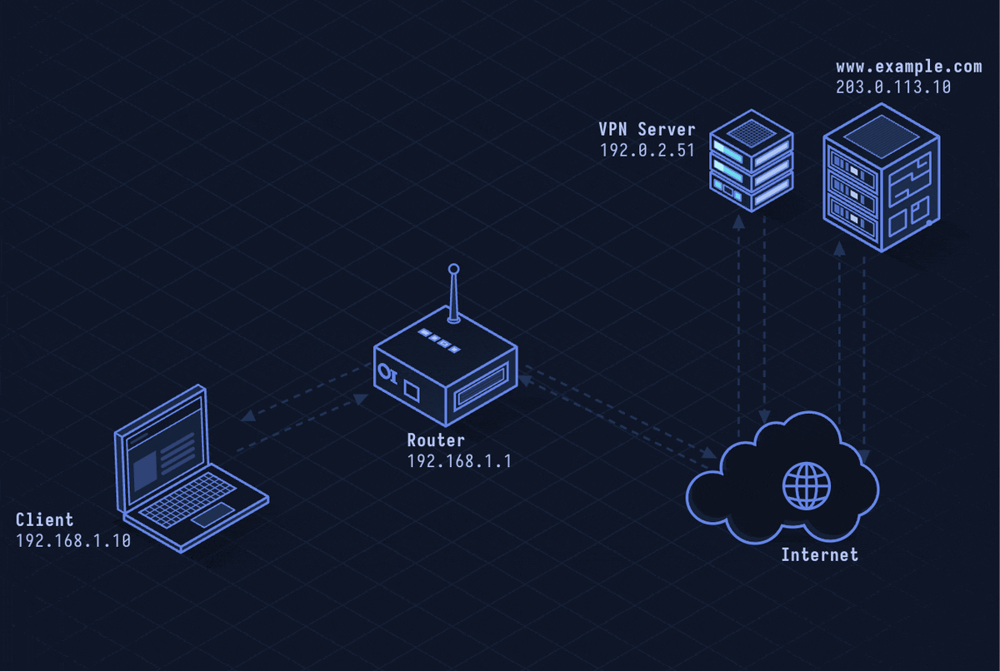

# WireGuard — Modern VPN Protocol

> **Layer 3 · Network** | Port: 51820 (UDP) | RFC-like whitepaper

## What Is WireGuard?

WireGuard is a modern, minimal VPN protocol. It replaces OpenVPN and IPsec with a ~4000-line kernel module that uses fixed, state-of-the-art cryptography. No negotiation, no cipher agility — just ChaCha20-Poly1305 and Curve25519, chosen and baked in.

| Property | Value |
|----------|-------|
| Layer | Network (Layer 3) |
| Transport | UDP port 51820 (default) |
| Encryption | ChaCha20-Poly1305 |
| Key exchange | Noise_IKpsk2 (Curve25519 + HKDF) |
| Auth | Static Curve25519 keypair per peer |
| Connection | Stateless handshake (~1 RTT) |
| Kernel | Linux 5.6+, Windows, macOS, iOS, Android |
| Design doc | WireGuard whitepaper (Donenfeld, 2017) |

---

## Network Simulation



Client sends first encrypted packet, triggering handshake. Initiator and responder exchange handshake messages (Noise handshake). Session keys derived. Encrypted IP packets encapsulated in UDP and flow through the tunnel. Roaming: client IP changes, same public key continues session.

## Sequence Diagram


Shows: Initiator handshake message 1 (ephemeral key + static key + timestamp), responder handshake message 2 (ephemeral + static + cookie), transport data messages (counter + encrypted IP packet), and connection migration on IP change.

---

## Step-by-Step Walkthrough

### Step 1 · Key Generation

Each WireGuard peer generates a Curve25519 keypair:

```bash
wg genkey | tee private.key | wg pubkey > public.key

private.key: 32 bytes random scalar
public.key:  Curve25519 point = private * G
```

Peers exchange public keys out-of-band (config file, QR code, API).

### Step 2 · Configuration

```ini
# /etc/wireguard/wg0.conf (server)
[Interface]
PrivateKey = <server-private-key>
Address = 10.0.0.1/24
ListenPort = 51820

[Peer]
PublicKey = <client-public-key>
AllowedIPs = 10.0.0.2/32  # only route this IP to this peer
```

```ini
# Client config
[Interface]
PrivateKey = <client-private-key>
Address = 10.0.0.2/24

[Peer]
PublicKey = <server-public-key>
Endpoint = vpn.example.com:51820
AllowedIPs = 0.0.0.0/0  # route all traffic through VPN
```

### Step 3 · Handshake (Noise_IKpsk2)

Triggered when client sends first packet to a known peer:

```
Initiator → Responder: Handshake Initiation (148 bytes)
  Ephemeral public key (encrypted)
  Static public key (encrypted, authenticated)
  Timestamp (encrypted, authenticated)
  MAC1 (rate-limiting cookie check)

Responder → Initiator: Handshake Response (92 bytes)
  Ephemeral public key (encrypted)
  Empty payload (authenticated)
  MAC1
```

Both sides derive symmetric session keys:
```
Chain key mixes:  initiator static, responder static,
                  initiator ephemeral, responder ephemeral, PSK
Result: two 32-byte session keys (send / receive per side)
```

### Step 4 · Transport Packets

Data encapsulated as:

```
UDP packet:
  WireGuard Header:
    Type: 0x00000004 (data)
    Receiver Index: 4-byte session ID
    Counter: 8-byte nonce (monotonically increasing)
  Encrypted Payload:
    ChaCha20-Poly1305(IP packet, nonce=counter, key=session_key)
  Auth Tag: 16 bytes
```

Counter prevents replay attacks. Receives packets out of order up to a window (64 packets).

### Step 5 · Roaming (Connection Migration)

WireGuard is stateless — no connection concept:

```
Client IP changes (mobile handover, Wi-Fi→4G):
  Next packet from new IP/port accepted if:
    MAC authenticates with known peer public key
    Counter is fresh (not replayed)
  Server updates peer's endpoint transparently
  No reconnection required
```

### Step 6 · AllowedIPs Routing

WireGuard uses allowed-IPs as a routing table AND access control:

```
Incoming packet source IP must be in peer's AllowedIPs
  → if not: dropped
Outgoing packet destination IP matches peer's AllowedIPs
  → route through that peer's tunnel
```

---

## Security Considerations

| Attack/Issue | Detail |
|--------------|--------|
| **Static Public Key = Identity** | Public key is stable identifier; correlation across VPN servers |
| **No PFS Without Rekey** | Handshake happens every 180s max; captured traffic decryptable if session key compromised before rekey |
| **Timing Fingerprinting** | Silence is maintained between peers without keep-alive; connection timing is visible |
| **AllowedIPs Misconfiguration** | 0.0.0.0/0 routes all traffic including local; split-tunnel misconfiguration exposes internals |
| **DNS Leaks** | Traffic through tunnel but DNS queries using system resolver bypass VPN |

**Mitigations:** Use pre-shared key (PSK) for quantum resistance, rotate key pairs periodically, configure DNS inside tunnel (via AllowedIPs + DoH), use UAPI or WireGuard manager for key management, monitor for leaks.

---

*See also: [lesson-13-ssh.md](lesson-13-ssh.md) for SSH tunneling, [lesson-38-ipsec.md](lesson-38-ipsec.md) for IPsec comparison.*
