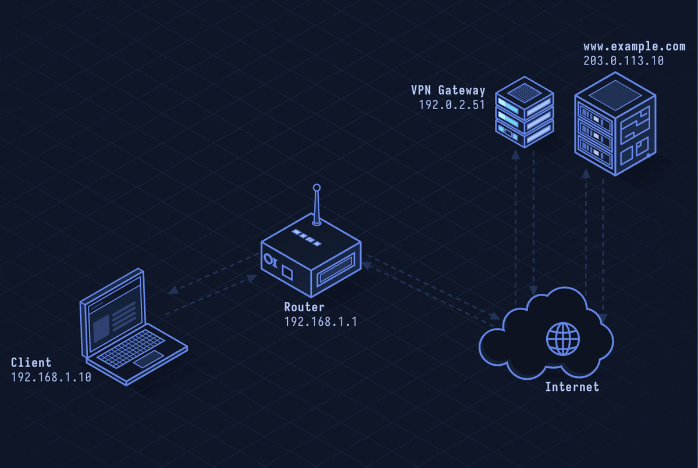

# IPsec — IP Security Architecture

> **Layer 3 · Network** | Protocol: 50 (ESP) / 51 (AH) / UDP 500 & 4500 | RFC 4301

## What Is IPsec?

IPsec secures IP packets at the network layer — below TCP/UDP. It provides encryption (ESP), authentication (AH), and key exchange (IKEv2). Site-to-site VPNs between routers, remote-access VPN clients, and encrypted backbone links use IPsec. It's older and more complex than WireGuard but widely deployed in enterprise and ISP infrastructure.

| Property | Value |
|----------|-------|
| Layer | Network (Layer 3) |
| Protocols | ESP (50), AH (51), IKEv2 (UDP 500/4500) |
| Encryption | AES-GCM, AES-CBC, ChaCha20 |
| Integrity | HMAC-SHA256/384/512 |
| Key exchange | IKEv2 (RFC 7296) |
| Modes | Transport (host-to-host), Tunnel (gateway-to-gateway) |
| Defined In | RFC 4301, 7296 |

---

## Network Simulation



Two gateways exchange IKEv2 SA_INIT messages to establish the IKE SA, then IKE_AUTH authenticates both sides and creates the first CHILD_SA (IPsec SA). ESP packets encapsulate IP traffic between the two networks, encrypted and authenticated.

## Sequence Diagram


Shows: IKEv2 SA_INIT (DH exchange + nonces), IKE_AUTH (identity + certificate/PSK auth + CREATE_CHILD_SA), ESP tunnel traffic, periodic INFORMATIONAL keepalives, and CHILD_SA rekey.

---

## Step-by-Step Walkthrough

### Step 1 · IKEv2 Phase 1 — SA_INIT

Establish the IKE Security Association (control channel):

```
Initiator → Responder (UDP 500):
  IKE_SA_INIT Request:
    SA: Propose cipher suites (AES-256-GCM, DH Group 20/P-384, PRF-SHA384)
    KE: DH public key (Group 20)
    Nonce: Ni (32 bytes random)

Responder → Initiator:
  IKE_SA_INIT Response:
    SA: Selected cipher suite
    KE: DH public key
    Nonce: Nr
    CERTREQ: (request certificate from initiator)
```

Both sides compute SKEYSEED = prf(Ni | Nr, g^ir):
- SK_d: key derivation material
- SK_ai/SK_ar: IKE integrity keys
- SK_ei/SK_er: IKE encryption keys

### Step 2 · IKEv2 Phase 2 — IKE_AUTH

Authenticate and create first IPsec SA:

```
Initiator → Responder (encrypted + authenticated):
  IKE_AUTH Request:
    IDi: "gateway-a@example.com"
    CERT: X.509 certificate
    AUTH: RSA signature over previous messages
    SA: Propose IPsec SA (AES-256-GCM)
    TSi: 10.0.1.0/24 (traffic selector — interesting traffic)
    TSr: 10.0.2.0/24

Responder → Initiator:
  IKE_AUTH Response:
    IDr: "gateway-b@example.com"
    CERT + AUTH
    SA: Accepted IPsec SA
    TSi/TSr: Confirmed selectors
```

IPsec SA created with keys derived from SKEYSEED + TSi/TSr.

### Step 3 · ESP Packet (Tunnel Mode)

IPsec in tunnel mode wraps entire original IP packet:

```
+------------------+---------------------+------------------+
| New IP Header    |   ESP Header        | Original Packet  | Auth Tag |
| (gateway→gateway)| SPI + Sequence Num  | (encrypted)      |          |
+------------------+---------------------+------------------+----------+

SPI (Security Parameter Index): identifies which SA to use
Sequence Number: monotonic, anti-replay
Payload: AES-GCM encrypted (original IP header + data + padding)
Auth Tag: GCM authentication tag (or HMAC for older modes)
```

### Step 4 · Transport vs Tunnel Mode

```
Transport mode: Protects only transport payload (host-to-host)
  [IP Header][ESP Header][TCP/UDP Header + Data][Auth Tag]
  
Tunnel mode: Wraps entire packet (gateway-to-gateway, remote access)
  [New IP Header][ESP Header][Original IP Header + TCP/UDP + Data][Auth Tag]
```

### Step 5 · NAT Traversal (NAT-T)

IPsec can't traverse NAT because NAT changes IP/port and breaks AH authentication. Solution: ESP-in-UDP encapsulation on port 4500:

```
Detector: IKEv2 sends NAT_DETECTION_SOURCE_IP notify payload
If NAT detected: switch to UDP 4500
ESP packets wrapped: UDP 4500 | NON-ESP Marker | ESP Packet
```

### Step 6 · Rekeying

CHILD_SA rekeycd every 1 hour (default) or at byte limit:

```
Initiator → Responder: CREATE_CHILD_SA Request
  SA: New cipher proposal
  KE: New DH group
  Nonce: new

Responder → Initiator: CREATE_CHILD_SA Response
  New CHILD_SA SPI allocated
  
Old SA active until new SA confirmed, then deleted
```

---

## Security Considerations

| Attack | Mechanism |
|--------|-----------|
| **IKEv1 Aggressive Mode** | Leaks hash of PSK; offline dictionary attack |
| **Weak PSK** | Pre-shared key brute-forceable offline from IKE exchange |
| **Main Mode with PSK Identity Disclosure** | Sends identity before authentication in IKEv1 main mode |
| **Downgrade to IKEv1** | Force negotiation to vulnerable IKEv1 |
| **Certificate Revocation Bypass** | CRL not checked; revoked certificate accepted |
| **Traffic Selector Mismatch** | Route traffic around IPsec SA if selector too narrow |

**Mitigations:** Use IKEv2 only (never IKEv1), use certificates over PSK, check OCSP/CRL, use AES-GCM (not AES-CBC+HMAC), enable Dead Peer Detection (DPD), use strong DH groups (≥256-bit ECC).

---

*See also: [lesson-37-wireguard.md](lesson-37-wireguard.md) for modern VPN alternative.*
