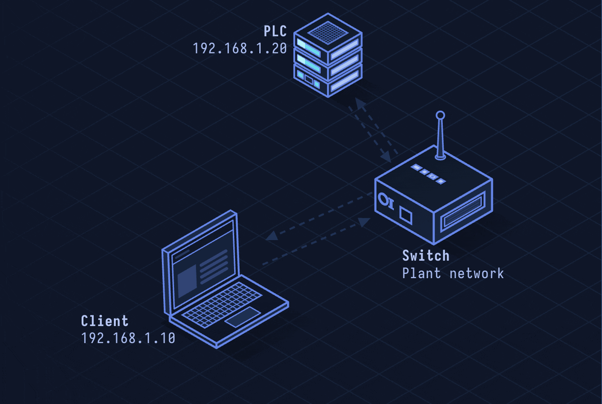

# Modbus — Industrial Control Protocol

> **Layer 7 · Application** | Port: 502 (TCP) / Serial | Modicon, 1979 / open standard

## What Is Modbus?

Modbus is the most widely used industrial communication protocol. It connects PLCs (Programmable Logic Controllers), sensors, and SCADA systems in factories, power plants, water treatment facilities, and building automation. Created in 1979 and unchanged at its core — it has no authentication, no encryption, and no access control.

| Property | Value |
|----------|-------|
| Layer | Application (Layer 7) |
| Transport | TCP port 502 (Modbus TCP), RS-232/RS-485 (RTU) |
| Model | Master/Slave (Client/Server) |
| Auth | None |
| Encryption | None |
| Origins | Modicon (1979) — now open |
| Variants | Modbus RTU (serial), Modbus TCP (Ethernet), Modbus ASCII |

---

## Network Simulation



SCADA master sends Modbus TCP Read Holding Registers request to PLC slave. PLC responds with register values (temperature, pressure readings). SCADA sends Write Single Coil to close a valve. PLC responds with echo confirming the command.

## Sequence Diagram


Shows: TCP connect to port 502, Read Coils request/response, Read Holding Registers, Write Single Coil (actuator command), Write Multiple Registers, and exception response.

---

## Step-by-Step Walkthrough

### Step 1 · Modbus Data Model

Modbus organizes device data into four tables:

| Table | Type | Access | Typical use |
|-------|------|--------|-------------|
| Coils (0x) | 1-bit | Read/Write | Digital outputs (relay on/off) |
| Discrete Inputs (1x) | 1-bit | Read only | Digital inputs (switch state) |
| Input Registers (3x) | 16-bit | Read only | Analog inputs (sensor values) |
| Holding Registers (4x) | 16-bit | Read/Write | Configuration, setpoints |

### Step 2 · Modbus TCP Frame

```
MBAP Header (7 bytes):
  Transaction ID:  2 bytes  (request-response matching)
  Protocol ID:     2 bytes  (0x0000 for Modbus)
  Length:          2 bytes  (bytes remaining)
  Unit ID:         1 byte   (slave device ID)

PDU (Protocol Data Unit):
  Function Code:   1 byte
  Data:            variable
```

### Step 3 · Read Holding Registers (FC 0x03)

SCADA reads temperature/pressure from PLC:

```
Request:
  Transaction: 0x0001
  Protocol:    0x0000
  Length:      0x0006
  Unit ID:     0x01       (device 1)
  FC:          0x03       (Read Holding Registers)
  Start Addr:  0x006B     (register 107)
  Quantity:    0x0003     (read 3 registers)

Response:
  Transaction: 0x0001
  FC:          0x03
  Byte Count:  0x06       (3 registers × 2 bytes)
  Data:        0x022B     (register 107: 555 = 55.5°C)
              0x0000     (register 108: 0)
              0x0064     (register 109: 100)
```

### Step 4 · Write Single Coil (FC 0x05)

SCADA commands PLC to open/close a valve:

```
Request:
  FC:         0x05       (Write Single Coil)
  Coil Addr:  0x00AC     (coil 172)
  Value:      0xFF00     (0xFF00 = ON, 0x0000 = OFF)

Response (echo of request = success):
  FC:         0x05
  Coil Addr:  0x00AC
  Value:      0xFF00
```

### Step 5 · Exception Responses

When an error occurs, slave returns function code + 0x80:

```
Request FC: 0x03 (Read Holding Registers)
Error Response:
  FC: 0x83 (0x03 | 0x80)
  Exception Code:
    01: Illegal Function
    02: Illegal Data Address
    03: Illegal Data Value
    04: Slave Device Failure
```

### Step 6 · Modbus RTU (Serial)

Over RS-485 serial:

```
[Slave Address][FC][Data][CRC-16]

No TCP wrapper; slave address in first byte
CRC-16/IBM instead of TCP checksum
```

Modbus ASCII variant encodes each byte as two ASCII hex characters.

---

## Security Considerations

| Attack | Mechanism |
|--------|-----------|
| **Unauthenticated Commands** | Any TCP client on port 502 can issue write commands — no auth required |
| **Replay Attack** | Capture legitimate SCADA command, replay later to manipulate actuators |
| **Command Injection** | Write malicious setpoints or coil values to damage physical equipment |
| **Reconnaissance** | Read all registers to map process variables — no read access control |
| **Modbus Fuzzing** | Malformed function codes crash PLCs with no error recovery |
| **Stuxnet-style** | Manipulate PLC logic via Modbus-equivalent while SCADA shows normal readings |

**Mitigations:** Never expose port 502 to internet, isolate OT network (air-gap or unidirectional data diode), deploy Modbus-aware industrial firewall (allow-list expected function codes/addresses), use Modbus+ or encrypted alternatives for new deployments (MQTT/TLS), monitor for anomalous register write patterns.

> **Critical:** Modbus controls physical processes — pumps, valves, power breakers. A successful attack is not just a data breach; it can cause equipment damage, environmental incidents, or danger to human life.

---

*See also: [lesson-18-ot-ics-security.md](lesson-18-ot-ics-security.md) for broader OT/ICS security context.*
