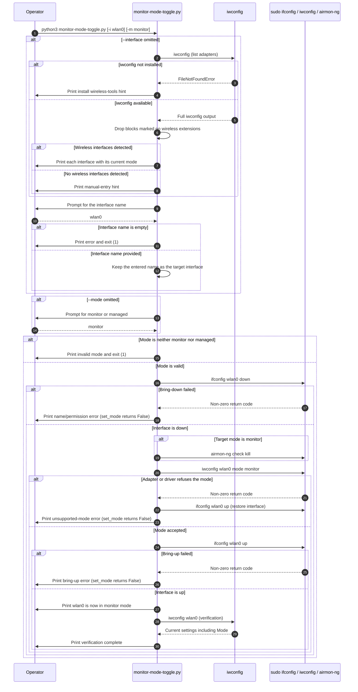

# Monitor Mode Toggle — Overview, Usage, Code Explanation, and Sequence Diagram

## What It Does (High-Level)

This script switches a wireless network adapter between **monitor mode** and **managed mode** using `iwconfig`/`ifconfig`. It can auto-detect the available wireless interfaces when no interface name is supplied, and it verifies the resulting mode at the end of the run.

---

## Usage Scenario

- **When to Use:**
  Prepare a USB/PCI Wi-Fi adapter for packet capture (monitor mode) during an authorized wireless lab, then switch it back to normal connectivity (managed mode) when the exercise is over.

- **Why:**
  Tools such as aircrack-ng, bettercap, and scapy sniffing require the adapter to be in monitor mode; everyday network use requires managed mode.

- **Prerequisites:**
  - Linux with `wireless-tools` (`iwconfig`) and net-tools (`ifconfig`)
  - `aircrack-ng` (the script calls `airmon-ng check kill` before entering monitor mode)
  - Root privileges (the mode changes are executed through `sudo`)
  - A driver that actually supports the requested mode
  - Python 3 (standard library only: `argparse`, `re`, `subprocess`)

- **How to Run:**

  ```bash
  sudo python3 monitor-mode-toggle.py --interface wlan0 --mode monitor
  sudo python3 monitor-mode-toggle.py --interface wlan0 --mode managed
  ```

  Both flags are optional. Without `--interface` the script lists the detected wireless interfaces and asks for a name; without `--mode` it asks which mode to switch to.

---

## Inputs and Outputs

| | |
|---|---|
| **Inputs** | `-i/--interface` (e.g. `wlan0`), `-m/--mode` (`monitor` or `managed`), or interactive answers when the flags are omitted |
| **Outputs** | Console status messages, any errors returned by `ifconfig`/`iwconfig`, and a final `iwconfig <interface>` listing that shows the current mode |
| **Exit codes** | `1` when the interface name is empty or the mode is not `monitor`/`managed`; otherwise `0` after the verification step |

---

## Code Explanation

### `list_wireless_interfaces()`
Runs `iwconfig` and splits the output into blocks separated by blank lines. Blocks whose first line contains `no wireless extensions` are skipped; the first token of every remaining block is collected as an interface name. If `iwconfig` is missing (`FileNotFoundError`) it prints an install hint and returns an empty list.

### `current_mode(interface)`
Runs `iwconfig <interface>` and extracts the current mode with the regular expression `Mode:(\S+)`. Returns `None` when the mode cannot be determined (including a missing `iwconfig`).

### `kill_interfering_processes()`
Runs `sudo airmon-ng check kill` so that NetworkManager and similar services do not interfere with monitor mode. It is only invoked when the target mode is `monitor`.

### `set_mode(interface, mode)`
The core sequence, with a failure branch after every privileged command:

1. `sudo ifconfig <interface> down` — on failure it prints a permission/name hint and returns `False`.
2. If the target mode is `monitor`, kill interfering processes.
3. `sudo iwconfig <interface> mode <mode>` — on failure it brings the interface back up, prints a driver-support hint and returns `False`.
4. `sudo ifconfig <interface> up` — on failure it prints an error and returns `False`.
5. Prints `<interface> is now in <mode> mode` and returns `True`.

### `__main__` block
Parses the arguments, auto-detects interfaces when `--interface` is missing (empty input aborts with exit code `1`), resolves the target mode from `-m` or a prompt (anything other than `monitor`/`managed` aborts with exit code `1`), calls `set_mode()`, and on success runs `iwconfig <interface>` once more to display the verified state.

---

## Sequence Diagram (Code Flow)



---

## Safety and Legal Notice

Only use monitor mode on networks and hardware you own or are explicitly authorized to test. Killing interfering processes with `airmon-ng check kill` disconnects the machine from its current Wi-Fi network.
