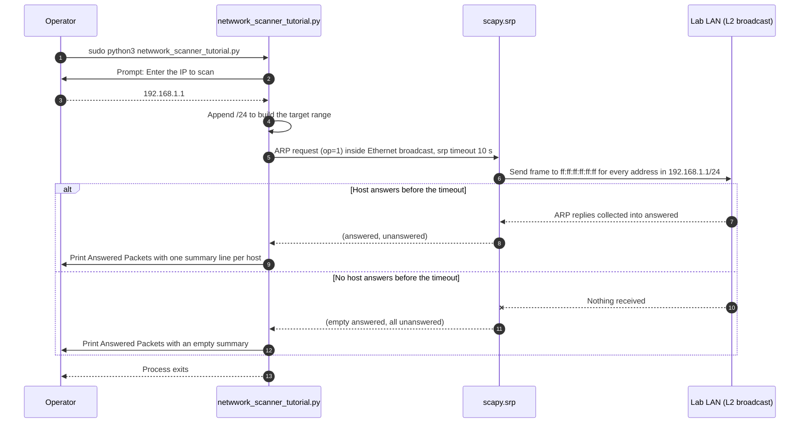

# Network Scanner Tutorial — Overview, Usage, Code Explanation, and Sequence Diagram

This document describes `netwwork_scanner_tutorial.py`, the minimal ARP scan demo used to introduce network discovery. (The file name keeps the original `netwwork` spelling; it is intentionally not renamed here.)

---

## What It Does (High-Level)

The script builds an ARP request for a single IP, expands it to the whole `/24` subnet, broadcasts it at layer 2 with Scapy, and prints a summary of every host that answered within the timeout. It is the smallest possible version of a network scanner: no root check, no output file, no vendor lookup.

---

## Usage Scenario

- **When to Use:**
  First practical lesson of a LAN discovery module — showing how an ARP "who-has" broadcast and its replies enumerate live hosts, before moving on to `network_scanner.py` (which wraps `netdiscover`) or `async_port_scanner.py`.

- **Prerequisites:**
  - Python 3 with `scapy` (`pip install scapy`)
  - Root privileges — `scapy.srp()` needs raw packet sockets
  - An interface in the same L2 segment as the targets, inside a lab network you own or are authorized to test

- **How to Run:**

  ```bash
  sudo python3 netwwork_scanner_tutorial.py
  ```

  The script prompts for an IP address; the `/24` suffix is appended automatically, so entering `192.168.1.1` scans `192.168.1.1/24`.

---

## Inputs and Outputs

| | |
|---|---|
| **Input** | One interactive prompt: the base IP address (`Enter the IP to scan:`) |
| **Output** | `Answered Packets:` followed by Scapy's `answered.summary()` lines (one per responding host); empty when nobody replies |
| **Side effects** | Sends one broadcast ARP request per address in the `/24` range; nothing is written to disk |

---

## Code Explanation

### `scan(ip)`
1. Creates the ARP layer: `scapy.ARP(pdst=ip, op=1)` — `op=1` is the ARP *request* ("who-has").
2. Creates the Ethernet layer: `scapy.Ether(dst="ff:ff:ff:ff:ff:ff")` — layer 2 broadcast.
3. Stacks them with `broadcast/arp_request` to form a complete frame.
4. Sends the frame and collects replies with `scapy.srp(..., timeout=10)`, which returns the `(answered, unanswered)` pair.
5. Prints `Answered Packets:` plus `answered.summary()`.

### `__main__` block
Reads the target IP from `input()`, appends `"/24"` to widen the scan to the whole subnet, and calls `scan()`. There is no argument parsing, validation, or privilege check — those are deliberately left as exercises.

---

## Sequence Diagram (Code Flow)



---

## Notes and Safety

- The script exits after a single scan; rerun it to repeat.
- Because it broadcasts ARP requests, only run it against networks you own or are explicitly authorized to test.
- Related, more complete scripts: `network_scanner.py` (netdiscover wrapper) and `async_port_scanner.py` (TCP service probing with banner grabbing).
