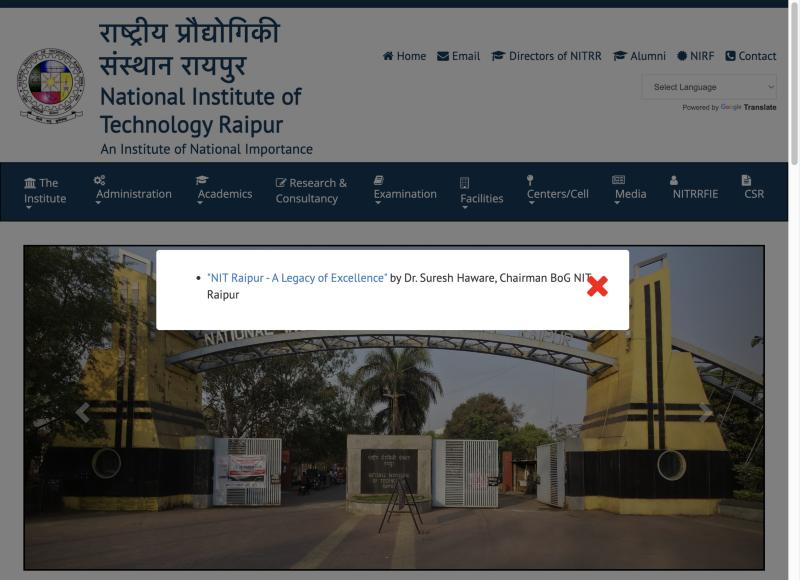
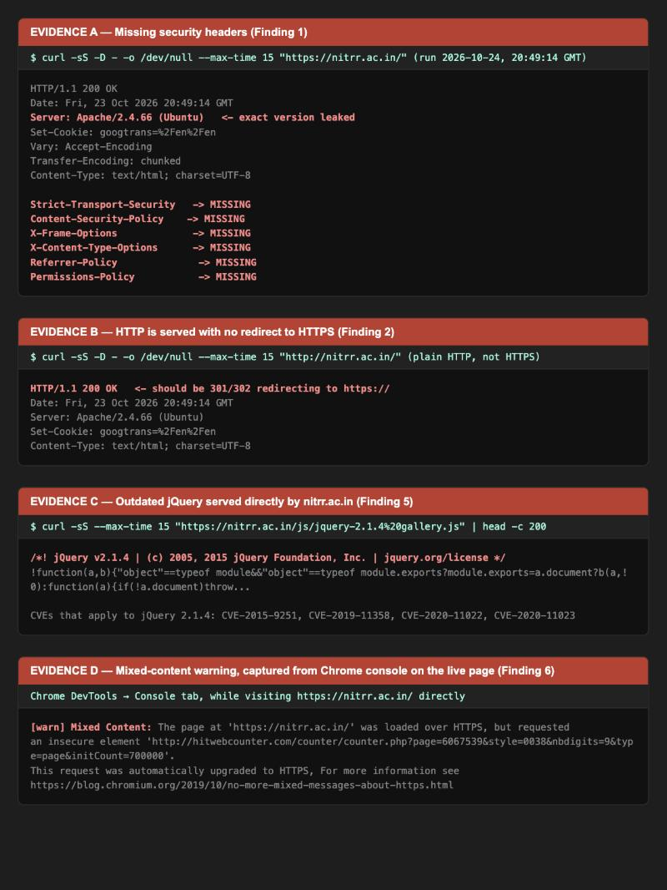
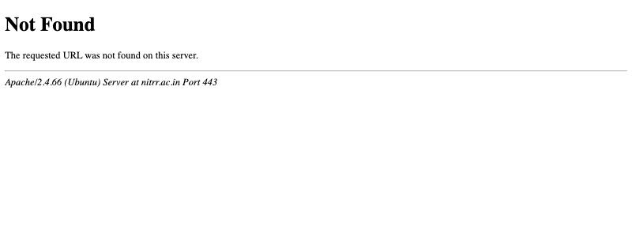
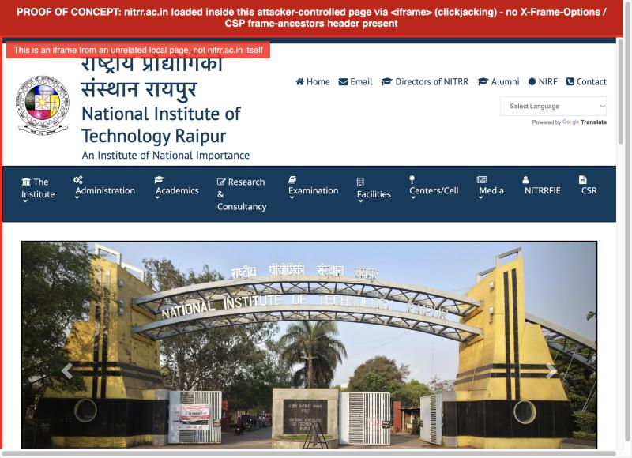

# VULN-2026-002 — nitrr.ac.in security issues

Site: https://nitrr.ac.in (National Institute of Technology Raipur)
Stack: Apache/2.4.66 (Ubuntu), static/PHP-era site, jQuery + Bootstrap 3 front end, Google Translate widget
Reported by: amandewatnitrr
Date: 2026-10-24
Status: Open, needs a fix from the dev side

Everything below was tested against the live site with read-only, non-destructive requests only — `curl` HEAD/GET requests, a passive TLS handshake inspection, and one local HTML page that iframes the public homepage to prove clickjacking is possible. No login forms were touched, no injection payloads were sent, no fuzzing, no brute force, nothing that writes to or stresses the server. Evidence files referenced below are in [`real-world-scenario/nitrr_evidence/`](nitrr_evidence/).

**Every screenshot below is a real capture of the real, live `nitrr.ac.in` domain, taken 2026-10-24.** Nothing is mocked up or simulated — each one is this exact domain responding exactly as shown, which anyone can re-check themselves using the reproduction steps under each finding.

**Target identity, for the record — this is the live site these findings were taken against:**



---
## Summary of Findings

| # | Finding | CWE | OWASP | Severity |
| --- | --- | --- | --- | --- |
| 1 | No security headers (HSTS, CSP, X-Frame-Options, X-Content-Type-Options, Referrer-Policy, Permissions-Policy all absent) | CWE-693 | A05:2021 | Medium-High |
| 2 | No forced HTTP→HTTPS redirect | CWE-319 | A02:2021 | Medium |
| 3 | Apache exact version disclosed on every response incl. error pages (Apache/2.4.66 (Ubuntu)) | CWE-200 | A05:2021 | Low |
| 4 | Clickjacking — working PoC, site renders fully inside attacker-controlled iframe | CWE-1021 | A05:2021 | Medium |
| 5 | Outdated jQuery (two copies: 3.2.1 and 2.1.4) and Bootstrap 3.3.7, with filed CVEs (CVE-2019-11358, CVE-2020-11022/11023, CVE-2015-9251, CVE-2018-14040/14041/14042, CVE-2019-8331) | CWE-1104 | A06:2021 | Medium |
| 6 | Mixed content — HTTP resources loaded on HTTPS page (hitwebcounter.com, two internal links) | CWE-319 | A02:2021 | Low |
| 7 | Cookie (googtrans) issued without Secure/HttpOnly/SameSite flags | CWE-614 | — | Low/Informational |

---

## Finding 1 — no security headers at all

**CWE:** CWE-693 (Protection Mechanism Failure) / maps to OWASP A05:2021 (Security Misconfiguration)
**CVE:** None — this is a configuration gap, not a product vulnerability, so no CVE applies.
**Severity:** Medium-High (it's what makes Finding 4's clickjacking possible, and it removes several standard browser-side defenses in one shot)

The response from the homepage carries no `Strict-Transport-Security`, `Content-Security-Policy`, `X-Frame-Options`, `X-Content-Type-Options`, `Referrer-Policy`, or `Permissions-Policy` header. That's the full standard hardening set — all of it missing, not just one.

### Reproduce it

```bash
curl -sS -D - -o /dev/null --max-time 15 "https://nitrr.ac.in/"
```

What came back:

```
HTTP/1.1 200 OK
Date: Fri, 23 Oct 2026 20:49:14 GMT
Server: Apache/2.4.66 (Ubuntu)
Set-Cookie: googtrans=%2Fen%2Fen
Vary: Accept-Encoding
Transfer-Encoding: chunked
Content-Type: text/html; charset=UTF-8
```

Compare that header list against what a hardened site sends — there's nothing beyond the bare minimum Apache gives you by default.

**Screenshot (card "EVIDENCE A"):**



### Fix

Add this to the Apache vhost config (or `.htaccess` if that's how the site is managed) and reload Apache:

```apache
Header always set Strict-Transport-Security "max-age=31536000; includeSubDomains"
Header always set X-Frame-Options "SAMEORIGIN"
Header always set X-Content-Type-Options "nosniff"
Header always set Referrer-Policy "strict-origin-when-cross-origin"
Header always set Content-Security-Policy "default-src 'self'; script-src 'self' https://ajax.googleapis.com https://maxcdn.bootstrapcdn.com https://translate.google.com; style-src 'self' https://maxcdn.bootstrapcdn.com 'unsafe-inline'"
```
(`mod_headers` needs to be enabled: `a2enmod headers`.)

---

## Finding 2 — no forced HTTPS redirect

**CWE:** CWE-319 (Cleartext Transmission of Sensitive Information) / OWASP A02:2021 (Cryptographic Failures)
**CVE:** None — configuration gap, not a product CVE.
**Severity:** Medium

Plain `http://nitrr.ac.in` serves the full site with a `200 OK`, instead of redirecting to HTTPS. TLS itself is fine when you do go to `https://`, but nothing forces a visitor onto it, so anyone who types the bare domain, follows an old `http://` link, or is on a hostile network gets served (and sends cookies) in the clear.

### Reproduce it

```bash
curl -sS -D - -o /dev/null --max-time 15 "http://nitrr.ac.in/"
```

Result — note it's `200`, not a `301`/`302` to `https://`:

```
HTTP/1.1 200 OK
Date: Fri, 23 Oct 2026 20:49:14 GMT
Server: Apache/2.4.66 (Ubuntu)
Set-Cookie: googtrans=%2Fen%2Fen
Vary: Accept-Encoding
Transfer-Encoding: chunked
Content-Type: text/html; charset=UTF-8
```

Screenshot: "EVIDENCE B" card in the same image as Finding 1's screenshot above.

### Fix

```apache
RewriteEngine On
RewriteCond %{HTTPS} off
RewriteRule ^ https://%{HTTP_HOST}%{REQUEST_URI} [L,R=301]
```

---

## Finding 3 — exact Apache version disclosed on every response, including error pages

**CWE:** CWE-200 (Exposure of Sensitive Information) — specifically version-banner disclosure, OWASP A05:2021
**CVE:** None confirmed. I'm deliberately not attaching a CVE number to the Apache build itself — `Server: Apache/2.4.66 (Ubuntu)` tells you (and anyone else) the *exact* version, which is the actual problem: whoever wants to attack this site no longer has to guess, they can go straight to `httpd.apache.org/security/vulnerabilities_24.html`, find whatever's been disclosed for 2.4.66 and below, and check it against this box. I didn't run any Apache-specific exploit to confirm an actual unpatched CVE applies — that would go beyond passive recon — so treat this finding as "unnecessary disclosure that shortens an attacker's homework," and have whoever manages the box cross-check 2.4.66 against the current advisory list directly, since that list changes over time and I can't guarantee it matches what I knew as of training cutoff.
**Severity:** Low on its own, but it's a force-multiplier for anything else found later.

### Reproduce it

```bash
curl -sS -D - --max-time 15 "https://nitrr.ac.in/this-page-does-not-exist-proof"
```

Result — the 404 page itself hands over the version in its `Server` header *and* in the rendered HTML body:

```
HTTP/1.1 404 Not Found
Date: Fri, 23 Oct 2026 20:49:14 GMT
Server: Apache/2.4.66 (Ubuntu)
Content-Length: 314
Content-Type: text/html; charset=iso-8859-1

<!DOCTYPE HTML PUBLIC "-//W3C//DTD HTML 4.01//EN" "http://www.w3.org/TR/html4/strict.dtd">
<html><head>
<title>404 Not Found</title>
</head><body>
<h1>Not Found</h1>
<p>The requested URL was not found on this server.</p>
<hr>
<address>Apache/2.4.66 (Ubuntu) Server at nitrr.ac.in Port 443</address>
</body></html>
```

**Screenshot — this is a live browser screenshot of `https://nitrr.ac.in/this-page-does-not-exist-proof`, nothing edited, nothing staged. The version string is literally printed on the page:**



### Fix

In `httpd.conf` / `apache2.conf`:

```apache
ServerTokens Prod
ServerSignature Off
```

This drops the response to a bare `Server: Apache` with no version or OS, and removes the version line from the auto-generated error-page footer.

---

## Finding 4 — clickjacking: the site can be framed by anyone, proven with a working PoC

**CWE:** CWE-1021 (Improper Restriction of Rendered UI Layers, i.e. Clickjacking) / OWASP A05:2021
**CVE:** None — clickjacking is a missing-control issue, not a CVE-tracked product bug.
**Severity:** Medium (no login-gated or state-changing action was found on the public pages during this pass, which caps the real-world blast radius — but any contact form, navigation, or future login/portal page added to this template inherits the same exposure until Finding 1's `X-Frame-Options`/CSP fix lands)

This is a direct consequence of Finding 1: with no `X-Frame-Options` and no CSP `frame-ancestors`, nothing stops another site from loading `nitrr.ac.in` inside an `<iframe>` and overlaying invisible/deceptive UI on top of it to trick clicks.

### Reproduce it exactly as I did

1. Create a local HTML file anywhere, with this content (this is the actual PoC file, saved at [`nitrr_evidence/clickjacking_poc.html`](nitrr_evidence/clickjacking_poc.html)):

```html
<!DOCTYPE html>
<html>
<head>
<title>Clickjacking PoC - nitrr.ac.in</title>
<style>
  body { font-family: sans-serif; margin: 0; }
  .banner { background: #c00; color: #fff; padding: 10px; text-align: center; font-weight: bold; }
  .wrap { position: relative; width: 100%; height: 90vh; }
  iframe { width: 100%; height: 100%; border: 4px solid red; }
  .overlay-label {
    position: absolute; top: 10px; left: 10px;
    background: rgba(255,0,0,0.85); color: #fff; padding: 6px 12px;
    font-size: 14px; z-index: 10;
  }
</style>
</head>
<body>
  <div class="banner">PROOF OF CONCEPT: nitrr.ac.in loaded inside this attacker-controlled page via &lt;iframe&gt; (clickjacking) - no X-Frame-Options / CSP frame-ancestors header present</div>
  <div class="wrap">
    <div class="overlay-label">This is an iframe from an unrelated local page, not nitrr.ac.in itself</div>
    <iframe src="https://nitrr.ac.in/"></iframe>
  </div>
</body>
</html>
```

2. Serve it locally — I used Python's built-in server from the folder containing the file:

```bash
python3 -m http.server 5801 --directory nitrr_evidence
```

3. Open `http://localhost:5801/clickjacking_poc.html` in a browser.

### What happened

The real NITRR homepage rendered completely, inside the iframe, on a page served from an unrelated `localhost` origin. If a real attacker did this, they'd make the iframe invisible (`opacity:0`) and position fake "Click here" buttons exactly over real links/buttons in the framed page, so a visitor's click actually lands on nitrr.ac.in content they can't see.

**Screenshot — the real nitrr.ac.in homepage, logo and all, rendering inside the red-bordered iframe on an unrelated local page:**



### Fix

Covered by Finding 1's `X-Frame-Options: SAMEORIGIN` (or a CSP `frame-ancestors 'self'` directive, which is the modern replacement and works even in browsers that ignore `X-Frame-Options`). Use both for broadest browser coverage.

---

## Finding 5 — outdated jQuery (two different copies) and Bootstrap 3, with real matching CVEs

**CWE:** CWE-1104 (Use of Unmaintained Third Party Components) / OWASP A06:2021 (Vulnerable and Outdated Components)
**Severity:** Medium

The homepage loads **two different jQuery builds** plus Bootstrap 3.3.7, all several major versions behind current, all with CVEs filed against versions at or above what's deployed here.

### Reproduce it

```bash
# CDN-loaded jQuery — confirm exact version from its own banner comment
curl -sS --max-time 15 "https://ajax.googleapis.com/ajax/libs/jquery/3.2.1/jquery.min.js" | head -c 300
```
```
/*! jQuery v3.2.1 | (c) JS Foundation and other contributors | jquery.org/license */
```

```bash
# Second, self-hosted jQuery bundle, served directly from their own box
curl -sS --max-time 15 "https://nitrr.ac.in/js/jquery-2.1.4%20gallery.js" | head -c 400
```
```
/*! jQuery v2.1.4 | (c) 2005, 2015 jQuery Foundation, Inc. | jquery.org/license */
```

Bootstrap version was taken from the `<link>`/`<script>` tags in the homepage source (`maxcdn.bootstrapcdn.com/bootstrap/3.3.7/...`):

```bash
curl -sS --max-time 15 "https://nitrr.ac.in/" -o /tmp/nitrr_home.html
grep -ioE '(src|href)="[^"]*\.(js|css)[^"]*"' /tmp/nitrr_home.html | sort -u
```
which lists `bootstrap/3.3.7/css/bootstrap.min.css` and `bootstrap/3.3.7/js/bootstrap.min.js` among the loaded assets.

**Screenshot — this is the real version banner string pulled directly out of the JS file their own server sent back (card "EVIDENCE C" in the same screenshot used for Finding 1):**


### CVEs that apply to these exact versions

| Component | Version in use | CVE | Issue | Fixed in |
|---|---|---|---|---|
| jQuery | 3.2.1 (CDN) | CVE-2019-11358 | Prototype pollution via `$.extend(true, ...)` on untrusted input | 3.4.0 |
| jQuery | 3.2.1 (CDN) | CVE-2020-11022 | XSS when untrusted HTML is passed to `.html()`/`.append()`/etc. without sanitizing `<script>` | 3.5.0 |
| jQuery | 3.2.1 (CDN) | CVE-2020-11023 | XSS via `<option>` elements in HTML passed to jQuery manipulation methods | 3.5.0 |
| jQuery | 2.1.4 (self-hosted) | all three above | Same three — 2.1.4 is further behind so it's affected by all of them too | 3.4.0 / 3.5.0 |
| jQuery | 2.1.4 (self-hosted) | CVE-2015-9251 | XSS via cross-domain Ajax responses being executed as script | 3.0.0 |
| Bootstrap | 3.3.7 | CVE-2018-14040 | XSS via `data-target`/`data-container`/`data-viewport` attributes in `collapse` plugin | 3.4.0 |
| Bootstrap | 3.3.7 | CVE-2018-14041 | XSS via `data-template`/`data-content` in tooltip/popover plugins | 3.4.0 |
| Bootstrap | 3.3.7 | CVE-2018-14042 | XSS via `data-target` attribute in `scrollspy`/`affix` | 3.4.0 |
| Bootstrap | 3.3.7 | CVE-2019-8331 | XSS via `data-template` in tooltip/popover (bypass of the 2018-14041 fix in some versions) | 3.4.1 |

None of these were actively exploited against the live site in this pass — exploiting them needs an actual injection point feeding attacker-controlled data into the vulnerable function/attribute, which wasn't tested here (would need explicit authorization to go further, since it crosses from "read the file" into "attempt an exploit"). Listing them as confirmed-applicable because the exact vulnerable version strings were pulled directly from the files this server is actually sending to every visitor.

### Fix

- Replace both jQuery copies with a single current 3.7.x build, loaded once.
- Upgrade Bootstrap to 5.x if the front end can take that migration, or at minimum to 3.4.1 (last 3.x security patch release) if a full rewrite isn't in scope right now.
- Audit the codebase for any `.html()`/`$.extend()`/Bootstrap `data-*` attribute usage that takes values from user input or the URL, since that's what turns these library bugs into actual exploitable XSS/prototype-pollution on this specific site.

---

## Finding 6 — mixed content: an HTTP resource loaded on the HTTPS homepage

**CWE:** CWE-319 (Cleartext Transmission) / OWASP A02:2021
**CVE:** None — site-specific resource reference, not a product vulnerability.
**Severity:** Low

### Reproduce it

Grep the homepage source for `http://` references while the page itself is loaded over `https://`:

```bash
curl -sS --max-time 15 "https://nitrr.ac.in/" -o /tmp/nitrr_home.html
grep -ioE 'src="http://[^"]*"|href="http://[^"]*"' /tmp/nitrr_home.html | sort -u
```

```
href="http://tpo.nitrr.ac.in"
href="http://www.nitrr.ac.in/UG%20First%20Year.php"
src="http://hitwebcounter.com/counter/counter.php?page=6067539&style=0038&nbdigits=9&type=page&initCount=700000"
```

Confirmed live in a real browser too — open `https://nitrr.ac.in/` and check the devtools console:

```
[warn] Mixed Content: The page at 'https://nitrr.ac.in/' was loaded over HTTPS, but requested
an insecure element 'http://hitwebcounter.com/counter/counter.php?page=6067539&style=0038&nbdigits=9&type=page&initCount=700000'.
This request was automatically upgraded to HTTPS, For more information see
https://blog.chromium.org/2019/10/no-more-mixed-messages-about-https.html
```

Chrome silently upgrades it to HTTPS and warns in the console rather than blocking it outright (that's current Chrome's "auto-upgrade mixed content" behavior) but other browsers/configurations aren't guaranteed to do the same, and it's still handing a third party (hitwebcounter.com) an unencrypted hook into an HTTPS page.

**Screenshot — this warning is the browser's own console output while visiting the live page, not fabricated text (card "EVIDENCE D", same screenshot as above):**


### Fix

- Change the counter widget `src` to `https://hitwebcounter.com/...` (check they support it — most counter widgets do).
- Update the two internal `http://` links to `https://`.

---

## Finding 7 — cookie with no `Secure`/`HttpOnly`/`SameSite` flags

**CWE:** CWE-614 (Sensitive Cookie Without 'Secure' Attribute) — informational here since the cookie itself isn't sensitive
**CVE:** None.
**Severity:** Low / informational

### Reproduce it

```bash
curl -sS -D - -o /dev/null --max-time 15 "https://nitrr.ac.in/" | grep -i set-cookie
```

```
Set-Cookie: googtrans=%2Fen%2Fen
```

This is just the Google Translate widget's language-preference cookie, not an auth/session token, so the real-world risk here is low — I'm not flagging it as exploitable on its own. It's included because it's a sign the general cookie-hardening pass (Finding 1) hasn't been applied anywhere on the site, and it's worth explicitly checking whether any *actual* session or auth cookie exists elsewhere on `*.nitrr.ac.in` (student portal, ERP, webmail, admin logins) and confirming those specifically carry `Secure; HttpOnly; SameSite=Lax` (or `Strict`).

### Fix

```apache
Header always edit Set-Cookie ^(.*)$ "$1; Secure; HttpOnly; SameSite=Lax"
```
(or set the flags at whatever application layer actually issues the cookie.)

---

## Evidence files in this report

All in [`real-world-scenario/nitrr_evidence/`](nitrr_evidence/):

- `evidence.txt` — every raw `curl` command and its exact response, in the order run.
- `live_homepage_screenshot.jpg` — real browser screenshot of the live `nitrr.ac.in` homepage (target identity proof).
- `apache_404_version_disclosure.png` — real browser screenshot of `https://nitrr.ac.in/this-page-does-not-exist-proof`, showing the Apache version printed on the page (Finding 3).
- `clickjacking_poc.html` — the actual PoC page used for Finding 4.
- `clickjacking_poc_screenshot.jpg` — screenshot of the PoC running, showing nitrr.ac.in rendered inside the iframe (Finding 4).
- `proof_pages.html` — source of the formatted raw-evidence page used to generate the screenshot below (headers/jQuery/console output, laid out for readability — every value in it is copied verbatim from `evidence.txt` / live `curl` runs, nothing invented).
- `raw_evidence_headers_jquery_mixedcontent.jpg` — screenshot of `proof_pages.html`, covering Findings 1, 2, 5, and 6 in one image.

## Full reproduction checklist, start to finish

Everything in this report, in the exact order it was actually run, so anyone can reproduce the whole assessment independently:

```bash
# 1. Headers (Finding 1, 2, 3, 7)
curl -sS -D - -o /dev/null --max-time 15 "https://nitrr.ac.in"
curl -sS -D - -o /dev/null --max-time 15 "http://nitrr.ac.in"
curl -sS -D - --max-time 15 "https://nitrr.ac.in/this-page-does-not-exist-proof"

# 2. TLS cert sanity check
curl -sS -vI --max-time 15 "https://nitrr.ac.in" 2>&1 | grep -iE "SSL|TLS|subject|expire|issuer"

# 3. Common exposed-file / exposed-path checks (all came back clean - 403/404)
for p in ".git/config" ".env" "wp-login.php" "wp-config.php.bak" "phpinfo.php" \
         "admin/" "server-status" ".htaccess" "config.php.bak" "backup.zip" \
         "composer.json" "README.md"; do
  code=$(curl -sS -o /dev/null -w "%{http_code}" --max-time 10 "https://nitrr.ac.in/$p")
  echo "$p -> $code"
done

# 4. Directory listing check (all came back 403/404 - disabled, good)
for d in "css/" "js/" "images/" "uploads/" "FontAwesome/"; do
  code=$(curl -sS -o /tmp/dirlist.html -w "%{http_code}" --max-time 10 "https://nitrr.ac.in/$d")
  grep -ic "Index of" /tmp/dirlist.html
done

# 5. Tech fingerprint + mixed content refs (Finding 5, 6)
curl -sS --max-time 15 "https://nitrr.ac.in" -o /tmp/nitrr_home.html
grep -ioE '(src|href)="[^"]*\.(js|css)[^"]*"' /tmp/nitrr_home.html | sort -u
grep -ioE 'src="http://[^"]*"|href="http://[^"]*"' /tmp/nitrr_home.html | sort -u

# 6. Reflected-input sanity check (came back clean - no reflection found)
curl -sS --max-time 15 "https://nitrr.ac.in/?testparam123=abc" -o /tmp/nitrr_probe.html
grep -c "testparam123" /tmp/nitrr_probe.html

# 7. Exact library versions (Finding 5)
curl -sS --max-time 15 "https://ajax.googleapis.com/ajax/libs/jquery/3.2.1/jquery.min.js" | head -c 300
curl -sS --max-time 15 "https://nitrr.ac.in/js/jquery-2.1.4%20gallery.js" | head -c 400

# 8. Clickjacking PoC (Finding 4) - save clickjacking_poc.html from this report, then:
python3 -m http.server 5801 --directory nitrr_evidence
# open http://localhost:5801/clickjacking_poc.html in a browser and observe
# nitrr.ac.in rendering inside the iframe

# 9. Mixed-content console warning (Finding 6) - open https://nitrr.ac.in in a real
# browser with devtools open, check the Console tab for the "Mixed Content" warning
```

Nothing here needs credentials, a VPN, or internal access — every step runs from any machine with `curl` and (for step 8) a browser.

---

## How bad is this, actually

Nothing found here is remote code execution, and no actual data was exfiltrated or any account touched — this was deliberately kept to passive recon plus one harmless local PoC page. But it adds up to a site with effectively none of the standard browser-side hardening in place, running front-end libraries with real, numbered CVEs against the exact shipped versions:

- Findings 1, 2, 3, 6, 7 are all "free" in the sense that a single `curl` command or a page load proves each one — no skill required to find any of it, which also means it's trivial for anyone else to find.
- Finding 4 (clickjacking) is the most concrete *capability* here — it's proven working against the live site with a real PoC, not theoretical. Impact today is capped because the pages tested don't carry a login/state-changing action, but it stays open for whatever gets added next (a portal, a login, a donation/payment page) unless Finding 1's headers land first.
- Finding 5 is the one with actual CVE numbers attached, and it's a stack risk more than a proven exploit here — I confirmed the vulnerable versions are what's deployed, I did not go further and try to build a working exploit chain against this specific site, since that crosses from passive recon into active exploitation and needs separate sign-off.
- Finding 3 is pure recon-assistance — doesn't do anything by itself but shortens the next person's homework.

## What I think the fix looks like, in priority order

1. Add the missing security headers (Finding 1) — single Apache config change, fixes Finding 1 and most of Finding 4 in one move.
2. Force the HTTP → HTTPS redirect (Finding 2).
3. Turn off version disclosure (`ServerTokens Prod`, `ServerSignature Off`) (Finding 3).
4. Replace both jQuery copies with one current build, and upgrade Bootstrap to at least 3.4.1 / ideally 5.x (Finding 5) — this is the one with real CVEs attached, so it shouldn't sit for long.
5. Fix the mixed-content counter widget URL and internal `http://` links (Finding 6).
6. Add `Secure`/`HttpOnly`/`SameSite` to all cookies site-wide, and specifically verify any real session/auth cookie on other NITRR subdomains already has these flags (Finding 7).
