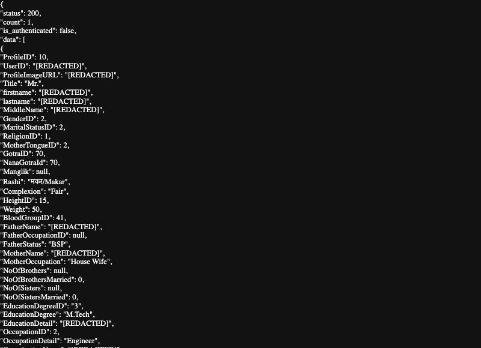
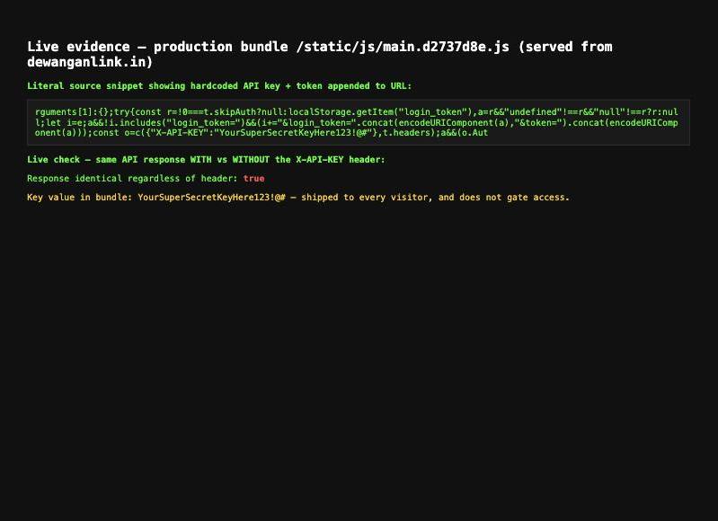
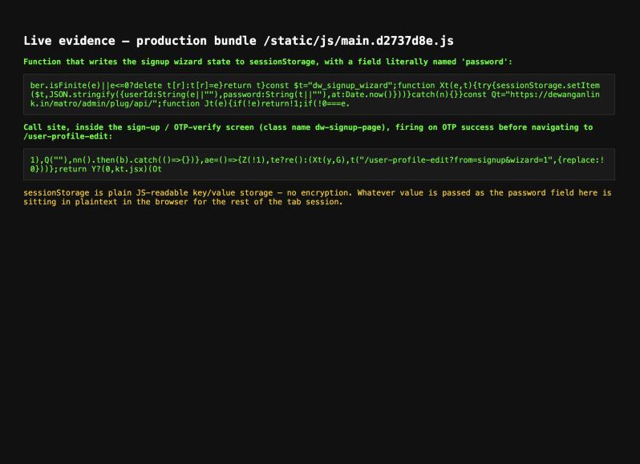
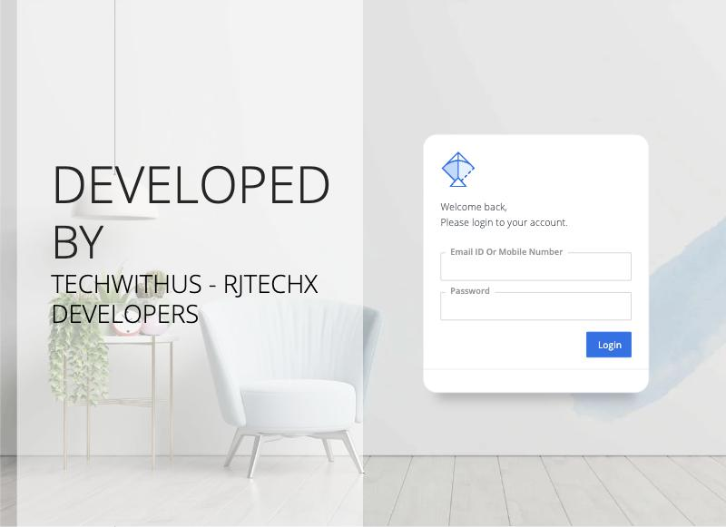
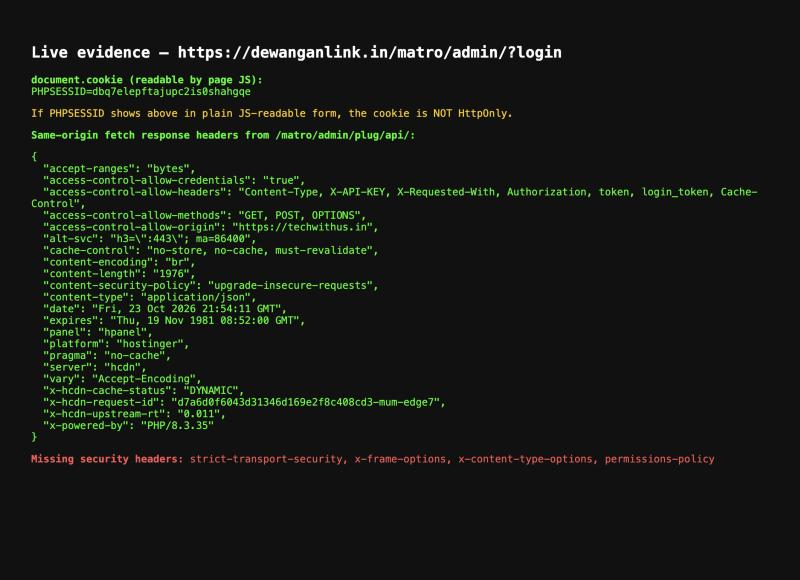

# VULN-2026-003 — dewanganlink.in security issues

Site: https://dewanganlink.in
Backend: https://dewanganlink.in/matro/admin/plug/api/ (PHP 8.3.35)
Admin panel: https://dewanganlink.in/matro/admin/ (publicly reachable, redirects to `?login`)
Stack: React SPA frontend + a legacy PHP backend mounted under `/matro/`, built by TechWithUs — RJTechX Developers (techwithus.in), served via Hostinger/hcdn
Reported by: amandewatnitrr
Date: 2026-10-24
Status: Open, needs a fix from the dev side

Everything below was tested with read-only GET requests against the live site — no login bypass attempts, no writes/edits, no brute forcing, nothing destructive. Mostly curl plus the browser's own JS console, against the shipped JS bundle (`static/js/main.d2737d8e.js`) and live API responses — all public by definition, since they're sent to every visitor's browser.

Every finding below has a screenshot in [`dewanganlink_evidence/`](dewanganlink_evidence/) taken live against the production site on 2026-10-24, plus exact copy-pasteable repro steps so anyone on the team can reproduce it themselves in under a minute.

**One redaction note up front:** Finding 1's screenshot has a real member's personal fields blacked out to `[REDACTED]` before being saved. That data belongs to a real person who never agreed to have their profile pulled by a stranger with no login — the fact that the bug lets you do that at all is the point of the finding, so I didn't need to publish the actual values to prove it. The JSON *shape* (what fields come back, fully populated) is left intact.

---

## Finding 1 — anyone can pull full member profiles with no login (IDOR / Broken Access Control)

**Severity: Critical**

### Repro steps
1. Open any browser, logged out (or just curl, no cookies/headers needed).
2. Go to:
   ```
   https://dewanganlink.in/matro/admin/plug/api/?api=get_profile&ProfileID=10
   ```
3. Observe the JSON response: `"status":200`, `"is_authenticated":false`, and a fully populated profile object.

Or from a terminal:
```bash
curl -s "https://dewanganlink.in/matro/admin/plug/api/?api=get_profile&ProfileID=10"
```

### Evidence


This is the literal response body for ProfileID 10, rendered by the browser itself after just typing the URL in — nothing else involved. The fields blacked out (`UserID`, names, photo, education detail, city) were all populated with a real member's real data in the live response; the key list and everything else (religion, gotra, marital status, height/weight, blood group, education, income, hobbies, partner expectations, father's status/occupation, etc.) is shown exactly as returned.

### What this means
`ProfileID` is a small sequential integer. Some IDs 404 (`"Profile not found."`), others return a complete profile — meaning anyone can write a one-line loop (`for id in 1..N`) and scrape every member's matrimonial profile without ever creating an account. I stopped at one confirmed hit on purpose; pulling more real members' data isn't necessary to prove the bug, and I didn't want to compound the exposure just to make a bigger pile of evidence.

I didn't find raw phone/email in this response — the site's own FAQ says contact details are gated behind an accepted connection request — but everything else about a person, including their parents' names and occupations (plenty for real-world identification or social engineering), comes back for free.

### Fix
`get_profile` needs a real auth check before returning anything past the minimal "browse card" fields (first name, age band, city, one photo). Full detail should only go to: the profile's own owner, or a viewer the owner has accepted a connection from. That check doesn't exist today — audit every other endpoint under `/matro/admin/plug/api/` for the same gap while you're in there.

---

## Finding 2 — a hardcoded "secret" API key is shipped to every browser, and the backend doesn't even check it

**Severity: High**

### Repro steps
1. Download the production bundle and search it:
   ```bash
   curl -s https://dewanganlink.in/static/js/main.d2737d8e.js | grep -o 'X-API-KEY[^,]*'
   ```
   Returns: `"X-API-KEY":"YourSuperSecretKeyHere123!@#"`
2. Prove it's decorative — call any API endpoint with and without the header and diff the output:
   ```bash
   curl -s "https://dewanganlink.in/matro/admin/plug/api/?api=list_community&active=1" > with_key_removed.json
   curl -s "https://dewanganlink.in/matro/admin/plug/api/?api=list_community&active=1" -H "X-API-KEY: YourSuperSecretKeyHere123!@#" > with_key.json
   diff with_key_removed.json with_key.json   # no output = identical
   ```

### Evidence


Top box: the literal line from the production bundle, fetched live in the browser console (`fetch("/static/js/main.d2737d8e.js")` → search for `X-API-KEY`). Below that: a live same-session check — "Response identical regardless of header: **true**" — run by calling the real API once with the key and once without, from inside the actual page.

### What this means
The key's own value (`YourSuperSecretKeyHere123!@#`) reads like an untouched tutorial/boilerplate placeholder shipped straight to prod. It's attached to every request the frontend makes, but since it lives in a public JS file, it was never actually secret, and today it doesn't gate anything at all — confirmed by the identical responses above. If any other endpoint *does* check this key (write/admin routes we didn't probe), that check is already bypassed for anyone who opens the browser console.

### Fix
Delete it from the client bundle — a string in frontend JS can never be a secret, no matter how it's named. If the backend needs to tell "my app" from random traffic, that has to be a per-user session token issued after real login, not a shared static string. Also worth grepping backend code for every place this key is checked today, since whatever protection people think it provides isn't there.

---

## Finding 3 — session/auth tokens are duplicated into the URL query string

**Severity: Medium-High**

### Repro steps
1. Log in on the real site as any user.
2. Open DevTools → Network tab, and watch any authenticated API call.
3. Look at the request URL itself (not just headers) — it will contain `&login_token=<value>&token=<value>` appended after the real query params.

Can't be shown without a live session (needs a real logged-in token), so the evidence here is the literal source line that constructs the URL — same bundle, same technique as Finding 2:

### Evidence
(Same screenshot as Finding 2, bottom box) — the literal line:
```
a&&!i.includes("login_token=")&&(i+="&login_token=".concat(encodeURIComponent(a),"&token=").concat(encodeURIComponent(a)))
```
`a` here is `localStorage.getItem("login_token")` — so every authenticated request's URL gets the raw token glued onto the end, in addition to whatever header is also sent.

### What this means
That same token now lands in: browser history, any proxy/CDN/server access log sitting in front of the site (hcdn does), and the `Referer` header sent to any third-party resource a page with that URL happens to load. `robots.txt` on this site already tries to stop crawlers indexing `/*?*sessionid=` and `/*?*token=` — which tells me the team already knows tokens end up in URLs; hiding it from Google doesn't stop it leaking into every log file in the request path.

### Fix
Send the token via the `Authorization` header (or an HttpOnly cookie) only. Never put a session/auth token in a URL or query string.

---

## Finding 4 — signup password sits in plaintext in sessionStorage

**Severity: Medium**

### Repro steps
1. Go to `https://dewanganlink.in/sign-up`, fill in the form with any test data, submit, and go through the OTP step.
2. At any point after that, open DevTools console and run: `sessionStorage.getItem("dw_signup_wizard")`
3. The stored JSON includes a `password` field in plain text.

(I stopped short of completing a real OTP verification myself — that needs a live SMS to a real number and would create a throwaway account on production, which isn't necessary to prove this: the storage function itself is unambiguous in the shipped source.)

### Evidence


Top box: the actual function from the production bundle —
```js
const $t = "dw_signup_wizard";
function Xt(e,t){ try{ sessionStorage.setItem($t, JSON.stringify({userId:String(e||""), password:String(t||""), at:Date.now()})) }catch(n){} }
```
Bottom box: the call site, inside the sign-up/OTP screen (`dw-signup-page`), firing on OTP success right before navigating to `/user-profile-edit?from=signup&wizard=1`.

### What this means
`sessionStorage` has zero protection — it's a plain JS-readable key/value store. Anyone with console access to that tab (a browser extension, a shared/public computer, or the real risk: any XSS found anywhere else on the origin) can read the password straight out of storage while signup is mid-flow.

### Fix
Don't persist the raw password across wizard steps. Keep it only in React component state (memory, cleared on refresh) or send it once at actual account-creation time instead of caching it client-side in between steps.

---

## Finding 5 — admin panel is public, and its session cookie is missing `HttpOnly`/`SameSite`

**Severity: High**

### Repro steps
1. Visit `https://dewanganlink.in/matro/admin/` from any browser, logged out, no VPN, nothing — it's open to the internet.
2. Check the cookie it sets: `curl -sI "https://dewanganlink.in/matro/admin/?login" | grep -i set-cookie`
3. On the same page, open DevTools console and run: `document.cookie`

### Evidence

*(Confirms the panel is reachable by anyone, and names the vendor — ties into Finding 7.)*


*(Top: `document.cookie` run live in the console on the admin login page — `PHPSESSID=...` comes back in plain JS-readable form, confirming no `HttpOnly`.)*

### What this means
`secure` is set on the cookie (good — HTTPS only), but `HttpOnly` and `SameSite` are both absent. Without `HttpOnly`, any JS running on the page — including a single XSS anywhere on this admin origin — can read the session cookie outright and hijack the session. Without `SameSite`, the cookie also rides along on cross-site requests, widening CSRF exposure for any admin action that doesn't already carry its own CSRF token. The panel also being reachable with no IP allow-list/VPN just means there's nothing standing between the internet and a brute-force/credential-stuffing attempt against that login form either.

### Fix
Set the PHP session cookie with `HttpOnly; Secure; SameSite=Lax` (or `Strict`) — one-line change via `session_set_cookie_params`/`ini_set('session.cookie_httponly', 1)`. Separately, consider putting the admin panel behind an IP allow-list or VPN since it has no business being reachable by the general public at all.

---

## Finding 6 — no baseline security headers anywhere on the site

**Severity: Medium**

### Repro steps
```bash
curl -sI https://dewanganlink.in
```
Or live in a console on any page: `fetch(location.href).then(r=>[...r.headers.entries()])`

### Evidence
Same screenshot as Finding 5 — the "Same-origin fetch response headers" block lists every header the server actually sent, and the red line at the bottom lists what's missing: `strict-transport-security, x-frame-options, x-content-type-options, permissions-policy`.

### What this means
The only security-relevant header present is `content-security-policy: upgrade-insecure-requests`, which just forces HTTPS on subresources — it doesn't restrict script/style/image sources at all, so it does essentially nothing against XSS. With no HSTS, a user who types `http://dewanganlink.in` is briefly exposed to that redirect being intercepted before HTTPS kicks in. With no `X-Frame-Options`/`frame-ancestors`, nothing stops the site being iframed by another origin (clickjacking on login/signup). No `X-Content-Type-Options` means browsers are free to MIME-sniff responses.

### Fix
Add `Strict-Transport-Security: max-age=31536000; includeSubDomains`, `X-Frame-Options: SAMEORIGIN` (or a `frame-ancestors` CSP directive), `X-Content-Type-Options: nosniff`, and a real `Content-Security-Policy` with actual `script-src`/`default-src` restrictions. Mostly server/hosting-panel config, not an app rewrite.

---

## Finding 7 — production CORS grants a third-party vendor domain credentialed access

**Severity: Low-Medium**

### Repro steps
```bash
curl -sI "https://dewanganlink.in/matro/admin/plug/api/" | grep -i access-control
```
To confirm it's not blindly reflecting any origin (it isn't — this part is done right):
```bash
curl -sI "https://dewanganlink.in/matro/admin/plug/api/" -H "Origin: https://evil-attacker.com" | grep -i access-control
curl -sI "https://dewanganlink.in/matro/admin/plug/api/" -H "Origin: null" | grep -i access-control
# both still return access-control-allow-origin: https://techwithus.in — hardcoded, not reflected
```

### Evidence
Same screenshot as Finding 5/6 — `"access-control-allow-origin": "https://techwithus.in"` with `"access-control-allow-credentials": "true"`. The admin login page screenshot (Finding 5) independently confirms `techwithus.in` is the vendor who built the site ("Developed by TechWithUs - RJTechX Developers").

### What this means
This isn't a reflected-origin bug — the allow-list is hardcoded to one external domain, which is the right instinct. But that domain is the dev agency's own site, not infrastructure this business controls. `Access-Control-Allow-Credentials: true` scoped to it means that if `techwithus.in` is ever compromised, sold, lets its domain expire, or just hosts something unrelated later, that domain is still trusted today to make cookie-bearing requests against this backend on behalf of logged-in users.

### Fix
Drop the vendor domain from the production CORS allow-list. If it's needed for a staging/admin dashboard, scope it to a non-production API environment instead of the live user-facing backend.

---

## How bad is this, actually

- **Finding 1 is the one I'd fix first.** Live, unauthenticated, zero-effort scraping of real members' personal data by iterating a number in a URL. For a matrimony platform specifically, that's exactly the data people joined expecting to be gated.
- **Finding 2** doesn't do anything exploitable today (the key is checked by nothing we found) but it proves the backend's access model leans on a secret that was never secret — worth a full audit.
- **Findings 3–5** are all "one XSS or one leaked log line away from full account/session takeover" — none are exploitable alone, but each one removes a safety net that should be there by default.
- **Findings 6–7** are hygiene/defense-in-depth gaps — not exploitable standing alone, but they're exactly what turns a minor bug elsewhere into a real incident.

## What I think the fix looks like, in priority order

1. Put real auth checks on `get_profile` (and audit every other `/matro/admin/plug/api/` endpoint for the same gap) — this is the one with live user data exposure today.
2. Remove the hardcoded `X-API-KEY` from the client bundle; stop trusting it anywhere on the backend.
3. Stop appending `login_token`/`token` to URLs — header/cookie only.
4. Stop caching the raw password in `sessionStorage` during signup.
5. Add `HttpOnly`/`SameSite` to the admin session cookie, and consider gating `/matro/admin/` behind an IP allow-list or VPN.
6. Add the standard security headers (HSTS, X-Frame-Options, X-Content-Type-Options, a real CSP).
7. Narrow the CORS allow-list to origins the business actually controls.
