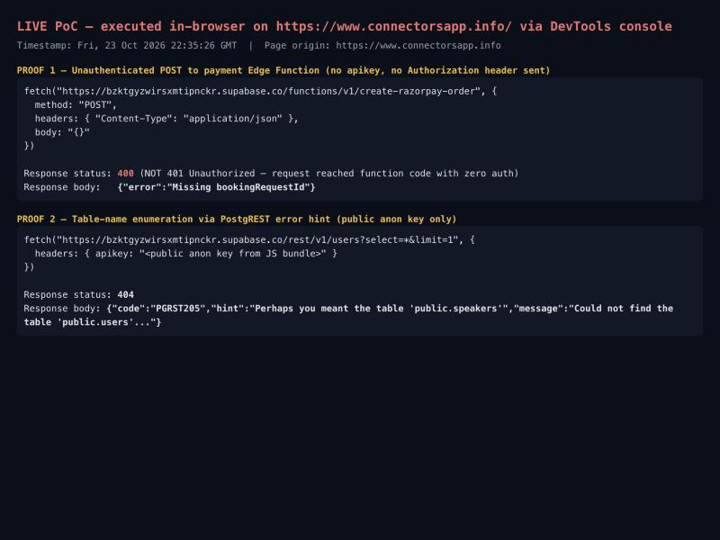
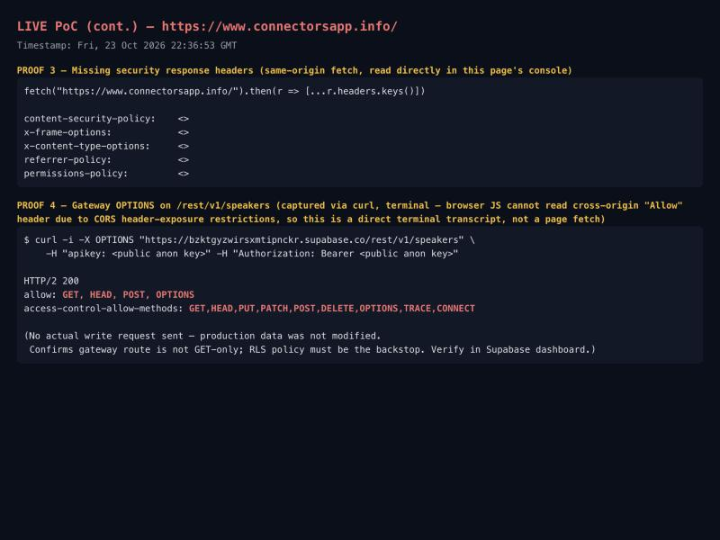
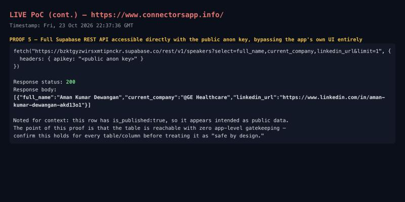

# VULN-2026-004 — connectorsapp.info security issues

Site: https://www.connectorsapp.info/
Backend: Supabase project `bzktgyzwirsxmtipnckr` (`https://bzktgyzwirsxmtipnckr.supabase.co`) — Postgres + PostgREST + Edge Functions
Frontend: Vite/React SPA, hosted on Vercel
Payment: Razorpay, invoked via two Supabase Edge Functions (`create-razorpay-order`, `verify-razorpay-payment`)
Reported by: amandewatnitrr (co-owner)
Date: 2026-10-24
Status: Open, needs a fix from the dev side

Everything below was tested with read-only GET/OPTIONS requests against the live site and backend — no login bypass attempts, no writes/edits/inserts, no real Razorpay order created, nothing destructive. Mostly curl plus the browser's own JS console (`fetch()` run live in DevTools on the production page itself), against the shipped JS bundle (`assets/index-seZRpP5q.js`) and live API responses.

Every finding below has a screenshot in [`connectorsapp_evidence/`](connectorsapp_evidence/) taken live against production on 2026-10-24, plus exact copy-pasteable repro steps so anyone on the team can reproduce it themselves in under a minute.

---

## Finding 1 — payment Edge Functions accept requests with zero authentication

**Severity: Critical**

### Repro steps
```bash
curl -i -X POST "https://bzktgyzwirsxmtipnckr.supabase.co/functions/v1/create-razorpay-order" \
  -H "Content-Type: application/json" -d '{}'
```
No `apikey` header, no `Authorization` header — nothing. Response: `400 {"error":"Missing bookingRequestId"}`.

That status matters: a `401` would mean Supabase's own gateway rejected the request before it reached the function (normal, expected behavior). A `400` with an *application-level* validation error means the request sailed straight past auth and into the function's own logic. Same result for `verify-razorpay-payment`.

### Evidence


Top box: the exact `fetch()` call run live in DevTools console on `https://www.connectorsapp.info/` itself — reproduced from the production page, same as any real attacker's script could do, since CORS on these functions is wide open (`Access-Control-Allow-Origin: *`).

### What this means
These two functions were deployed with JWT verification disabled (`--no-verify-jwt`). Combined with open CORS, any website — not just yours — can call your payment-order-creation logic directly, with no account, login, or API key. Depending on what the function trusts from the request body, this opens the door to:
- Spamming/abusing the live Razorpay merchant account (junk orders, quota burn, dashboard noise).
- Business-logic abuse if the order amount/recipient is ever trusted from client input instead of being re-derived server-side from the real booking row.
- Brute-forcing/enumerating valid `bookingRequestId` values.

### Fix
1. Re-deploy both functions *without* `--no-verify-jwt`, so a valid Supabase session/anon key is required at minimum.
2. Restrict CORS on these functions to your real domain instead of `*`.
3. Inside the function, always re-fetch price/booking details from your own DB using the trusted record — never trust an amount passed in by the client.
4. Add rate limiting in front of both functions.

---

## Finding 2 — database schema enumerable via PostgREST error hints

**Severity: Medium**

### Repro steps
```bash
curl -s "https://bzktgyzwirsxmtipnckr.supabase.co/rest/v1/users?select=*&limit=1" \
  -H "apikey: <public anon key from JS bundle>"
```
Returns: `{"code":"PGRST205","hint":"Perhaps you meant the table 'public.speakers'","message":"Could not find the table 'public.users'..."}`

### Evidence
Same screenshot as Finding 1 above (bottom box, "PROOF 2").

### What this means
Querying a table name that doesn't exist returns a "did you mean" hint naming a real table in your schema. Anyone can fuzz common names (`users`, `orders`, `payments`, `customers`, etc.) and get real schema names back for free, using nothing but the public anon key that already ships in the JS bundle by design.

### Fix
This is default PostgREST behavior and can't be fully disabled — the real mitigation is to treat every table reachable through `/rest/v1/` as effectively public-facing, and audit that Row-Level-Security (RLS) policies on every table explicitly deny anonymous access unless that table is genuinely meant to be public.

---

## Finding 3 — write methods not blocked at the gateway for the public `speakers` table (needs RLS confirmation)

**Severity: Medium**

### Repro steps
```bash
curl -i -X OPTIONS "https://bzktgyzwirsxmtipnckr.supabase.co/rest/v1/speakers" \
  -H "apikey: <public anon key>" -H "Authorization: Bearer <public anon key>"
```
Returns `Allow: GET, HEAD, POST, OPTIONS` and `Access-Control-Allow-Methods: GET,HEAD,PUT,PATCH,POST,DELETE,OPTIONS,TRACE,CONNECT` — using only the public anon key.

I deliberately did not send an actual POST/PATCH/DELETE — that would risk creating or modifying real production data. This only proves the route isn't GET-only at the gateway; PostgREST evaluates RLS at execution time, so an anonymous write may or may not actually be blocked.

### Evidence


Bottom box: the raw curl transcript above. (Browser JavaScript can't read this cross-origin `Allow` header itself due to CORS header-exposure rules, so this one is a direct terminal capture rather than an in-page `fetch()`, unlike the other findings.)

### What this means
RLS is the *only* thing standing between an anonymous visitor and writing to this table. That may well be configured correctly already — this finding is a flag to verify, not a confirmed break-in.

### Fix
Confirm in the Supabase dashboard (Authentication → Policies → `speakers`) that the anon role has no INSERT/UPDATE/DELETE policy, only a SELECT policy filtered to `is_published = true`. Repeat for every other table exposed through `/rest/v1/`.

---

## Finding 4 — no baseline security headers on the main site

**Severity: Low**

### Repro steps
```bash
curl -sI https://www.connectorsapp.info/
```
Or live in a console on the page itself: `fetch(location.href).then(r => [...r.headers.entries()])`

### Evidence
Same screenshot as Finding 3 above (top box) — `content-security-policy`, `x-frame-options`, `x-content-type-options`, `referrer-policy`, and `permissions-policy` are all absent from the same-origin response.

### What this means
`Strict-Transport-Security` is present on cached responses and the HTTP→HTTPS / bare-domain→`www` redirects both work correctly — those parts are fine. But with no CSP, no `X-Frame-Options`, and no `X-Content-Type-Options`, there's nothing stopping clickjacking (iframing the site from another origin) or MIME-sniffing, and no defense-in-depth against a future XSS bug anywhere on the origin.

### Fix
Add these headers at the Vercel edge/CDN config level (`vercel.json` `headers` config or middleware). Starting point for a React/Vite SPA using Supabase + Razorpay:
```
Content-Security-Policy: default-src 'self'; script-src 'self' https://checkout.razorpay.com; connect-src 'self' https://*.supabase.co https://api.razorpay.com; frame-src https://api.razorpay.com; img-src 'self' https: data:; style-src 'self' 'unsafe-inline' https://fonts.googleapis.com; font-src https://fonts.gstatic.com
X-Frame-Options: DENY
X-Content-Type-Options: nosniff
Referrer-Policy: strict-origin-when-cross-origin
Permissions-Policy: geolocation=(), camera=(), microphone=()
```

---

## Context, not a finding — `speakers` table is readable via the public API

Included for completeness since it's the result most likely to get mistaken for "the big leak." It isn't one as far as I could confirm: the one row returned was already marked `is_published:true`, consistent with intentional public mentor-profile content (name, LinkedIn, bio — the kind of thing meant to show up on the site itself).



The point of this screenshot is that the table is reachable directly through the API, completely bypassing the app's own frontend UI. That's expected with Supabase's model (the anon key is meant to be public, RLS is the real gate) — it's listed here only so the team double-checks that `is_published` filtering is enforced by an actual RLS policy server-side, not just by the frontend hiding unpublished rows in the UI, since the API clearly doesn't care what the UI shows.

---

## What was checked and found OK

- Razorpay key in the JS bundle (`rzp_live_TIu7WaER6Ma5I5`) is the public key-id, meant to be client-side — not a secret. No secret/private key found anywhere in the bundle.
- No `.env`, `.git`, `package.json`, admin panel, or debug/introspection endpoint exposed.
- HTTP → HTTPS redirect and bare-domain → `www` redirect both work correctly.
- `Strict-Transport-Security` present on cached responses.

## Explicitly not tested (by design — these would risk harming production)

- No actual SQL injection, XSS execution, or command injection payloads were fired at any input.
- No POST/PATCH/DELETE was sent to any table — nothing was created, modified, or deleted in the database.
- No real Razorpay order was created and no payment flow was completed.

If deeper testing is wanted later (authenticated-user IDOR checks, actual write/RLS verification, rate-limit testing), that needs a designated test account/environment, not direct prod poking.

---

## How bad is this, actually

- **Finding 1 is the one I'd fix first.** It's the only finding with direct financial/business exposure — unauthenticated access to the function that talks to your live Razorpay account.
- **Finding 2** doesn't do anything exploitable by itself, but it hands out real schema names for free, which makes Finding 3 worth taking seriously.
- **Finding 3** is unconfirmed but needs a five-minute dashboard check, not a guess — "probably fine" isn't the same as "verified fine" for a table reachable with no login.
- **Finding 4** is hygiene/defense-in-depth — not exploitable standing alone, but it's exactly what turns a minor bug elsewhere into a real incident.

## What I think the fix looks like, in priority order

1. Re-deploy `create-razorpay-order` and `verify-razorpay-payment` with JWT verification enabled and CORS locked to the real domain.
2. Confirm RLS policies explicitly block anonymous INSERT/UPDATE/DELETE on `speakers` (and every other table under `/rest/v1/`).
3. Add the standard security headers (CSP, X-Frame-Options, X-Content-Type-Options, Referrer-Policy, Permissions-Policy) at the Vercel edge.
4. Treat the PostgREST schema as public knowledge going forward — no new table should assume "nobody will guess the name" as protection.
