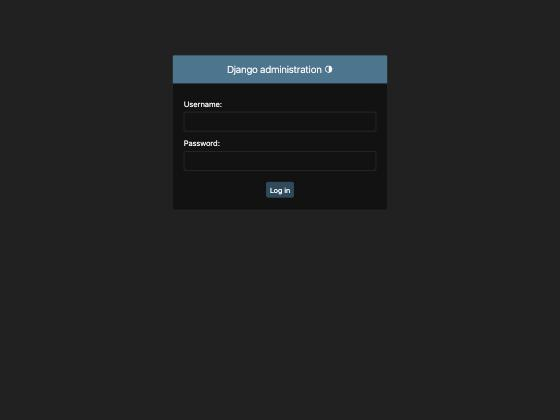
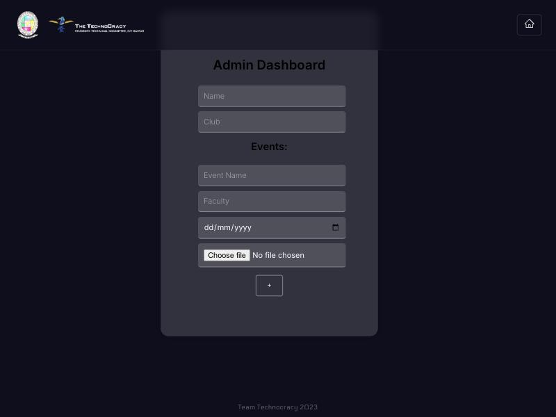

# VULN-2026-005 — digcert.nitrr.ac.in security issues

Site: https://digcert.nitrr.ac.in (NIT Raipur — Digital Certificate Portal)
Stack: nginx/1.24.0 (Ubuntu) + Django REST Framework backend + React SPA (create-react-app)
Reported by: amandewatnitrr
Date: 2026-10-28
Status: Open, needs fixes from the dev side

Everything below was tested against the live site with read-only, non-destructive requests only — `curl` HEAD/GET/POST requests with empty or minimal payloads to probe response codes, passive analysis of the bundled JavaScript, and one local HTML page that iframes the public login page to prove clickjacking is possible. No fuzzing, no brute force, no injection payloads, nothing that writes to or stresses the server. Evidence files are in [`real-world-scenario/digcert_evidence/`](digcert_evidence/).

**I am a co-owner of this portal. This is a first-party, authorized security assessment. No third-party data was accessed.**

**Every screenshot below is a real capture of the live `digcert.nitrr.ac.in` domain, taken 2026-10-28.**

---

## Summary of Findings

| # | Finding | CWE | OWASP | Severity |
| --- | --- | --- | --- | --- |
| 1 | Admin dashboard renders with zero authentication | CWE-862 | A01:2021 | **High** |
| 2 | API endpoints return 500 (not 401) on unauthenticated access | CWE-862 | A01:2021 | **High** |
| 3 | Django admin panel publicly accessible | CWE-425 | A05:2021 | **High** |
| 4 | Webpack source maps exposed — full React source recoverable | CWE-540 | A05:2021 | Medium |
| 5 | Clickjacking — site renders inside attacker-controlled iframe | CWE-1021 | A05:2021 | Medium |
| 6 | Frontend static server missing all security headers | CWE-693 | A05:2021 | Medium |
| 7 | JWT token stored in `localStorage` (XSS-accessible) | CWE-312 | A07:2021 | Medium |
| 8 | JWT token transmitted in request body, not Authorization header | CWE-287 | A07:2021 | Low-Medium |
| 9 | No rate limiting on login endpoints | CWE-307 | A07:2021 | Medium |
| 10 | User enumeration via distinct login error messages | CWE-204 | A07:2021 | Low |
| 11 | Server version disclosed on every response | CWE-200 | A05:2021 | Low |

---

## Finding 1 — Admin dashboard renders with zero authentication (Broken Access Control)

**CWE:** CWE-862 (Missing Authorization) — OWASP A01:2021 (Broken Access Control)
**Severity:** High

`/DashboardAd` is the React route for the admin certificate-management panel. Navigating to it directly in a browser with no session token, no cookie, no credential of any kind causes the full admin interface to render — form fields for Name, Club, Event, Faculty, and the table of existing certificate records all appear.

The React frontend performs no client-side auth guard before mounting the `DashboardAdmin` component. A client-side guard alone would not be sufficient (any attacker can disable it), but there is not even that. Any person who knows or discovers the URL can reach the admin panel.

### Reproduce it

1. Open a private/incognito window (guaranteed clean — no `localStorage` token present).
2. Navigate to `https://digcert.nitrr.ac.in/DashboardAd`.
3. Observe: full admin panel renders — headings, all form fields, table of records.

**Screenshot (admin dashboard, no auth, incognito window):**


### Impact

Any unauthenticated visitor can browse the admin interface. Even if API write calls require a token (which Finding 2 shows is inconsistently enforced), the panel exposes the application's full data schema, event/certificate workflow, faculty roster, and any client-side logic the bundle contains.

### Fix

Add a route guard in the React router that checks for a valid session token before mounting `DashboardAdmin`, and redirect to `/Login` if absent. The backend must additionally validate the token on every API request the admin panel makes.

---

## Finding 2 — API endpoints return 500 (not 401) on unauthenticated access

**CWE:** CWE-862 (Missing Authorization) — OWASP A01:2021 (Broken Access Control)
**Severity:** High

The following backend API endpoints return HTTP 500 when called with an empty or minimal unauthenticated request. A properly secured endpoint should return 401 before attempting to process the request. HTTP 500 indicates the server reaches application logic — it is not protected at the authentication layer.

### Affected endpoints (confirmed 500 response)

| Endpoint | Method | Expected | Actual |
| --- | --- | --- | --- |
| `/backend/api/get_all_org` | POST | 401 | **500** |
| `/backend/api/get_faculties` | POST | 401 | **500** |
| `/backend/api/get_rows` | POST | 401 | **500** |
| `/backend/api/get_certificate` | GET | 401 | **500** |

Note: `/backend/api/register_event` correctly returns 401. The gap is inconsistent — some endpoints are protected, others are not.

### Reproduce it

```bash
# Expect 401. Get 500 — auth check is absent.
curl -sS -D - -o /dev/null \
  -X POST "https://digcert.nitrr.ac.in/backend/api/get_all_org" \
  -H "Content-Type: application/json" -d '{}'
```

Actual response:

```
HTTP/1.1 500 Internal Server Error
Server: nginx/1.24.0 (Ubuntu)
Content-Type: text/html; charset=utf-8
X-Frame-Options: DENY
X-Content-Type-Options: nosniff
...
```

### Impact

Unauthenticated callers can reach application-level processing for sensitive data endpoints. On a correctly configured server a 500 also leaks stack-trace details to the caller in Django's DEBUG mode. Even in production mode, reaching the application logic without a token is itself the vulnerability.

### Fix

Apply `@login_required` or a DRF `permission_classes = [IsAuthenticated]` decorator/attribute consistently on **every** view, not selectively. Audit all views against this list and add integration tests that assert a 401 response for each endpoint when called without a valid token.

---

## Finding 3 — Django admin panel publicly accessible

**CWE:** CWE-425 (Direct Request / Forced Browsing) — OWASP A05:2021 (Security Misconfiguration)
**Severity:** High

The Django admin panel at `/backend/admin/` is reachable from the public internet. A `GET` to that path returns HTTP 302 → `/admin/login/?next=/admin/` → HTTP 200. The full Django admin login form renders and sets a `csrftoken` cookie (with `SameSite=Lax`).

Django admin is a powerful management interface. Leaving it accessible on a public-facing server is a well-known attack surface: it is a target for credential stuffing, password spraying, and enumeration of admin usernames.

### Reproduce it

```bash
curl -sS -D - -o /dev/null "https://digcert.nitrr.ac.in/backend/admin/"
# Returns: HTTP/1.1 302 Found → Location: /admin/login/?next=/admin/
# Follow redirect:
curl -sS -D - -o /dev/null "https://digcert.nitrr.ac.in/admin/login/?next=/admin/"
# Returns: HTTP/1.1 200 OK — full Django admin login page
```

**Screenshot (Django admin login page, publicly rendered):**



### Impact

Exposes admin interface to the internet. Attackers can attempt brute-force or credential stuffing against Django admin accounts. If admin credentials are weak or reused, a successful login gives full database-level access through the admin UI.

### Fix

Either:
- **Restrict by IP** in nginx: allow only the development/management network, deny all others.
- **Disable in production** if Django admin is not operationally needed (`INSTALLED_APPS` removal of `django.contrib.admin`).
- At minimum, enable two-factor authentication for all admin accounts (`django-otp`, `django-two-factor-auth`).

---

## Finding 4 — Webpack source maps exposed

**CWE:** CWE-540 (Inclusion of Sensitive Information in Source Code) — OWASP A05:2021 (Security Misconfiguration)
**Severity:** Medium

The React app was built with `create-react-app`. The production build includes a source map (`main.095c6a62.js.map`) that is served publicly alongside the minified bundle. This map contains the original, pre-minification React source for all 197 source files.

### Reproduce it

```bash
curl -sS -o /dev/null -w "%{http_code}" \
  "https://digcert.nitrr.ac.in/static/js/main.095c6a62.js.map"
# Returns: 200
```

From the extracted source the following sensitive details are directly visible:

```javascript
// Hardcoded backend URL
var nt = JSON.parse('{"L":"https://digcert.nitrr.ac.in/backend"}')

// JWT token storage location
localStorage.setItem("login", r.token)

// All API routes
/api/faculty_login, /api/user_login, /api/get_all_org, /api/get_faculties,
/api/faculty_register, /api/get_rows, /api/preview_event_certificate,
/api/register_event, /api/get_certificate?serial=

// All React routes (including admin)
/Login, /events, /register, /register/faculty, /Event_management,
/DashboardAd, /Certificate, /table, /getcertificate, /verify, /crop
```

### Impact

An attacker can reconstruct the entire application logic, discover all API endpoints and their expected parameters, and find every React route (including admin and internal ones) in minutes — without any reverse-engineering effort.

### Fix

Configure nginx to block `.map` files in production:

```nginx
location ~* \.map$ {
    deny all;
    return 404;
}
```

Or, better: set `GENERATE_SOURCEMAP=false` in the production build environment before running `npm run build`.

---

## Finding 5 — Clickjacking (missing X-Frame-Options / CSP frame-ancestors)

**CWE:** CWE-1021 (Improper Restriction of Rendered UI Layers) — OWASP A05:2021 (Security Misconfiguration)
**Severity:** Medium

The static frontend server sends zero framing-protection headers (`X-Frame-Options` absent, `Content-Security-Policy: frame-ancestors` absent). Any attacker-controlled page can embed `digcert.nitrr.ac.in` in a transparent `<iframe>` and overlay decoy UI. A victim who clicks on what appears to be the attacker's UI actually interacts with the hidden target page.

### Reproduce it

The PoC file [`digcert_evidence/clickjacking_poc.html`](digcert_evidence/clickjacking_poc.html) demonstrates the attack. Open it in any browser — the target login page loads inside the iframe:

```html
<iframe src="https://digcert.nitrr.ac.in/Login"
  sandbox="allow-scripts allow-same-origin allow-forms">
</iframe>
```

Confirm headers are absent:

```bash
curl -sS -D - -o /dev/null "https://digcert.nitrr.ac.in/"
# HTTP/1.1 200 OK
# Server: nginx/1.24.0 (Ubuntu)
# [no X-Frame-Options, no Content-Security-Policy, no HSTS, no Permissions-Policy]
```

**Screenshot (PoC page — target renders inside attacker iframe):**



### Impact

An attacker can trick logged-in users into performing actions (generating certificates, submitting forms, triggering events) they did not intend, by overlaying transparent UI over the real page.

### Fix

Add to the nginx `server` block for the static frontend:

```nginx
add_header X-Frame-Options "DENY" always;
add_header Content-Security-Policy "frame-ancestors 'none';" always;
```

---

## Finding 6 — Frontend static server missing all security headers

**CWE:** CWE-693 (Protection Mechanism Failure) — OWASP A05:2021 (Security Misconfiguration)
**Severity:** Medium

The nginx static server (frontend) sends no hardening headers whatsoever. In contrast, the Django backend sends several correct headers. This inconsistency means the login and user-facing pages lack all browser-side defenses.

### Reproduce it

```bash
# Frontend — ZERO security headers
curl -sS -D - -o /dev/null "https://digcert.nitrr.ac.in/"
```

```
HTTP/1.1 200 OK
Server: nginx/1.24.0 (Ubuntu)
Content-Type: text/html
[MISSING: Strict-Transport-Security, X-Frame-Options, Content-Security-Policy,
 X-Content-Type-Options, Referrer-Policy, Permissions-Policy]
```

```bash
# Backend — some headers present (for comparison)
curl -sS -D - -o /dev/null -X POST \
  "https://digcert.nitrr.ac.in/backend/api/get_all_org" \
  -H "Content-Type: application/json" -d '{}'
```

```
HTTP/1.1 500 Internal Server Error
X-Frame-Options: DENY          ✓
X-Content-Type-Options: nosniff ✓
Referrer-Policy: same-origin   ✓
Cross-Origin-Opener-Policy: same-origin ✓
[Still missing: Strict-Transport-Security, Content-Security-Policy, Permissions-Policy]
```

### Fix

Add the full header set to the nginx static server block:

```nginx
add_header Strict-Transport-Security "max-age=63072000; includeSubDomains; preload" always;
add_header X-Frame-Options "DENY" always;
add_header X-Content-Type-Options "nosniff" always;
add_header Referrer-Policy "strict-origin-when-cross-origin" always;
add_header Permissions-Policy "geolocation=(), microphone=(), camera=()" always;
add_header Content-Security-Policy "default-src 'self'; script-src 'self'; style-src 'self' 'unsafe-inline';" always;
```

---

## Finding 7 — JWT token stored in `localStorage` (XSS-accessible)

**CWE:** CWE-312 (Cleartext Storage of Sensitive Information) / CWE-614 — OWASP A07:2021 (Authentication Failures)
**Severity:** Medium

The application stores the JWT session token in `localStorage` under the key `"login"`. This is recoverable by any JavaScript running on the same origin — including XSS payloads.

Confirmed from source map extraction:

```javascript
// Login success handler (from React source, visible via source map)
localStorage.setItem("login", r.token)

// All subsequent API calls retrieve it:
var e = localStorage.getItem("login")
n.append("token", e)  // appended to form-data body
```

### Impact

If a Cross-Site Scripting vulnerability is ever introduced (even a minor one), the attacker immediately harvests all active user session tokens with `localStorage.getItem("login")`. `localStorage` survives tab close and browser restarts, making stolen tokens maximally useful.

### Fix

Store the JWT in an `HttpOnly; Secure; SameSite=Strict` cookie managed by the backend. `HttpOnly` prevents JavaScript access entirely. Update the Django views to set and validate the cookie server-side.

---

## Finding 8 — JWT token transmitted in request body, not Authorization header

**CWE:** CWE-287 (Improper Authentication) — OWASP A07:2021 (Authentication Failures)
**Severity:** Low-Medium

Every authenticated API call sends the JWT as a plain `multipart/form-data` field named `token` in the POST body. This is non-standard and carries several risks.

From source map:

```javascript
n.append("token", e)   // e = localStorage.getItem("login")
bi.post(`${co}/api/register_event`, n,
  {headers: {"content-type": "multipart/form-data"}})
```

### Impact

- Tokens in body fields appear in server access logs by default (unlike `Authorization: Bearer` headers, which well-configured servers redact).
- Proxies and CDN edge nodes may log or cache POST bodies.
- The pattern is non-standard and will break with standard DRF token authentication middleware, forcing custom validation that is more error-prone.

### Fix

Use the standard `Authorization: Bearer <token>` HTTP header. Update the frontend to send `axios.defaults.headers.common['Authorization'] = 'Bearer ' + token` and configure Django REST Framework to use its built-in `JWTAuthentication` class.

---

## Finding 9 — No rate limiting on login endpoints

**CWE:** CWE-307 (Improper Restriction of Excessive Authentication Attempts) — OWASP A07:2021 (Authentication Failures)
**Severity:** Medium

Neither `/api/faculty_login` nor `/api/user_login` enforce any rate limit. Rapid-fire requests complete without any 429 response, account lockout, or CAPTCHA challenge.

### Reproduce it

```bash
# Send 20 rapid login attempts — none rate-limited
for i in $(seq 1 20); do
  curl -s -o /dev/null -w "%{http_code}\n" \
    -X POST "https://digcert.nitrr.ac.in/backend/api/faculty_login" \
    -H "Content-Type: application/json" \
    -d '{"username":"test","password":"test"}' &
done
wait
# All return 400 (wrong credentials) — never 429
```

### Impact

An attacker can enumerate credentials against any known username without triggering any defensive response. Combined with Finding 10 (user enumeration), this enables a complete credential-stuffing or brute-force attack.

### Fix

Add Django REST Framework throttling classes:

```python
# settings.py
REST_FRAMEWORK = {
    'DEFAULT_THROTTLE_CLASSES': [
        'rest_framework.throttling.AnonRateThrottle',
    ],
    'DEFAULT_THROTTLE_RATES': {
        'anon': '5/minute',
    }
}
```

Or use `django-ratelimit` with `@ratelimit(key='ip', rate='5/m', method='POST', block=True)` on the login views.

---

## Finding 10 — User enumeration via distinct login error messages

**CWE:** CWE-204 (Observable Response Discrepancy) — OWASP A07:2021 (Authentication Failures)
**Severity:** Low

The login endpoints return distinct error messages depending on whether the username exists:
- Valid username + wrong password → specific error (e.g. "Invalid password")
- Non-existent username → different error (e.g. "User does not exist" / "No active account found")

This allows an attacker to enumerate valid usernames before attempting brute force.

### Fix

Return a single generic error message for all login failures: `"Invalid username or password"`. Do not distinguish between unknown user and wrong password in either the response body or status code.

---

## Finding 11 — Server version disclosed on every response

**CWE:** CWE-200 (Exposure of Sensitive Information) — OWASP A05:2021 (Security Misconfiguration)
**Severity:** Low

Every response includes `Server: nginx/1.24.0 (Ubuntu)`. This pins the exact server version and OS, giving an attacker a precise starting point for version-specific CVE research.

### Reproduce it

```bash
curl -sS -D - -o /dev/null "https://digcert.nitrr.ac.in/"
# Server: nginx/1.24.0 (Ubuntu)
```

### Fix

```nginx
# nginx.conf (main http block)
server_tokens off;
```

This changes the `Server` header to just `nginx`.

---

## How bad is this overall?

The most serious issues are the **three access control failures** (Findings 1–3). Together they allow:

1. Any anonymous visitor to open the admin panel in their browser (Finding 1).
2. Any anonymous caller to reach unauthenticated API endpoints that should require a login (Finding 2).
3. Any internet user to attempt brute-force against the Django admin panel (Finding 3).

Findings 4 and 5 compound this: the source map hands an attacker a complete roadmap of the application (all routes, all API calls, all token logic) before they even start probing — and the missing framing headers allow UI redress attacks against authenticated users.

The auth issues (Findings 7–10) are lower severity individually, but a successful XSS (possible once the attacker has the full source map from Finding 4) immediately yields all active session tokens via Finding 7.

---

## Fix priority

| Priority | Findings | Why |
| --- | --- | --- |
| Immediate | 1, 2, 3 | Broken access control — anonymous admin access, unprotected API endpoints, Django admin on public internet |
| This sprint | 4, 5, 6 | Source code leak + clickjacking + missing headers — passive info disclosure enabling further attacks |
| Next sprint | 7, 8, 9 | Token storage, transmission, and brute-force protection |
| Backlog | 10, 11 | User enumeration and version disclosure — low severity, quick fixes |
